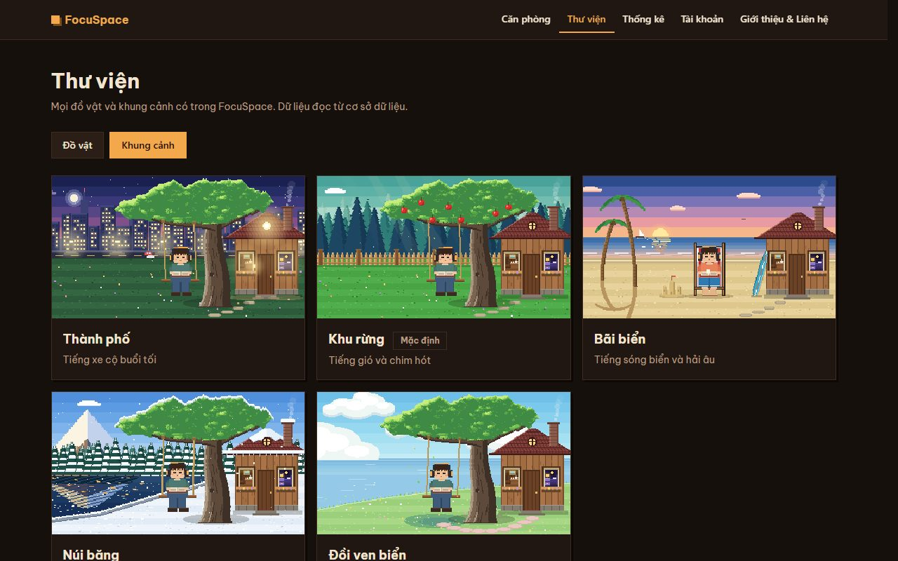
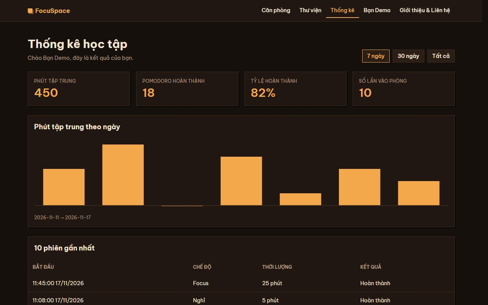
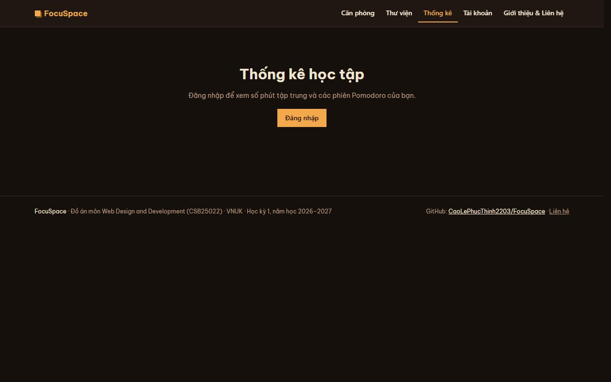

# FocuSpace

**FocuSpace** là ứng dụng web mô phỏng một phòng học ảo theo phong cách pixel art, kết hợp nhạc Lo-fi và âm thanh không gian, nhằm hỗ trợ người dùng duy trì sự tập trung khi học tập và làm việc vào buổi tối với tai nghe. Đây là đồ án cuối kỳ môn Web Design and Development (CSB25022), Trường Đại học Việt Nam – Vương quốc Anh (VNUK), học kỳ 1 năm học 2026–2027.

| | |
|---|---|
| **Địa chỉ triển khai** | https://focuspace-iota.vercel.app |
| **Kiểm tra trạng thái API** | https://focuspace-api.onrender.com/api/v1/health |
| **Video trình bày** | https://www.youtube.com/watch?v=9J9uekvG_xA |
| **Mã nguồn** | https://github.com/CaoLePhucThinh2203/FocuSpace |
| **Thời gian thực hiện** | 27/10/2026 – 17/11/2026, chia thành 5 sprint |

> **Lưu ý:** máy chủ backend sử dụng gói miễn phí của Render và tự chuyển sang trạng thái nghỉ sau 15 phút không có truy cập. Vì vậy, lần truy cập đầu tiên có thể mất khoảng một phút để máy chủ khởi động lại.

**Mục lục:** [1. Hướng dẫn cài đặt và chạy](#1-hướng-dẫn-cài-đặt-và-chạy-ứng-dụng-how-to-run-the-application) · [2. Tổng quan và công cụ](#2-tổng-quan-dự-án-và-công-cụ-sử-dụng-project-overview-and-used-tools) · [3. Chức năng và hình ảnh](#3-chức-năng-và-hình-ảnh-minh-họa-features-and-screenshots) · [4. Sơ đồ cơ sở dữ liệu](#4-sơ-đồ-cơ-sở-dữ-liệu-database-diagram--erd) · [5. Thông tin bổ sung](#5-thông-tin-bổ-sung-additional-information)

---

## 1. Hướng dẫn cài đặt và chạy ứng dụng (How to run the application)

**Yêu cầu môi trường:** Node.js phiên bản 20 trở lên và hệ quản trị cơ sở dữ liệu PostgreSQL 16 (cài đặt cục bộ hoặc khởi tạo miễn phí trên [Neon](https://neon.tech)).

```bash
npm install                        # cài đặt thư viện cho cả ba gói: shared, backend, frontend
copy .env.example backend\.env     # Windows; macOS/Linux: cp .env.example backend/.env
                                   # sau đó khai báo DATABASE_URL và JWT_SECRET trong backend/.env
npm run db:migrate                 # khởi tạo 8 bảng dữ liệu
npm run db:seed                    # nạp danh mục 17 đồ vật và 5 khung cảnh (chạy lại không tạo bản ghi trùng)
npm run dev                        # Web: http://localhost:5173 · API: http://localhost:3000/api/v1
```

Người dùng có thể sử dụng Căn phòng và Thư viện mà không cần tài khoản. Để lưu trạng thái phòng lên máy chủ và xem trang Thống kê, người dùng cần đăng ký tại trang Tài khoản.

| Lệnh kiểm thử và kiểm tra | Mô tả |
|---|---|
| `npm test` | Chạy kiểm thử đơn vị (shared, frontend) và kiểm thử tích hợp (backend). Kiểm thử tích hợp tự khởi tạo một cơ sở dữ liệu PostgreSQL tạm thời (`focuspace_test`) và không tác động đến cấu hình trong `backend/.env`. |
| `npm run test:e2e` | Chạy kiểm thử đầu cuối (E2E) bằng Playwright; mỗi use case tương ứng một tệp `frontend/e2e/ucXX-*.spec.ts`. |
| `npm run lint` · `npm run typecheck` · `npm run build` | Kiểm tra quy chuẩn mã nguồn (ESLint), kiểm tra kiểu dữ liệu TypeScript và biên dịch cả ba gói. |

Quy trình triển khai lên Vercel, Render và Neon được trình bày tại [mục 5](#triển-khai-hệ-thống).

## 2. Tổng quan dự án và công cụ sử dụng (Project overview and used tools)

Ứng dụng gồm 6 trang. Chức năng trọng tâm là **Căn phòng**, bao gồm ba không gian: Phòng học, Phòng ngủ và Sân vườn. Toàn bộ hình ảnh của Căn phòng được vẽ bằng Canvas 2D; âm thanh được tổng hợp bằng Web Audio API và thay đổi theo vị trí của đồ vật, do đó ứng dụng không sử dụng tệp hình ảnh hay tệp âm thanh có sẵn. Khách truy cập có thể sử dụng ngay, trạng thái phòng được lưu trong LocalStorage của trình duyệt; khi đăng nhập, trạng thái này được đồng bộ lên máy chủ.

**Kiến trúc hệ thống** gồm ba tầng:

```
Trình duyệt (React + Canvas + Web Audio) ── GA4, Sentry
   │  /api/v1 (JSON; refresh token lưu trong cookie httpOnly)
   ▼
Express API (Render) ── Sentry, nhật ký JSON (pino)
   │  Prisma
   ▼
PostgreSQL 16 (Neon)
```

| Thành phần | Công nghệ và công cụ |
|---|---|
| Frontend | Vite, React 18, TypeScript, React Router 6, Zustand, Tailwind CSS 4, Canvas 2D, Web Audio API |
| Backend | Node.js 20, Express, Prisma (migration, seeder), Zod, Argon2id, JWT HS256, pino |
| Mã dùng chung (`shared/`) | Danh mục đồ vật và khung cảnh, lược đồ `RoomState` (Zod), công thức tính âm thanh theo vị trí |
| Cơ sở dữ liệu | PostgreSQL 16 |
| Kiểm thử | Vitest, Supertest, Playwright, Lighthouse |
| Giám sát | Google Analytics 4, Sentry (frontend và backend), nhật ký JSON |
| Thiết kế | draw.io (wireframe, biểu đồ phân tích), prototype HTML (`prototype/`) |
| Quản lý quy trình | GitHub Issues, GitHub Projects, milestone S1–S5, Pull Request có người duyệt, Conventional Commits, GitHub Actions |
| Triển khai | Vercel (frontend), Render (backend), Neon (PostgreSQL) |

<details>
<summary><b>Cấu trúc thư mục</b></summary>

```
FocuSpace/
├── shared/      # danh mục, RoomState (Zod), công thức âm thanh: dùng chung cho client và server
├── backend/     # Express + Prisma; src/areas/<khu vực>/; prisma/ (schema, migration, seed)
├── frontend/    # React + Vite + Tailwind; src/areas/<khu vực>/; e2e/ (Playwright)
│   └── src/engine/legacy/roomEngine.js   # engine Căn phòng: vẽ canvas, âm thanh, khay, popover
├── docs/        # PRD, kiến trúc, API, CSDL, kế hoạch, phân tích, wireframe, báo cáo
├── prototype/   # bản thiết kế đã được duyệt
├── .github/     # mẫu issue, PR, cấu hình CI
└── render.yaml  # cấu hình triển khai Render
```

Mã nguồn được tổ chức theo 4 khu vực chức năng; mỗi thành viên phụ trách một thư mục `src/areas/<khu vực>/` ở cả frontend và backend. Các quy tắc nghiệp vụ của Căn phòng (chuyển phòng, Pomodoro, hẹn giờ ngủ, đặt đồ vật) được viết thành các hàm TypeScript thuần có kiểm thử đơn vị và được engine gọi lại.

</details>

## 3. Chức năng và hình ảnh minh họa (Features and screenshots)

| Trang | Chức năng chính |
|---|---|
| **Trang chủ** `/` | Giới thiệu ứng dụng, hình ảnh ba không gian, liên kết vào Căn phòng |
| **Căn phòng** `/room` | Ba không gian, chuyển đổi bằng mũi tên điều hướng · tùy chỉnh thời tiết, rèm, thảm và khung cảnh Sân vườn · kéo thả đồ vật (tối đa 25 đồ vật mỗi phòng) · âm thanh theo vị trí, Bảng âm lượng, 6 bản nhạc Lo-fi · đồng hồ Pomodoro với 4 nhịp học · hẹn giờ ngủ 15/30/60 phút · tự động lưu và đồng bộ khi đăng nhập |
| **Thư viện** `/library` | Hiển thị 17 đồ vật và 5 khung cảnh truy xuất từ cơ sở dữ liệu; lọc theo phòng và nhóm; điều kiện lọc được lưu trên URL |
| **Thống kê** `/stats` | Tổng số phút tập trung, số phiên Pomodoro và tỷ lệ hoàn thành theo 7 ngày, 30 ngày hoặc toàn bộ thời gian; biểu đồ cột theo ngày; danh sách 10 phiên gần nhất |
| **Tài khoản** `/account` | Đăng ký, đăng nhập (kiểm tra dữ liệu nhập trên biểu mẫu), đổi tên hiển thị, đăng xuất, xóa tài khoản |
| **Giới thiệu & Liên hệ** `/about` | Vấn đề ứng dụng giải quyết, hướng dẫn sử dụng, thành viên nhóm, thông tin liên hệ |

Giao diện tương thích với điện thoại, máy tính bảng và máy tính (đã kiểm tra ở các độ rộng 375, 768 và 1280 px); trên điện thoại, Căn phòng được sử dụng ở chế độ màn hình ngang.

| | |
|:---:|:---:|
| <br>Hình 1. Trang chủ | <br>Hình 2. Căn phòng – Phòng học |
| <br>Hình 3. Căn phòng – Phòng ngủ | <br>Hình 4. Căn phòng – Sân vườn |
| <br>Hình 5. Thư viện – Đồ vật | <br>Hình 6. Thư viện – Khung cảnh |
| <br>Hình 7. Thống kê (số liệu minh họa) | <br>Hình 8. Thống kê khi chưa đăng nhập |
| <br>Hình 9. Tài khoản | <br>Hình 10. Giới thiệu & Liên hệ |
|  |  |
| Hình 11. Trang chủ trên điện thoại | Hình 12. Thư viện trên điện thoại |

## 4. Sơ đồ cơ sở dữ liệu (Database diagram – ERD)


*Hình 13. Biểu đồ thực thể – liên kết (ERD) của hệ thống*

| Bảng | Dữ liệu lưu trữ |
|---|---|
| `users` | Tài khoản thành viên: email, mật khẩu đã băm bằng Argon2id, tên hiển thị |
| `refresh_tokens` | Phiên đăng nhập: refresh token đã băm, xoay vòng theo họ token |
| `room_states` | Trạng thái Căn phòng của từng thành viên, lưu dạng JSONB, kèm số `revision` phục vụ đồng bộ |
| `usage_sessions` | Các lượt sử dụng Căn phòng, ghi theo mã định danh ẩn danh (clientId) và gắn với tài khoản khi người dùng đã đăng nhập |
| `pomodoro_sessions` | Các phiên Pomodoro: chế độ, thời lượng, kết quả |
| `client_errors` | Lỗi phát sinh phía trình duyệt |
| `item_types` · `scenes` | Danh mục 17 đồ vật và 5 khung cảnh, được nạp bằng seeder |

Lược đồ quan hệ (chi tiết từng cột, khóa chính, khóa ngoại) được trình bày tại [`luoc-do-quan-he.png`](docs/images/diagrams/luoc-do-quan-he.png); mô tả đầy đủ các bảng, ràng buộc và truy vấn tại [`docs/DATABASE.md`](docs/DATABASE.md); lược đồ Prisma tại `backend/prisma/schema.prisma`. Seeder chỉ nạp danh mục đồ vật và khung cảnh, không tạo tài khoản hay dữ liệu mẫu.

## 5. Thông tin bổ sung (Additional information)

### Thành viên và phân công

| Thành viên | Nhiệm vụ phụ trách |
|---|---|
| Phúc Thịnh | Phòng học; quản lý kho mã nguồn, CI và triển khai; các trang Trang chủ, Thư viện, Tài khoản, Giới thiệu & Liên hệ; đồng bộ trạng thái phòng (`/room-state`) |
| Tuấn Hưng | Đồ vật, khay đồ vật và âm thanh; API `/catalog/items`; tối ưu hiệu năng theo Lighthouse |
| Đình Nhiên | Sân vườn và 5 khung cảnh; API `/catalog/scenes` và telemetry; tích hợp Google Analytics, Sentry |
| Tuấn Lộc | Phòng ngủ và hẹn giờ ngủ; đăng ký, đăng nhập, API `/me`, `/me/stats`; trang Thống kê; kiểm thử E2E giao diện tương thích |

### Đối chiếu với tiêu chí đánh giá

Bảng đối chiếu chi tiết được trình bày tại [`docs/PLAN.md`](docs/PLAN.md) §1.

| Tiêu chí | Minh chứng |
|---|---|
| 1a Họp phân công vai trò | [`docs/meetings/`](docs/meetings/) |
| 1b Wireframe | Vẽ bằng draw.io: [`docs/wireframes/FocuSpace_Wireframes.drawio`](docs/wireframes/FocuSpace_Wireframes.drawio), bản PNG cùng thư mục |
| 1c Kế hoạch và các mốc thời gian | [`docs/PLAN.md`](docs/PLAN.md) §3; milestone S1–S5 trên GitHub |
| 1d, 1e Quản lý dự án trên GitHub | 71 issue (#64–#134) lập từ [`docs/TASKS.md`](docs/TASKS.md), gắn milestone, nhãn khu vực và người phụ trách, mỗi issue dẫn tới Pull Request thực hiện; mỗi công việc một nhánh, Pull Request có review; Conventional Commits; CI GitHub Actions |
| 2a–2d Giao diện người dùng | 6 trang tại [mục 3](#3-chức-năng-và-hình-ảnh-minh-họa-features-and-screenshots); Tailwind CSS 4; kéo thả, popover, biểu mẫu, bộ lọc, hộp thoại; tương thích 3 kích thước màn hình |
| 3a–3c Cơ sở dữ liệu | ERD tại [mục 4](#4-sơ-đồ-cơ-sở-dữ-liệu-database-diagram--erd); PostgreSQL và Prisma; thao tác CRUD với tài khoản và trạng thái phòng; 2 trang động: Thư viện, Thống kê |
| 4a Google Lighthouse | [`docs/reports/lighthouse/`](docs/reports/lighthouse/README.md): 5 trang đạt 100 điểm ở cả 4 hạng mục; Căn phòng đạt Performance 95, Accessibility 100, SEO 100, Best Practices 96 khi đo trên Vercel và đạt 100 khi đo lại tại máy cục bộ sau khi tăng cỡ chữ chú thích lên 12 px |
| 4b Theo dõi và ghi nhật ký | Google Analytics 4, Sentry (frontend và backend), nhật ký JSON (pino); dữ liệu telemetry phiên học lưu trong cơ sở dữ liệu |
| 5a, 5b Đánh giá chéo | [`docs/reviews/`](docs/reviews/) |
| Self-report 5 sprint | Mỗi thành viên một file, đủ S1–S5: [Phúc Thịnh](docs/reports/Phuc-Thinh_Self-Report.md), [Tuấn Hưng](docs/reports/Tuan-Hung_Self-Report.md), [Tuấn Lộc](docs/reports/Tuan-Loc_Self-Report.md), [Đình Nhiên](docs/reports/DinhNhien_Self-Report.md) |

### Triển khai hệ thống

Hệ thống được triển khai trên Vercel, Render và Neon, đều sử dụng gói miễn phí.

1. **Neon:** khởi tạo dự án PostgreSQL 16, sao chép chuỗi kết nối (có tham số `sslmode=require`) vào biến `DATABASE_URL` trên máy, sau đó chạy `npm run db:migrate` và `npm run db:seed` một lần.
2. **Render:** chọn New → Blueprint → kho mã nguồn (Render đọc tệp `render.yaml`); khai báo `DATABASE_URL`, `CORS_ORIGIN` (tên miền Vercel) và `SENTRY_DSN`. Triển khai thành công khi `/api/v1/health` trả về `"status":"ok"`.
3. **Vercel:** nhập kho mã nguồn, đặt Root Directory là `frontend`, Framework là Vite; khai báo `VITE_GA_ID` và `VITE_SENTRY_DSN`. Vercel chuyển tiếp các yêu cầu `/api/...` sang Render (`frontend/vercel.json`) để cookie đăng nhập hoạt động trên cùng tên miền.
4. Khi danh mục đồ vật hoặc khung cảnh trong `shared/` thay đổi, cần chạy lại `npm run db:seed` với `DATABASE_URL` của Neon.

### Tài liệu dự án

| Tài liệu | Nội dung |
|---|---|
| [`docs/PRD.md`](docs/PRD.md) | Đặc tả yêu cầu sản phẩm: vấn đề, đối tượng người dùng, yêu cầu chức năng (FR), quy tắc nghiệp vụ (BR), tiêu chí nghiệm thu (AC) |
| [`docs/ARCHITECTURE.md`](docs/ARCHITECTURE.md) | Kiến trúc giải pháp, công nghệ, triển khai, bảo mật, CI/CD |
| [`docs/API.md`](docs/API.md) | Đặc tả 14 endpoint dưới `/api/v1`, mã lỗi, giới hạn tần suất truy cập |
| [`docs/DATABASE.md`](docs/DATABASE.md) | Thiết kế cơ sở dữ liệu, ERD, seeder |
| [`docs/PLAN.md`](docs/PLAN.md) · [`docs/TASKS.md`](docs/TASKS.md) | Kế hoạch dự án, lịch sprint, danh sách công việc |
| [`docs/analysis/`](docs/analysis/) | Biểu đồ phân tích (draw.io) và Chương 1 Phân tích hệ thống (.docx) |

### Ghi chú

- **Phương pháp thực hiện:** nhóm xây dựng prototype và đặc tả yêu cầu (PRD) trước, sau đó lập kế hoạch, thiết kế kiến trúc, cơ sở dữ liệu và API. Trong giai đoạn lập trình, nhóm áp dụng phương pháp viết kiểm thử trước (test-first): kiểm thử được viết theo tiêu chí nghiệm thu, sau đó mã nguồn được hoàn thiện cho đến khi toàn bộ kiểm thử đạt. Quy trình chi tiết được mô tả trong [`CLAUDE.md`](CLAUDE.md).
- **Giấy phép của bên thứ ba:** phông chữ Be Vietnam Pro (SIL Open Font License) được lưu trữ trực tiếp trong `frontend/public/fonts/`.
