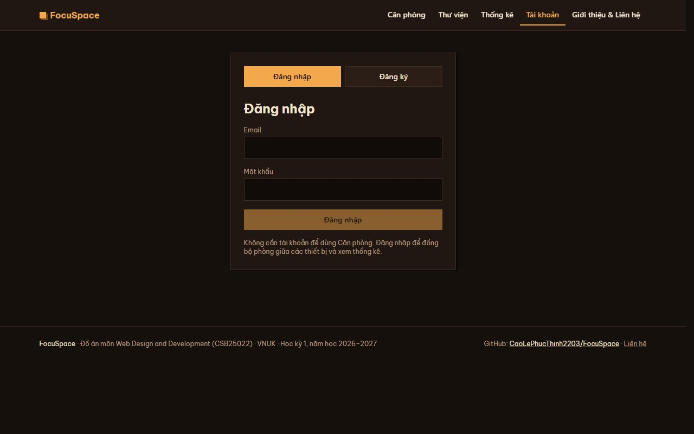
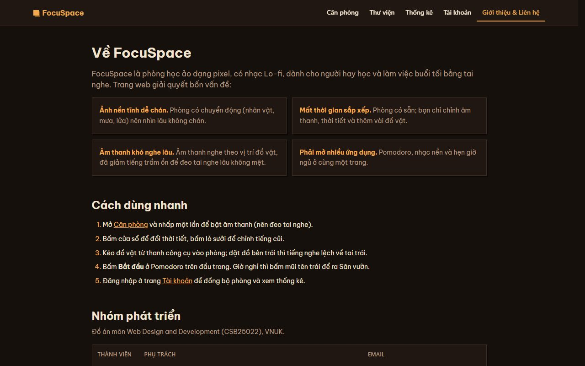
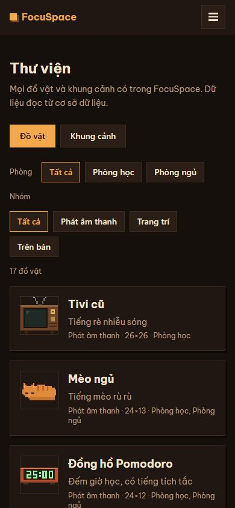

# FocuSpace

Phòng học ảo dạng pixel có nhạc Lo-fi, giúp tập trung khi học và làm việc buổi tối bằng tai nghe. Đồ án cuối kỳ môn Web Design and Development (CSB25022), VNUK, học kỳ 1 năm học 2026–2027.

| | |
|---|---|
| **Bản chạy thật** | https://focuspace-iota.vercel.app |
| **API** | https://focuspace-api.onrender.com/api/v1/health |
| **Video demo** | [Cần bổ sung: link YouTube] |
| **Repo** | https://github.com/CaoLePhucThinh2203/FocuSpace |
| **Thời gian** | 27/10/2026 – 27/11/2026, 5 sprint |

> Backend dùng gói miễn phí của Render, tự ngủ sau 15 phút không có ai dùng: lần mở đầu tiên có thể phải chờ khoảng 1 phút.

**Mục lục:** [1. Cách chạy](#1-cách-chạy-how-to-run-the-application) · [2. Tổng quan và công cụ](#2-tổng-quan-và-công-cụ-project-overview-and-used-tools) · [3. Tính năng và ảnh chụp](#3-tính-năng-và-ảnh-chụp-features-and-screenshots) · [4. Sơ đồ CSDL](#4-sơ-đồ-cơ-sở-dữ-liệu-database-diagram--erd) · [5. Thông tin thêm](#5-thông-tin-thêm-additional-information)

---

## 1. Cách chạy (How to run the application)

**Yêu cầu:** Node.js 20 trở lên, PostgreSQL 16 (cài trên máy hoặc tạo miễn phí trên [Neon](https://neon.tech)).

```bash
npm install                        # cài cho cả 3 gói: shared, backend, frontend
copy .env.example backend\.env     # Windows; macOS/Linux: cp .env.example backend/.env
                                   # rồi sửa DATABASE_URL và JWT_SECRET trong backend/.env
npm run db:migrate                 # tạo 8 bảng
npm run db:seed                    # nạp 17 đồ vật và 5 khung cảnh (chạy lại không bị trùng)
npm run dev                        # Web: http://localhost:5173 · API: http://localhost:3000/api/v1
```

Căn phòng và Thư viện dùng được ngay, không cần tài khoản. Đăng ký ở trang Tài khoản để lưu phòng lên máy chủ và xem Thống kê.

| Lệnh khác | Dùng để |
|---|---|
| `npm test` | Unit test (shared, frontend) và integration test (backend, tự dựng PostgreSQL tạm `focuspace_test`, không đụng `backend/.env`) |
| `npm run test:e2e` | E2E Playwright, mỗi use case một file `frontend/e2e/ucXX-*.spec.ts` |
| `npm run lint` · `npm run typecheck` · `npm run build` | ESLint, kiểm tra kiểu TypeScript, build cả 3 gói |

Cách triển khai lên Vercel, Render, Neon: xem [mục 5](#triển-khai).

## 2. Tổng quan và công cụ (Project overview and used tools)

FocuSpace có 6 trang. Trọng tâm là **Căn phòng** gồm 3 phòng (Phòng học, Phòng ngủ, Sân vườn), vẽ bằng Canvas 2D; âm thanh tạo bằng Web Audio API và nghe theo vị trí đồ vật, không dùng file ảnh hay file âm thanh. Khách dùng được ngay, phòng lưu trong LocalStorage; khi đăng nhập, phòng được đồng bộ lên máy chủ.

```
Trình duyệt (React + Canvas + Web Audio) ── GA4, Sentry
   │  /api/v1 (JSON; refresh token trong cookie httpOnly)
   ▼
Express API (Render) ── Sentry, log JSON (pino)
   │  Prisma
   ▼
PostgreSQL 16 (Neon)
```

| Phần | Công cụ |
|---|---|
| Frontend | Vite, React 18, TypeScript, React Router 6, Zustand, Tailwind CSS 4, Canvas 2D, Web Audio API |
| Backend | Node.js 20, Express, Prisma (migration, seeder), Zod, Argon2id, JWT HS256, pino |
| Dùng chung (`shared/`) | Danh mục đồ vật, khung cảnh, schema `RoomState` (Zod), công thức âm thanh theo vị trí |
| Cơ sở dữ liệu | PostgreSQL 16 |
| Kiểm thử | Vitest, Supertest, Playwright, Lighthouse |
| Theo dõi | Google Analytics 4, Sentry (frontend + backend), log JSON |
| Thiết kế | Figma (wireframe), prototype HTML (`prototype/`), draw.io (biểu đồ phân tích) |
| Quy trình | GitHub Issues, Projects, milestone S1–S5, Pull Request có người duyệt, Conventional Commits, GitHub Actions |
| Triển khai | Vercel (frontend), Render (backend), Neon (PostgreSQL) |

<details>
<summary><b>Cấu trúc thư mục</b></summary>

```
FocuSpace/
├── shared/      # danh mục, RoomState (Zod), công thức âm thanh: dùng cho cả client và server
├── backend/     # Express + Prisma; src/areas/<khu vực>/; prisma/ (schema, migration, seed)
├── frontend/    # React + Vite + Tailwind; src/areas/<khu vực>/; e2e/ (Playwright)
│   └── src/engine/legacy/roomEngine.js   # engine Căn phòng: vẽ canvas, âm thanh, khay, popover
├── docs/        # PRD, kiến trúc, API, CSDL, kế hoạch, phân tích, wireframe, báo cáo
├── prototype/   # bản thiết kế đã duyệt
├── .github/     # mẫu issue, PR, CI
└── render.yaml  # cấu hình Render
```

Code chia theo 4 khu vực, mỗi người một thư mục `src/areas/<khu vực>/` ở cả frontend và backend. Quy tắc nghiệp vụ của Căn phòng (chuyển phòng, Pomodoro, hẹn giờ ngủ, đặt đồ) là hàm TypeScript có unit test, engine gọi lại.

</details>

## 3. Tính năng và ảnh chụp (Features and screenshots)

| Trang | Tính năng chính |
|---|---|
| **Trang chủ** `/` | Giới thiệu, ảnh 3 phòng, nút vào phòng |
| **Căn phòng** `/room` | 3 phòng, chuyển bằng mũi tên · đổi thời tiết, rèm, thảm, khung cảnh Sân vườn · kéo thả đồ vật (tối đa 25 đồ mỗi phòng) · âm thanh theo vị trí, Bảng âm lượng, 6 bài nhạc Lo-fi · Pomodoro 4 nhịp học · hẹn giờ ngủ 15/30/60 phút · tự lưu, đồng bộ khi đăng nhập |
| **Thư viện** `/library` | 17 đồ vật và 5 khung cảnh đọc từ CSDL; lọc theo phòng, nhóm; bộ lọc ghi trên URL |
| **Thống kê** `/stats` | Số phút tập trung, số Pomodoro, tỷ lệ hoàn thành theo 7 ngày / 30 ngày / tất cả; biểu đồ cột theo ngày; 10 phiên gần nhất |
| **Tài khoản** `/account` | Đăng ký, đăng nhập (kiểm tra dữ liệu trên form), đổi tên hiển thị, đăng xuất, xóa tài khoản |
| **Giới thiệu & Liên hệ** `/about` | Vấn đề trang web giải quyết, cách dùng, thành viên, liên hệ |

Mọi trang dùng được trên điện thoại, máy tính bảng và máy tính (kiểm tra ở 375, 768, 1280 px); trên điện thoại, Căn phòng dùng ở chế độ xoay ngang.

| | |
|:---:|:---:|
| <br>Trang chủ | <br>Căn phòng: Phòng học |
| <br>Căn phòng: Phòng ngủ | <br>Căn phòng: Sân vườn |
| <br>Thư viện: Đồ vật | <br>Thư viện: Khung cảnh |
| <br>Thống kê (số liệu minh họa) | <br>Thống kê khi chưa đăng nhập |
| <br>Tài khoản | <br>Giới thiệu & Liên hệ |
|  |  |
| Trên điện thoại: Trang chủ | Trên điện thoại: Thư viện |

## 4. Sơ đồ cơ sở dữ liệu (Database diagram – ERD)


| Bảng | Lưu gì |
|---|---|
| `users` | Tài khoản Thành viên (email, mật khẩu băm Argon2id, tên hiển thị) |
| `refresh_tokens` | Phiên đăng nhập (refresh token băm, xoay vòng theo họ) |
| `room_states` | Bản lưu Căn phòng của mỗi Thành viên (JSONB, có `revision` để đồng bộ) |
| `usage_sessions` | Mỗi lần vào phòng (telemetry theo clientId ẩn danh, gắn tài khoản khi đã đăng nhập) |
| `pomodoro_sessions` | Các phiên Pomodoro: chế độ, thời lượng, kết quả |
| `client_errors` | Lỗi phía trình duyệt |
| `item_types` · `scenes` | Danh mục 17 đồ vật và 5 khung cảnh, nạp bằng seeder |

Lược đồ quan hệ (từng cột, khóa chính, khóa ngoại): [`luoc-do-quan-he.png`](docs/images/diagrams/luoc-do-quan-he.png) · Chi tiết bảng, ràng buộc, truy vấn: [`docs/DATABASE.md`](docs/DATABASE.md) · Schema: `backend/prisma/schema.prisma`. Seeder chỉ nạp danh mục đồ vật và khung cảnh, không tạo tài khoản hay số liệu mẫu.

## 5. Thông tin thêm (Additional information)

### Thành viên và phân công

| Thành viên | Phụ trách |
|---|---|
| Phúc Thịnh | Phòng học, quản lý repo, CI, triển khai; Trang chủ, Thư viện, Tài khoản, Giới thiệu; đồng bộ `/room-state` |
| Tuấn Hưng | Đồ vật, bảng đồ vật, âm thanh; `/catalog/items`; tối ưu Lighthouse |
| Đình Nhiên | Sân vườn và 5 khung cảnh; `/catalog/scenes`, telemetry; Google Analytics, Sentry |
| Tuấn Lộc | Phòng ngủ, hẹn giờ ngủ; đăng ký, đăng nhập, `/me`, `/me/stats`, trang Thống kê; E2E responsive |

### Đối chiếu tiêu chí chấm

Chi tiết: [`docs/PLAN.md`](docs/PLAN.md) §1.

| Tiêu chí | Ở đâu |
|---|---|
| 1a Họp phân vai | [`docs/meetings/`](docs/meetings/) |
| 1b Wireframe | Figma [Cần bổ sung: link]; bản xuất [`docs/wireframes/`](docs/wireframes/) |
| 1c Kế hoạch, mốc | [`docs/PLAN.md`](docs/PLAN.md) §3, milestone S1–S5 trên GitHub |
| 1d, 1e GitHub | Issues theo [`docs/TASKS.md`](docs/TASKS.md), mỗi việc một nhánh, PR liên kết issue, Conventional Commits, CI |
| 2a–2d Giao diện | 6 trang ở [mục 3](#3-tính-năng-và-ảnh-chụp-features-and-screenshots); Tailwind CSS 4; kéo thả, popover, form, bộ lọc, hộp thoại; responsive 3 cỡ màn hình |
| 3a–3c CSDL | ERD ở [mục 4](#4-sơ-đồ-cơ-sở-dữ-liệu-database-diagram--erd); PostgreSQL + Prisma, CRUD tài khoản và trạng thái phòng; 2 trang động: Thư viện, Thống kê |
| 4a Lighthouse | [`docs/reports/lighthouse/`](docs/reports/lighthouse/README.md): 5 trang đạt 100 cả 4 hạng mục; Căn phòng Performance 95, Accessibility 100, SEO 100, Best Practices 96 khi đo trên Vercel, lên 100 khi đo lại ở máy sau khi nâng chữ chú thích lên 12 px |
| 4b Tracking, logging | Google Analytics 4, Sentry (frontend + backend), log JSON pino; telemetry phiên học lưu trong CSDL |
| 5a, 5b Review chéo | [`docs/reviews/`](docs/reviews/) |
| Self-report 5 sprint | [`docs/reports/self-report.md`](docs/reports/self-report.md) (mỗi người một chương, đủ S1–S5) |

### Triển khai

Vercel + Render + Neon, đều là gói miễn phí.

1. **Neon:** tạo project PostgreSQL 16, chép chuỗi kết nối (có `sslmode=require`) vào `DATABASE_URL` trên máy, chạy `npm run db:migrate` và `npm run db:seed` một lần.
2. **Render:** New → Blueprint → chọn repo (đọc `render.yaml`); điền `DATABASE_URL`, `CORS_ORIGIN` (domain Vercel), `SENTRY_DSN`. Mở `/api/v1/health` thấy `"status":"ok"` là xong.
3. **Vercel:** Import repo → Root Directory `frontend` → Framework Vite; điền `VITE_GA_ID`, `VITE_SENTRY_DSN`. Vercel chuyển tiếp `/api/...` sang Render (`frontend/vercel.json`) nên cookie đăng nhập hoạt động.
4. Khi danh mục đồ vật hoặc khung cảnh trong `shared/` thay đổi, chạy lại `npm run db:seed` với `DATABASE_URL` của Neon.

### Tài liệu

| File | Nội dung |
|---|---|
| [`docs/PRD.md`](docs/PRD.md) | Yêu cầu sản phẩm: vấn đề, người dùng, tính năng (FR), quy tắc nghiệp vụ (BR), tiêu chí nghiệm thu (AC) |
| [`docs/ARCHITECTURE.md`](docs/ARCHITECTURE.md) | Kiến trúc, công nghệ, triển khai, bảo mật, CI/CD |
| [`docs/API.md`](docs/API.md) | 14 endpoint dưới `/api/v1`, mã lỗi, rate limit |
| [`docs/DATABASE.md`](docs/DATABASE.md) | Thiết kế CSDL, ERD, seeder |
| [`docs/PLAN.md`](docs/PLAN.md) · [`docs/TASKS.md`](docs/TASKS.md) | Kế hoạch, lịch sprint, danh sách task |
| [`docs/analysis/`](docs/analysis/) | Biểu đồ phân tích (draw.io) và Chương 1 Phân tích hệ thống (.docx) |

### Ghi chú

- **Cách làm việc:** dựng prototype và viết PRD trước, rồi kế hoạch, kiến trúc, CSDL, API; khi lập trình thì viết test trước, code tới khi test xanh. Quy trình chi tiết trong [`CLAUDE.md`](CLAUDE.md).
- **Giấy phép bên thứ ba:** font Be Vietnam Pro (SIL Open Font License), tự host trong `frontend/public/fonts/`.
