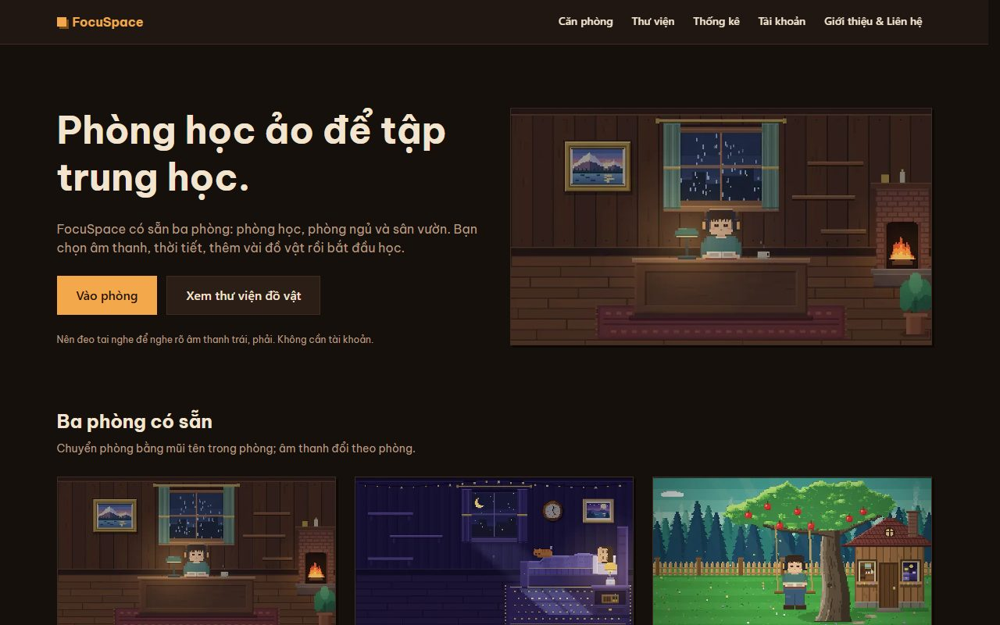
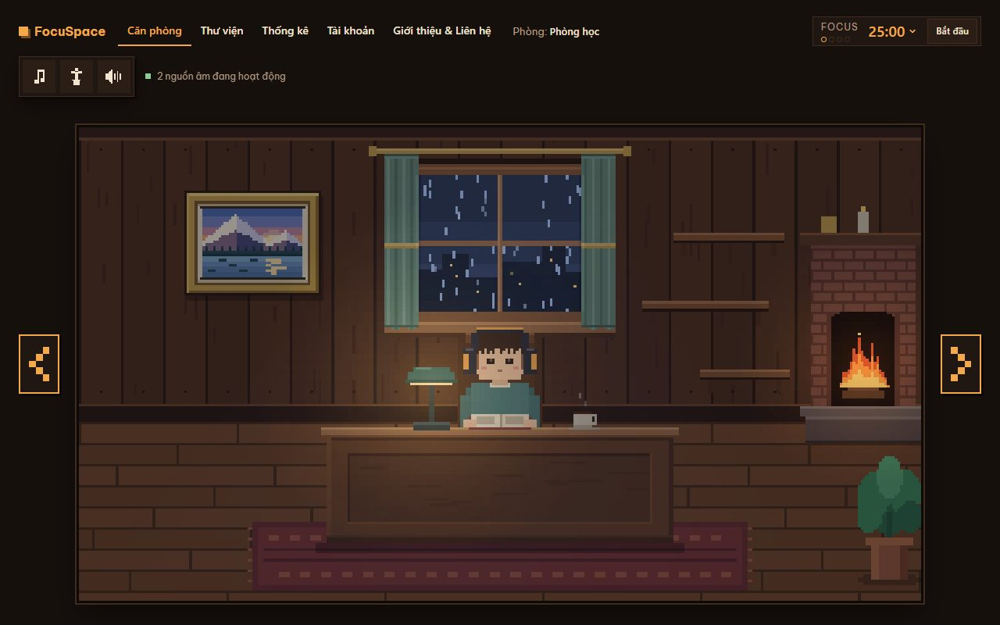
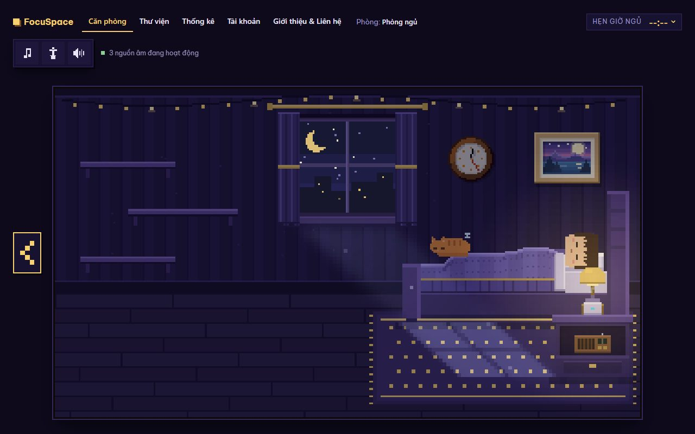
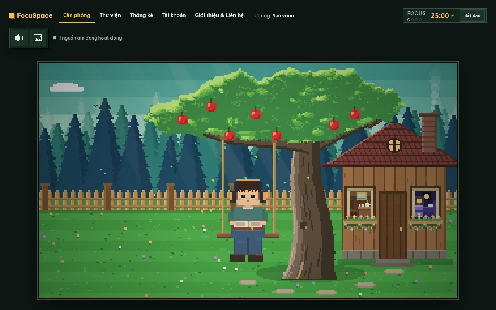
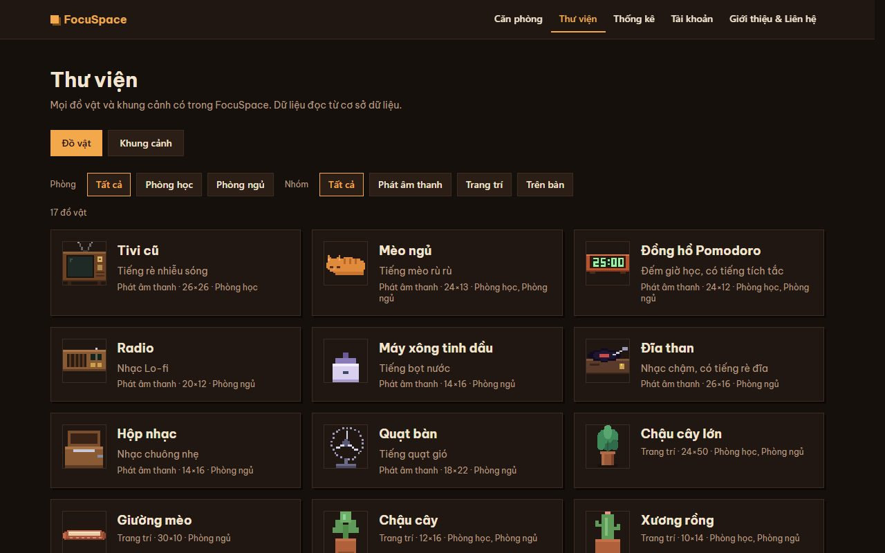
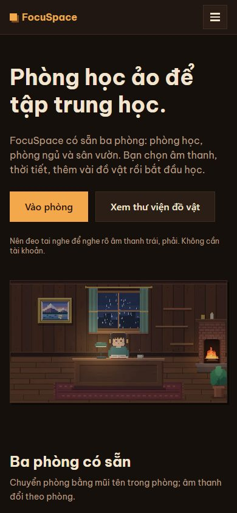
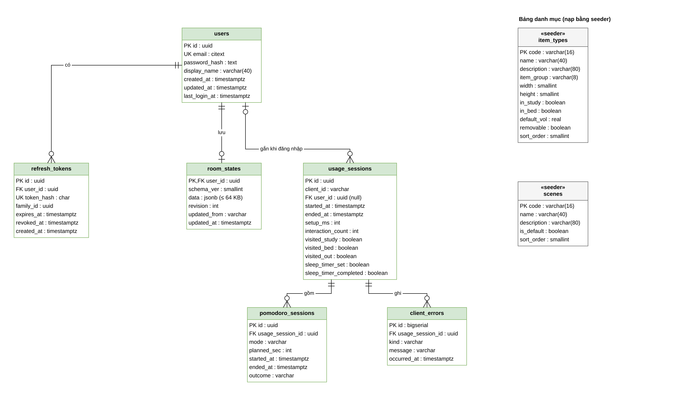

# FocuSpace

Phòng học ảo dạng pixel, có nhạc Lo-fi, giúp tập trung khi học và làm việc buổi tối bằng tai nghe. Có 3 phòng: Phòng học, Phòng ngủ, Sân vườn. Đồ vật trong phòng phát âm thanh theo vị trí; có Pomodoro, hẹn giờ ngủ và thống kê thời gian học.

Đồ án cuối kỳ môn Web Design and Development (CSB25022), VNUK, học kỳ 1 năm học 2026–2027.

| | |
|---|---|
| **Bản chạy thật** | https://focuspace-iota.vercel.app (API: https://focuspace-api.onrender.com/api/v1/health) |
| **Video demo** | [Cần bổ sung: link YouTube] |
| **Repo** | https://github.com/CaoLePhucThinh2203/FocuSpace |
| **Thời gian** | 27/10/2026 – 27/11/2026, 5 sprint |

Backend dùng gói miễn phí của Render, tự ngủ sau 15 phút không có ai dùng: lần mở đầu tiên có thể phải chờ khoảng 1 phút.

---

## 1. Cách chạy

Cần Node.js 20 trở lên và một cơ sở dữ liệu PostgreSQL 16 (cài trên máy hoặc tạo miễn phí trên [Neon](https://neon.tech)).

```bash
npm install                                   # cài cho cả shared, backend, frontend
copy .env.example backend\.env               # Windows; macOS/Linux: cp .env.example backend/.env
# sửa DATABASE_URL và JWT_SECRET trong backend/.env
npm run db:migrate                            # tạo 8 bảng từ backend/prisma/migrations
npm run db:seed                               # nạp 17 đồ vật và 5 khung cảnh (chạy lại không bị trùng)
npm run dev                                   # Web: http://localhost:5173 · API: http://localhost:3000/api/v1
```

Không cần tài khoản để dùng Căn phòng và Thư viện. Đăng ký ở trang Tài khoản để lưu phòng lên máy chủ và xem Thống kê.

**Kiểm thử**

| Lệnh | Nội dung |
|---|---|
| `npm test` | Unit test (shared, frontend) và integration test (backend). Integration test tự dựng một PostgreSQL 16 tạm (`embedded-postgres`, DB `focuspace_test`) rồi xóa khi xong, không đụng `DATABASE_URL` trong `backend/.env`. Muốn dùng PostgreSQL có sẵn thì đặt `TEST_DATABASE_URL` (chỉ nhận localhost; CI dùng cách này). |
| `npm run test:e2e` | E2E Playwright, mỗi use case một file `frontend/e2e/ucXX-*.spec.ts` |
| `npm run lint` · `npm run typecheck` · `npm run build` | ESLint, kiểm tra kiểu TypeScript, build cả 3 gói |

**Triển khai** (Vercel + Render + Neon, đều là gói miễn phí)

1. **Neon:** tạo project PostgreSQL 16, chép chuỗi kết nối (có `sslmode=require`). Đặt chuỗi này vào `DATABASE_URL` trên máy, chạy `npm run db:migrate` và `npm run db:seed` một lần.
2. **Render:** New → Blueprint → chọn repo, Render đọc `render.yaml`. Điền `DATABASE_URL` (Neon), `CORS_ORIGIN` (domain Vercel), `SENTRY_DSN`. Mở `/api/v1/health` thấy `"status":"ok"` là xong.
3. **Vercel:** Import repo → Root Directory `frontend` → Framework Vite; điền `VITE_GA_ID`, `VITE_SENTRY_DSN`. Frontend gọi `/api/...` cùng domain, Vercel chuyển tiếp sang Render (`frontend/vercel.json`) nên cookie đăng nhập hoạt động.
4. Khi danh mục đồ vật hoặc khung cảnh trong `shared/` thay đổi, chạy lại `npm run db:seed` với `DATABASE_URL` của Neon (Render không tự chạy seed).

## 2. Tổng quan và công cụ

Trang web có 6 trang. Căn phòng vẽ bằng Canvas 2D, âm thanh tạo bằng Web Audio API (phòng không dùng file ảnh hay file âm thanh). Khách dùng được ngay, phòng lưu trong LocalStorage; khi đăng nhập, phòng được đồng bộ lên máy chủ.

```
Trình duyệt (React + Canvas + Web Audio) ── GA4, Sentry
   │  /api/v1 (JSON; refresh token trong cookie httpOnly)
   ▼
Express API (Render) ── Sentry, log JSON (pino)
   │  Prisma
   ▼
PostgreSQL 16 (Neon)
```

| Phần | Công cụ |
|---|---|
| Thiết kế | Figma (wireframe 6 trang), prototype HTML (`prototype/`), draw.io (use case, Activity, Sequence, Class, ERD) |
| Frontend | Vite, React 18, TypeScript, React Router 6, Zustand, Tailwind CSS 4, Canvas 2D, Web Audio API; font Be Vietnam Pro tự host |
| Backend | Node.js 20, Express, Prisma (migration + seeder), Zod, Argon2id, JWT HS256, pino |
| Dùng chung | `shared/`: danh mục đồ vật, khung cảnh, schema `RoomState` (Zod), công thức âm thanh theo vị trí; client và server cùng dùng |
| Cơ sở dữ liệu | PostgreSQL 16 |
| Kiểm thử | Vitest (unit, integration), Supertest, Playwright (E2E), Lighthouse |
| Theo dõi | Google Analytics 4, Sentry (frontend + backend), log JSON |
| Quy trình | GitHub Issues, Projects, milestone S1–S5, mỗi việc một nhánh, Pull Request có người duyệt, Conventional Commits, GitHub Actions (lint, test, build) |
| Triển khai | Vercel (frontend), Render (backend), Neon (PostgreSQL) |

**Cấu trúc thư mục**

```
FocuSpace/
├── shared/              # danh mục, RoomState (Zod), công thức âm thanh: dùng cho cả client và server
├── backend/             # Express + Prisma; src/areas/<khu vực>/ (routes, service, seed); prisma/ (schema, migration, seed)
├── frontend/            # React + Vite + Tailwind; src/areas/<khu vực>/; e2e/ (Playwright)
│   └── src/engine/legacy/roomEngine.js   # engine Căn phòng: vẽ canvas, âm thanh, khay, popover
├── docs/                # PRD, kiến trúc, API, CSDL, kế hoạch, task, phân tích, wireframe, báo cáo
├── prototype/           # bản thiết kế đã duyệt (Căn phòng + 6 trang)
├── .github/             # mẫu issue, PR, CI
└── render.yaml          # cấu hình Render
```

Code chia theo 4 khu vực, mỗi người một thư mục `frontend/src/areas/<khu vực>/` và `backend/src/areas/<khu vực>/`: `items-audio` (Tuấn Hưng), `garden` (Đình Nhiên), `bedroom` (Tuấn Lộc), `study` (Phúc Thịnh). Quy tắc nghiệp vụ của Căn phòng (chuyển phòng, Pomodoro, hẹn giờ ngủ, đặt đồ) là hàm TypeScript có unit test, engine gọi lại (`frontend/src/engine/legacy/README.md`).

## 3. Tính năng và ảnh chụp

| Trang | Tính năng chính |
|---|---|
| **Trang chủ** `/` | Giới thiệu, ảnh 3 phòng, nút vào phòng |
| **Căn phòng** `/room` | 3 phòng, chuyển bằng mũi tên; đổi thời tiết, rèm, thảm, khung cảnh Sân vườn; kéo thả đồ vật (tối đa 25 đồ mỗi phòng, đủ thì báo); âm thanh nghe theo vị trí đồ vật; Bảng âm lượng; 6 bài nhạc Lo-fi; Pomodoro 4 nhịp học; hẹn giờ ngủ 15/30/60 phút, giảm âm dần rồi tắt; tự lưu, đồng bộ khi đăng nhập |
| **Thư viện** `/library` | 17 đồ vật và 5 khung cảnh đọc từ CSDL; lọc theo phòng, nhóm; bộ lọc ghi trên URL |
| **Thống kê** `/stats` | Số phút tập trung và số phiên Pomodoro theo khoảng thời gian; biểu đồ cột theo ngày; bảng phiên gần đây (đọc từ CSDL) |
| **Tài khoản** `/account` | Đăng ký, đăng nhập (kiểm tra dữ liệu trên form), đổi tên hiển thị, đăng xuất, xóa tài khoản |
| **Giới thiệu & Liên hệ** `/about` | Vấn đề trang web giải quyết, cách dùng, thành viên, liên hệ |

Mọi trang dùng được trên điện thoại, máy tính bảng và máy tính (kiểm tra ở 375, 768, 1280 px); trên điện thoại, Căn phòng dùng ở chế độ xoay ngang.

| | |
|---|---|
|  Trang chủ |  Căn phòng: Phòng học |
|  Căn phòng: Phòng ngủ |  Căn phòng: Sân vườn |
|  Thư viện: Đồ vật |  Thư viện: Khung cảnh |
|  Tài khoản |  Thống kê (khi chưa đăng nhập) |
|  Giới thiệu & Liên hệ |   Trên điện thoại |

## 4. Sơ đồ cơ sở dữ liệu (ERD)



8 bảng: `users`, `refresh_tokens`, `room_states`, `usage_sessions`, `pomodoro_sessions`, `client_errors`, `item_types`, `scenes`. Chi tiết từng bảng, ràng buộc và truy vấn: [`docs/DATABASE.md`](docs/DATABASE.md). Schema: `backend/prisma/schema.prisma`; migration: `backend/prisma/migrations/`; seeder: `backend/prisma/seed.ts` (chỉ nạp danh mục đồ vật và khung cảnh, không tạo tài khoản hay số liệu mẫu).

## 5. Thông tin thêm

**Thành viên và phân công**

| Thành viên | Phụ trách |
|---|---|
| Phúc Thịnh | Phòng học, quản lý repo, CI, triển khai; Trang chủ, Thư viện, Tài khoản, Giới thiệu; đồng bộ `/room-state` |
| Tuấn Hưng | Đồ vật, bảng đồ vật, âm thanh; `/catalog/items`; tối ưu Lighthouse |
| Đình Nhiên | Sân vườn và 5 khung cảnh (cùng nhóm dựng prototype Căn phòng); `/catalog/scenes`, telemetry; Google Analytics, Sentry |
| Tuấn Lộc | Phòng ngủ, hẹn giờ ngủ; đăng ký, đăng nhập, `/me`, `/me/stats`, trang Thống kê; E2E responsive |

**Đối chiếu tiêu chí chấm** (chi tiết: [`docs/PLAN.md`](docs/PLAN.md) §1)

| Tiêu chí | Ở đâu |
|---|---|
| 1a Họp phân vai | [`docs/meetings/`](docs/meetings/) |
| 1b Wireframe | Figma [Cần bổ sung: link]; bản xuất [`docs/wireframes/`](docs/wireframes/) |
| 1c Kế hoạch, mốc | [`docs/PLAN.md`](docs/PLAN.md) §3, milestone S1–S5 trên GitHub |
| 1d, 1e GitHub | Issues theo [`docs/TASKS.md`](docs/TASKS.md), mỗi việc một nhánh, PR liên kết issue, Conventional Commits, CI |
| 2a–2d Giao diện | 6 trang ở trên; Tailwind CSS 4; kéo thả, popover, form, bộ lọc, hộp thoại; responsive 3 cỡ màn hình |
| 3a–3c CSDL | ERD ở trên; PostgreSQL + Prisma, CRUD tài khoản và trạng thái phòng; 2 trang động: Thư viện, Thống kê |
| 4a Lighthouse | [`docs/reports/lighthouse/`](docs/reports/lighthouse/README.md): 5 trang đạt 100 cả 4 hạng mục; Căn phòng Performance 95, Accessibility 100, SEO 100, Best Practices 96 lúc đo trên Vercel, lên 100 khi đo lại ở máy sau khi nâng chữ chú thích lên 12 px |
| 4b Tracking, logging | Google Analytics 4, Sentry (frontend + backend), log JSON pino; telemetry phiên học lưu trong CSDL |
| 5a, 5b Review chéo | [`docs/reviews/`](docs/reviews/) |
| Self-report 5 sprint | [`docs/reports/`](docs/reports/) (`sprint-1` … `sprint-5`, mỗi người một file) |

**Tài liệu**

| File | Nội dung |
|---|---|
| [`docs/PRD.md`](docs/PRD.md) | Yêu cầu sản phẩm: vấn đề, người dùng, tính năng (FR), quy tắc nghiệp vụ (BR), tiêu chí nghiệm thu (AC) |
| [`docs/ARCHITECTURE.md`](docs/ARCHITECTURE.md) | Kiến trúc, công nghệ, triển khai, bảo mật, CI/CD |
| [`docs/API.md`](docs/API.md) | 14 endpoint dưới `/api/v1`, mã lỗi, rate limit |
| [`docs/DATABASE.md`](docs/DATABASE.md) | Thiết kế CSDL, ERD, seeder |
| [`docs/PLAN.md`](docs/PLAN.md) · [`docs/TASKS.md`](docs/TASKS.md) | Kế hoạch, lịch sprint, danh sách task và trạng thái |
| [`docs/analysis/`](docs/analysis/) | Biểu đồ phân tích (draw.io) và Chương 1 Phân tích hệ thống (.docx) |

**Cách làm việc:** dựng prototype và viết PRD trước, rồi tới kế hoạch, kiến trúc, CSDL, API; khi lập trình thì viết test trước, code tới khi test xanh (unit, integration, E2E). Quy trình chi tiết theo `docs/references/PlanDesignWeb.docx` và [`CLAUDE.md`](CLAUDE.md).

**Giấy phép bên thứ ba:** font Be Vietnam Pro (SIL Open Font License), tự host trong `frontend/public/fonts/`.