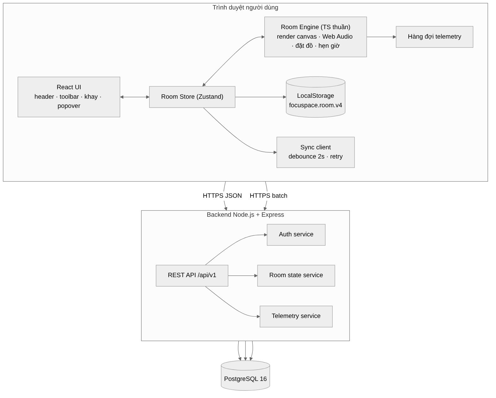
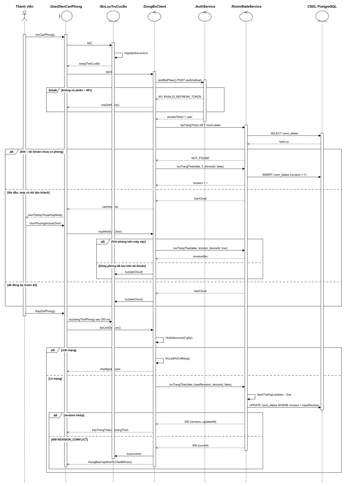
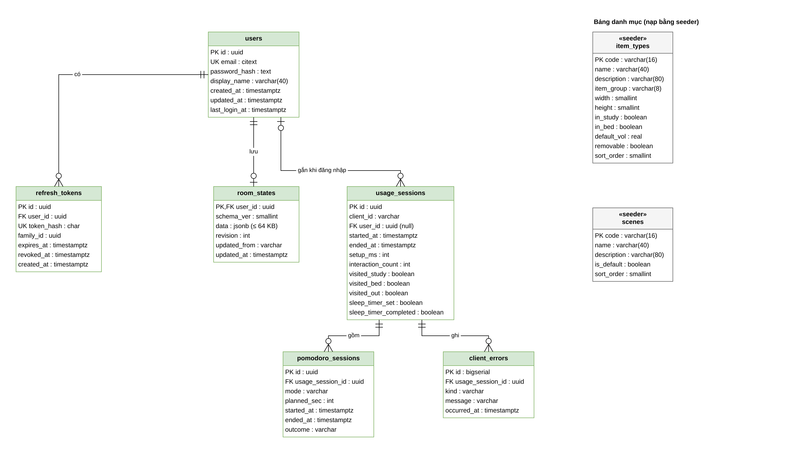
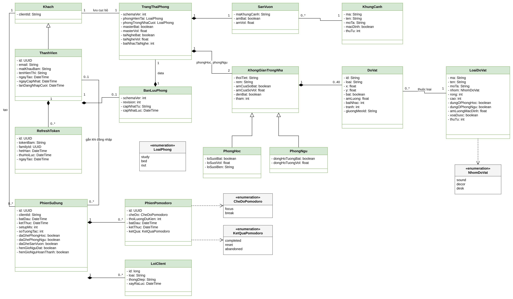
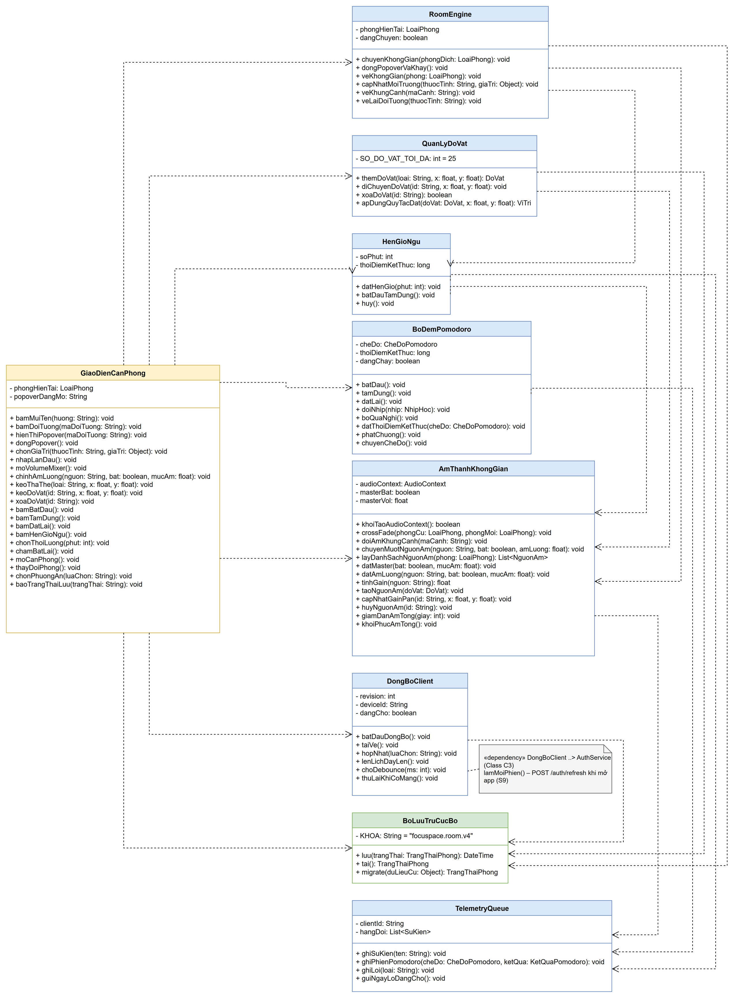
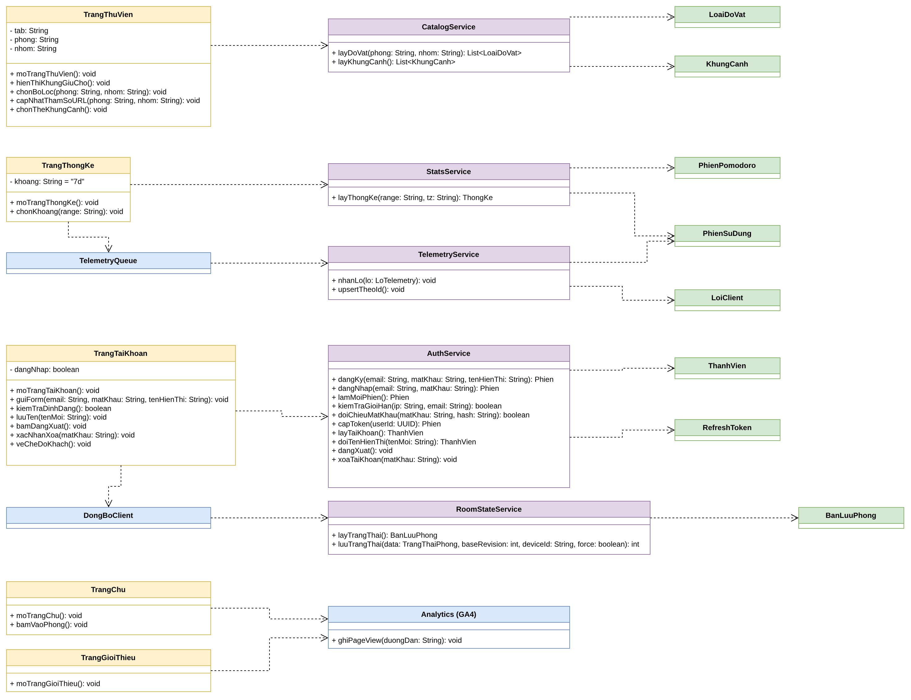

# FocuSpace — Tài liệu Kiến trúc giải pháp

Solution Architecture Document — FocuSpace bản chính thức

| | |
|---|---|
| **Sản phẩm** | FocuSpace — web app pixel art Lo-fi Semi-Sandbox |
| **Phiên bản** | v1.6 (font tự host 15/11/2026) · v1.5 (PA B cho Căn phòng 15/11/2026) · v1.4 (rút gọn 14/11/2026) · v1.0 duyệt 07/11, v1.1–v1.3 duyệt ở buổi họp 13/11/2026 |
| **Nguồn** | docs/PRD.md · docs/DATABASE.md · docs/API.md · docs/PLAN.md · docs/analysis/FocuSpace_Diagrams.drawio · prototype/ |

# 1. Giới thiệu & Tổng quan dự án

## 1.1 Mục đích tài liệu

Tài liệu mô tả thiết kế giải pháp CNTT cho FocuSpace bản chính thức, nối các yêu cầu trong PRD v5.1 với cách triển khai: thành phần phần mềm, dữ liệu, tích hợp, hạ tầng, bảo mật và vận hành. Đối tượng đọc: Tech Lead, developer frontend/backend, QA, người vận hành hệ thống.

## 1.2 Phạm vi

- Yêu cầu chức năng: ba không gian, đồ vật kéo thả, âm thanh không gian 2D, Bảng âm lượng, Pomodoro, Hẹn giờ ngủ, lưu cục bộ, tài khoản, đồng bộ cloud, đo KPI, website 6 trang với Thư viện và Thống kê lấy dữ liệu từ cơ sở dữ liệu, theo dõi bằng Google Analytics 4 và Sentry (PRD mục 5).

- Yêu cầu phi chức năng: hiệu năng, sẵn sàng, bảo mật, tương thích (PRD mục 6).

- Ngoài phạm vi: phòng học nhóm thời gian thực, tích hợp dịch vụ nhạc, đăng nhập OAuth, ứng dụng native.

- Ràng buộc đồ án: đề bài môn Web Design and Development (CSB25022) — Tailwind CSS, ít nhất 3 trang, PostgreSQL có migration và seeder, tối ưu Lighthouse, Google Analytics, Sentry, quy trình GitHub (PRD mục 2.4).

## 1.3 Bối cảnh

- **Trước:** prototype một file HTML (`prototype/FocuSpace-Semi-Sandbox.html`) chứa toàn bộ giao diện, đồ họa canvas và âm thanh Web Audio; trạng thái chỉ lưu LocalStorage, không tài khoản, không đo KPI.
- **Sau:** frontend React + TypeScript + Tailwind CSS, 6 trang; backend REST (Node.js + Express) cho tài khoản, đồng bộ phòng, telemetry, Thư viện, Thống kê; PostgreSQL có migration và seeder; **local-first** (không đăng nhập hoặc mất mạng vẫn dùng đủ tính năng); GA4 + Sentry.

# 2. Yêu cầu hệ thống (Requirements)

## 2.1 Yêu cầu chức năng

| **Nhóm**               | **Nghiệp vụ cốt lõi**                                      | **Mã PRD**                | **Use case** |
|------------------------|------------------------------------------------------------|---------------------------|---|
| Giao diện & điều hướng | Bố cục, thanh công cụ, popover, chuyển ba không gian       | FR-UI-01→06, FR-NAV-01→03, FR-PAGE-03 | UC.01, UC.12 |
| Ba không gian          | Phòng học, Phòng ngủ, Sân vườn với 5 khung cảnh            | FR-STUDY-01→08, FR-BED-01→07, FR-OUT-01→04 | UC.02 |
| Đồ vật                 | Danh mục 17 loại, thêm/xóa/kéo, quy tắc đặt, giường mèo    | FR-ITEM-01→08 | UC.04 |
| Âm thanh               | Chuỗi xử lý, công thức gain/pan, mixer, Master, mèo, đổi bài | FR-AUD-01→08              | UC.03 |
| Thời gian              | Pomodoro, Hẹn giờ ngủ                                      | FR-TIME-01→03             | UC.05, UC.06 |
| Lưu trữ                | LocalStorage, migrate dữ liệu cũ                           | FR-SAVE-01→04             | include Tự động lưu cục bộ |
| Tài khoản & đồng bộ    | Khách, đăng ký/đăng nhập, đồng bộ, hợp nhất, xung đột, xóa | FR-ACC-01→08 | UC.08, UC.09, UC.11 |
| Đo lường               | Phiên, Pomodoro, lỗi                                       | FR-TEL-01→03              | include Ghi nhận số liệu sử dụng |
| Website nhiều trang | 6 trang, thanh điều hướng chung, trang 404 | FR-PAGE-01→08 | UC.12 |
| Trang động | Thư viện lọc theo phòng và nhóm; Thống kê theo khoảng thời gian | FR-LIB-01→06, FR-STAT-01→06 | UC.07, UC.10 |
| Theo dõi và ghi lỗi | Google Analytics 4, Sentry | FR-OBS-01→04 | UC.12, UC.03 |

## 2.2 Yêu cầu phi chức năng (Quality Attributes)

### Hiệu năng & Khối lượng

| **Thuộc tính**                        | **Mục tiêu**                                       | **Ghi chú**                                                  |
|---------------------------------------|----------------------------------------------------|--------------------------------------------------------------|
| Phản hồi âm thanh khi kéo đồ          | \< 30 ms                                           | Xử lý hoàn toàn ở client                                     |
| First Contentful Paint                | \< 2 giây (4G)                                     | Gói JS nén \< 300 KB                                         |
| Thời gian phản hồi API                | p95 \< 300 ms                                      | Mọi endpoint                                                 |
| Độ trễ dữ liệu đồng bộ giữa thiết bị  | ≤ 2 giây sau thay đổi + thời gian mở app ở máy kia | PUT debounce 2 giây; máy kia nhận khi mở app hoặc khi bị 409 |
| Kích thước trạng thái phòng           | ≤ 64 KB / người dùng                               | Ràng buộc DB + validate                                      |
| Người dùng đồng thời | Khoảng 50 | Gói miễn phí Render + Neon (PRD Q-10) |
| Điểm Google Lighthouse | ≥ 90 cho Performance, Accessibility, Best Practices, SEO | Cấu hình mobile, cả 6 trang; đo trong CI |

### Bảo mật

| **Khía cạnh**              | **Giải pháp**                                                                                                                                                                                                                                                        |
|----------------------------|----------------------------------------------------------------------------------------------------------------------------------------------------------------------------------------------------------------------------------------------------------------------|
| Xác thực (Authentication)  | Email + mật khẩu (Argon2id). Access token JWT HS256 15 phút trong bộ nhớ trình duyệt; refresh token 256 bit ngẫu nhiên, 30 ngày, cookie httpOnly · Secure · SameSite=None (production; dev dùng Lax) · Path=/api/v1/auth; xoay vòng mỗi lần refresh, phát hiện dùng lại thì thu hồi cả chuỗi. |
| Phân quyền (Authorization) | Một vai trò duy nhất (người dùng). Mỗi người chỉ đọc/ghi room_states và tài khoản của chính mình, xác định bằng sub trong JWT; không có tham số user id trên URL. Danh mục (/catalog) công khai, chỉ đọc.                                                                                                    |
| Mã hóa khi truyền          | HTTPS cho mọi kết nối (Vercel, Render); kết nối Render → Neon dùng TLS (`sslmode=require`).                                                                                                                                                                                                     |
| Mã hóa khi lưu | Mật khẩu (Argon2id) và refresh token (SHA-256) chỉ lưu bản băm. |
| Chống lạm dụng             | Rate limit đăng nhập/đăng ký 10 lần/15 phút/IP; telemetry 60 lô/giờ/clientId; giới hạn body 64 KB / 256 KB; CORS chỉ cho origin frontend; validate Zod mọi request.                                                                                                  |

# 3. Kiến trúc giải pháp chi tiết

## 3.1 Kiến trúc khái niệm (Conceptual Architecture)

Hai khối lớn: **ứng dụng trong trình duyệt** chịu toàn bộ trải nghiệm và lưu cục bộ; **backend** chỉ lo tài khoản, đồng bộ và số liệu. Hai khối nói chuyện qua REST/JSON trên HTTPS.

*Hình 1 — Kiến trúc khái niệm*

## 3.2 Kiến trúc ứng dụng (Application Architecture)

### Kiểu kiến trúc

- **Modular monolith**, không dùng microservice: chỉ có 5 miền nghiệp vụ nhỏ (auth, room state, telemetry, catalog, stats), tương ứng 5 lớp service AuthService, RoomStateService, TelemetryService, CatalogService, StatsService, 14 endpoint; tách service sẽ tăng chi phí vận hành mà không có lợi về mở rộng.

- Backend phân lớp: routes (HTTP, validate) → services (nghiệp vụ) → Prisma (dữ liệu). Phụ thuộc bên ngoài truyền vào qua tham số (ví dụ createApp({ db })) để test được — tinh thần Ports & Adapters.

- Frontend: React chỉ lo UI; **Room Engine** không phụ thuộc React, chạy vòng vẽ 10 FPS và đồ thị Web Audio riêng. Theo PA B (15/11/2026), phần vẽ và âm thanh nằm trong `frontend/src/engine/legacy/roomEngine.js` (chép từ prototype, có các thay đổi PRD v5.5–v5.8); quy tắc nghiệp vụ là hàm thuần TypeScript có unit test trong `areas/<khu-vực>/engine/` và `shared/`, engine import và gọi lại.

- Frontend nhiều trang: React Router định tuyến phía client, mỗi trang tải lười (code splitting); Tailwind CSS cho mọi giao diện ngoài canvas, cấu hình màu và font lấy từ prototype.

- **Local-first + optimistic concurrency:** client luôn ghi LocalStorage trước, đồng bộ sau; server dùng số revision để phát hiện xung đột (409).

- Schema dữ liệu dùng chung (shared/, Zod) cho validate và migrate ở cả client lẫn server.

### Thành phần

| **Thành phần**       | **Công nghệ**       | **Trách nhiệm**                                                                                                |
|----------------------|---------------------|----------------------------------------------------------------------------------------------------------------|
| UI                   | React 18, Zustand, Tailwind CSS   | Header, thanh công cụ, khay, popover, mixer, chọn khung cảnh, mũi tên/cửa nhà, hộp thoại hợp nhất |
| Room Engine — render | Canvas 2D           | 4 lớp: nền tĩnh, hoạt họa 10 FPS, DOM đồ vật, ánh sáng 160×90; dừng khi tab ẩn                                 |
| Room Engine — audio  | Web Audio API       | AudioContext, Master, nhánh âm mỗi nguồn, công thức gain/pan, âm tổng hợp, nhạc Lo-fi bằng OfflineAudioContext |
| Room Engine — logic  | TypeScript          | Quy tắc đặt đồ, Pomodoro, Hẹn giờ ngủ, bảng chuyển phòng                                                       |
| Persistence          | LocalStorage, fetch | Lưu 250 ms, migrate, sync client (debounce 2 s, keepalive, backoff, xử lý 409)                                 |
| Telemetry queue      | TypeScript          | Gom sự kiện, gửi lô mỗi 60 s hoặc khi ẩn tab                                                                   |
| API                  | Node.js 20, Express | Định tuyến /api/v1, CORS, giới hạn body, rate limit, định dạng lỗi chuẩn                                       |
| Auth service         | Argon2id, JWT       | Đăng ký, đăng nhập, refresh xoay vòng, đăng xuất, xóa tài khoản                                                |
| Room state service   | Zod, Prisma         | Validate, migrate, ghi có kiểm tra revision, force khi hợp nhất                                                |
| Telemetry service    | Prisma              | Upsert idempotent phiên, Pomodoro, lỗi                                                                         |
| Trang và điều hướng | React Router 6, Tailwind CSS | 6 trang, thanh điều hướng, chân trang, trang 404; tải lười từng trang; title và meta description theo trang |
| Catalog service | Prisma | Đọc item_types, scenes theo bộ lọc; trả kèm Cache-Control 1 giờ |
| Stats service | Prisma, SQL tổng hợp | Tính phút tập trung, số Pomodoro, số phiên theo ngày cho một người dùng |
| Seeder | Prisma seed, shared/catalog | Nạp danh mục ban đầu; upsert theo code nên chạy lại không bị trùng |
| Observability | gtag.js (GA4), Sentry SDK, pino | Lượt xem, sự kiện, lỗi frontend và backend, log JSON có requestId |

### Ánh xạ lớp thiết kế ↔ thành phần

| **Lớp (Chương 1, Class C2/C3)** | **Module mã nguồn** (`frontend/src/`, `backend/src/`) |
|---|---|
| GiaoDienCanPhong | `areas/study/pages/Room.tsx` (header chung, hộp thoại hợp nhất, ô thông báo), `areas/study/engine/markup.ts` + `room.css` (khung Căn phòng); thanh công cụ, khay, popover, Bảng âm lượng, khay Khung cảnh, ô Hẹn giờ ngủ dựng trong `engine/legacy/roomEngine.js` |
| RoomEngine | `engine/legacy/roomEngine.js` (vẽ ba không gian, vòng lặp, khởi động) + `areas/study/engine/rooms.ts` (bảng chuyển phòng, quy tắc chuyển) |
| QuanLyDoVat | `areas/items-audio/engine/placement.ts` (+ `shared/src/spatial.ts`) |
| AmThanhKhongGian | `engine/legacy/roomEngine.js` (khối AUDIO ENGINE, ĐỊNH TUYẾN ÂM THANH THEO PHÒNG, âm Phòng ngủ, âm khung cảnh) + `shared/src/spatial.ts` (công thức gain/pan) |
| BoDemPomodoro / HenGioNgu | `areas/study/engine/pomodoro.ts` / `areas/bedroom/engine/sleepTimer.ts` |
| BoLuuTruCucBo / DongBoClient | `areas/study/roomSync.ts` + `lib/api.ts` + `shared/src/migrate.ts` |
| TelemetryQueue | `areas/garden/telemetry.ts` |
| TrangChu, TrangThuVien, TrangTaiKhoan, TrangGioiThieu | `areas/study/pages/` (Home, Library, Account, About, NotFound) |
| TrangThongKe | `areas/bedroom/pages/Stats.tsx` |
| AuthService, StatsService | `backend/src/areas/bedroom/` (authService, statsService, routes) |
| RoomStateService | `backend/src/areas/study/roomStateService.ts` |
| CatalogService | `backend/src/areas/items-audio/catalogItemsService.ts`, `backend/src/areas/garden/scenesService.ts` |
| TelemetryService | `backend/src/areas/garden/telemetryService.ts` |

Router và seeder của mỗi khu vực được nạp tự động (`backend/src/lib/areas.ts`, `frontend/src/lib/areas.ts`), nên phần nền chạy được khi chưa có code của khu vực khác.

Thông điệp trong biểu đồ Sequence (Chương 1 §1.4) dùng đúng tên phương thức của các lớp này. Hình các biểu đồ lớp: Phụ lục A.

### Luồng chính

*Hình 2 — Mở ứng dụng, đồng bộ và xử lý xung đột (Sequence UC.09; cùng hình với Chương 1, Hình 1.22; nguồn: `docs/analysis/FocuSpace_Diagrams.drawio`, trang S9)*

Hình 2 gồm hai luồng chính của hệ thống:

- **Mở ứng dụng:** đọc LocalStorage và `migrate()` về RoomState v4; `POST /auth/refresh` bằng cookie — không có phiên (401) thì thoát sang chế độ khách (khối `break`); có phiên thì `GET /room-state`. Tài khoản chưa có phòng (404) thì tải phòng của máy lên với baseRevision = 0; lần đầu đăng nhập trên máy có dữ liệu khách thì hiện hộp thoại hợp nhất và ghi bản được chọn với `force = true`.
- **Lưu thay đổi:** áp ngay vào hình và âm, lưu LocalStorage sau 250 ms, đẩy `PUT /room-state` sau 2 giây; backend kiểm tra Zod rồi `UPDATE … WHERE revision = baseRevision`. Khớp thì trả revision mới; máy khác đã ghi trước thì trả 409 REVISION_CONFLICT kèm bản hiện có, client áp bản server và báo “Phòng đã được cập nhật từ thiết bị khác”. Mất mạng thì thử lại khi có mạng, chip báo ngoại tuyến.

AudioContext được tạo ở trạng thái tạm dừng và chỉ bật sau cú nhấp/phím đầu tiên (PRD FR-AUD-07): xem Sequence UC.03 (Chương 1, Hình 1.16).

## 3.3 Kiến trúc dữ liệu (Data Architecture)

*Hình 4 — Sơ đồ quan hệ dữ liệu (ERD), gồm hai bảng danh mục item_types và scenes (nguồn: `docs/analysis/FocuSpace_Diagrams.drawio`, trang ERD; khớp từng cột với `docs/DATABASE.md` §3)*

### Ánh xạ lớp thực thể ↔ bảng (Chương 1, Class C1)

| **Lớp (Class C1)** | **Bảng / đối tượng** | **Ánh xạ thuộc tính** |
|---|---|---|
| ThanhVien | users | id↔id, email↔email, matKhauBam↔password_hash, tenHienThi↔display_name, ngayTao↔created_at, ngayCapNhat↔updated_at, lanDangNhapCuoi↔last_login_at |
| RefreshToken | refresh_tokens | id, tokenBam↔token_hash, familyId↔family_id, hetHan↔expires_at, thuHoiLuc↔revoked_at, ngayTao↔created_at |
| BanLuuPhong | room_states | schemaVer↔schema_ver, data (= TrangThaiPhong, JSONB), revision, capNhatTu↔updated_from, capNhatLuc↔updated_at |
| TrangThaiPhong, KhongGianTrongNha, PhongHoc, PhongNgu, SanVuon, DoVat | Đối tượng RoomState (API Phụ lục A; shared/src/roomState.ts) | Không phải bảng riêng; nằm trong room_states.data và LocalStorage focuspace.room.v4 |
| LoaiDoVat | item_types | ma↔code, ten↔name, moTa↔description, nhom↔item_group, rong↔width, cao↔height, dungOPhongHoc↔in_study, dungOPhongNgu↔in_bed, amLuongMacDinh↔default_vol, xoaDuoc↔removable, thuTu↔sort_order |
| KhungCanh | scenes | ma↔code, ten↔name, moTa↔description, macDinh↔is_default, thuTu↔sort_order |
| PhienSuDung | usage_sessions | id, clientId↔client_id, (user_id: liên kết ThanhVien), batDau↔started_at, ketThuc↔ended_at, setupMs↔setup_ms, soTuongTac↔interaction_count, daGhePhongHoc/PhongNgu/SanVuon↔visited_study/bed/out, henGioNguDat↔sleep_timer_set, henGioNguHoanThanh↔sleep_timer_completed |
| PhienPomodoro | pomodoro_sessions | id, cheDo↔mode, thoiLuongDuKien↔planned_sec, batDau↔started_at, ketThuc↔ended_at, ketQua↔outcome |
| LoiClient | client_errors | id (bigserial), loai↔kind, thongDiep↔message, xayRaLuc↔occurred_at |
| Khach | (chỉ phía trình duyệt) | clientId ẩn danh + LocalStorage |

### Chiến lược lưu trữ

| **Dữ liệu**                      | **Nơi lưu**                                                                    | **Lý do**                                                                                                 |
|----------------------------------|--------------------------------------------------------------------------------|-----------------------------------------------------------------------------------------------------------|
| Trạng thái phòng                 | LocalStorage (focuspace.room.v4) + room_states.data (JSONB), 1 dòng/người dùng | Client luôn đọc/ghi cả khối; cấu trúc đổi theo phiên bản và đã có migrate; không cần truy vấn từng đồ vật |
| Tài khoản, token                 | Bảng quan hệ users, refresh_tokens                                             | Ràng buộc duy nhất, khóa ngoại, cascade khi xóa                                                           |
| Số liệu KPI                      | Bảng quan hệ usage_sessions, pomodoro_sessions, client_errors                  | Cần truy vấn tổng hợp (trung bình, tỷ lệ, retention)                                                      |
| Pomodoro / Hẹn giờ ngủ đang chạy | Chỉ trong bộ nhớ trình duyệt                                                   | Không giữ qua lần tải lại (FR-SAVE-04)                                                                    |
| Danh mục đồ vật, khung cảnh | Bảng item_types, scenes; nạp bằng seeder từ shared/catalog | Trang Thư viện truy vấn và lọc theo phòng, nhóm; cùng một nguồn với engine (DRY) |

### Thay đổi cấu trúc dữ liệu

- RoomState: tăng `schemaVer`, thêm bước migrate trong `shared/`; server migrate khi đọc, không migrate hàng loạt.
- Bảng: `prisma migrate` (chỉ thêm cột/bảng); seeder `prisma db seed` upsert theo code nên chạy lại an toàn, không tạo người dùng hay số liệu mẫu.

## 3.4 Kiến trúc tích hợp (Integration Architecture)

| **Kênh**                        | **Dùng?** | **Ghi chú**                                                                                    |
|---------------------------------|-----------|------------------------------------------------------------------------------------------------|
| REST/JSON qua HTTPS             | Có        | Toàn bộ giao tiếp client ↔ backend, tiền tố /api/v1 (chi tiết trong API Docs)                  |
| Cookie httpOnly                 | Có        | Chỉ cho refresh token, phạm vi /api/v1/auth                                                    |
| fetch keepalive                 | Có        | Lần đồng bộ cuối khi đóng tab                                                                  |
| Google Fonts                    | Không     | Từ v1.6 font Be Vietnam Pro tự host trong `frontend/public/fonts/` (giấy phép OFL), `@font-face` nằm trong CSS chính nhúng vào trang; không tải được thì dùng font hệ thống |
| Google Analytics 4 (gtag.js) | Có | Lượt xem trang và sự kiện; chỉ ở bản production; không gửi dữ liệu cá nhân |
| Sentry | Có | SDK frontend và backend gửi lỗi qua HTTPS; DSN đặt trong biến môi trường |

## 3.5 Kiến trúc hạ tầng & Cloud

Chốt 13/11/2026 (D-04), gói miễn phí, chi phí 0 đồng trong thời gian đồ án.

| **Lớp** | **Dịch vụ** | **Cấu hình** |
|---|---|---|
| Frontend | Vercel | Root Directory `frontend`, framework Vite. `frontend/vercel.json` chuyển `/api/*` sang Render và trả `index.html` cho các route còn lại. Không cần `VITE_API_URL` (mặc định `/api/v1`); `VITE_GA_ID`, `VITE_SENTRY_DSN` nếu bật theo dõi |
| Backend | Render — Web Service Node 20 | Tạo bằng Blueprint từ `render.yaml`: build `npm install` + `prisma generate`, start `prisma migrate deploy` rồi `npm run start -w backend` (chạy TypeScript bằng tsx); health check `GET /api/v1/health`; biến `DATABASE_URL`, `JWT_SECRET` (Render tự sinh), `CORS_ORIGIN` (domain Vercel), `COOKIE_SECURE=true`, `SENTRY_DSN`. Gói miễn phí ngủ sau 15 phút: mở link health trước khi demo |
| Database | Neon — PostgreSQL 16 | `DATABASE_URL` dùng chuỗi **không qua pooler** (unpooled) để `migrate deploy` chạy được; seed chạy một lần từ máy dev (`npm run db:seed`) |
| Theo dõi | Google Analytics 4, Sentry | Tài khoản do Phúc Thịnh tạo; mã chỉ đặt trong biến môi trường |

Trình duyệt chỉ gọi domain Vercel (Vercel chuyển tiếp `/api` sang Render), nên cookie refresh token là cookie cùng trang, không bị chặn cookie bên thứ ba.

## 3.6 Kiến trúc bảo mật & IAM

- Quản lý danh tính tự xây (email/mật khẩu), không OAuth2/OIDC ở phiên bản này (đã chốt). Nếu bổ sung sau, thêm bảng auth_identities và luồng OIDC mà không đổi cấu trúc token hiện tại.

- Secret (`JWT_SECRET`, `DATABASE_URL`, `SENTRY_DSN`) đặt trong biến môi trường của Render/Vercel, không nằm trong mã nguồn; `.env` chỉ dùng cho máy dev và không commit.

# 4. Vận hành & Quản lý giải pháp

## 4.1 Giám sát & Logging

| **Hạng mục**       | **Giải pháp**                                                                                          | **Ngưỡng cảnh báo**                         |
|--------------------|--------------------------------------------------------------------------------------------------------|---------------------------------------------|
| Log tập trung      | Log JSON (pino) có requestId, gửi về dịch vụ log của nền tảng; không ghi mật khẩu, token, nội dung room state | —                                           |
| Health check | GET /api/v1/health (Render dùng để kiểm tra service) | Render báo lỗi khi health không trả 200 |
| APM / lỗi frontend | Sentry cho frontend và backend (lỗi, phiên bản phát hành, môi trường, không gửi dữ liệu cá nhân); tỷ lệ lỗi Audio Context lấy từ client_errors                         | Lỗi Audio Context \> 0,05% phiên/ngày       |
| KPI sản phẩm       | Truy vấn tổng hợp theo DATABASE §5, bảng điều khiển hằng ngày                                          | —                                           |
| Hành vi người dùng | Google Analytics 4: lượt xem từng trang, sự kiện room_switch, item_add, scene_change, pomodoro_start, pomodoro_complete, sleep_timer_set, sign_up, login | — |
| Hiệu năng trang | Lighthouse CI trên bản build cho cả 6 trang | Điểm \< 90 ở bất kỳ nhóm nào |

## 4.2 DevOps & CI/CD

Monorepo npm workspaces (`shared`, `backend`, `frontend`). CI (`.github/workflows/ci.yml`, job `build-test`) chạy trên mỗi PR và mỗi lần push lên `main`, có PostgreSQL 16 dạng service (DB `focuspace_test`): cài thư viện → `prisma generate` → `npm run lint` → `npm test` → build frontend. Ruleset của `main` bắt buộc job này xanh trước khi merge.

Triển khai: Render và Vercel tự deploy lại khi `main` có commit mới; migration chạy trong lệnh start của Render. Rollback: chọn lại bản deploy trước trên Render/Vercel; migration chỉ thêm cột/bảng nên không cần hạ cấp DB.

### Quy trình làm việc trên GitHub

- **Repo:** một repo GitHub cho cả monorepo, mọi thành viên có quyền ghi; README.md ở thư mục gốc theo mẫu nộp bài (cách chạy, tổng quan và công cụ, tính năng kèm ảnh, ERD, thông tin khác).

- **Nhánh:** main luôn chạy được và được bảo vệ (chỉ merge qua Pull Request, CI phải xanh, ít nhất 1 người duyệt). Mỗi việc một nhánh chủ đề tách từ main: feat/\<số-issue\>-\<mô-tả\>, fix/…, docs/…, test/…, chore/….

- **Ticket:** mỗi việc là một GitHub Issue theo mẫu (Tính năng, Lỗi), gắn nhãn loại (`type:*`), khu vực (`area:items-audio`, `area:garden`, `area:bedroom`, `area:study`, `area:pages`, `area:repo`, `area:backend`, `area:shared` — theo `docs/TASKS.md`) và ưu tiên (P0, P1), gắn milestone theo sprint; theo dõi trên bảng GitHub Projects: Backlog → To do → In progress → Review → Done.

- **Commit:** theo Conventional Commits, mỗi commit một thay đổi, kèm số issue: \<type\>(\<phạm vi\>): \<mô tả ngắn\> (#\<số\>), ví dụ feat(library): lọc đồ vật theo phòng (#24). type gồm feat, fix, docs, test, refactor, chore.

- **Pull Request:** mô tả theo mẫu (làm gì, cách kiểm tra, ảnh chụp nếu đổi giao diện) và dòng Closes #\<số\> để liên kết, tự đóng issue; merge bằng merge commit để giữ lịch sử commit của nhánh.

- **Thư mục .github/:** ISSUE_TEMPLATE/ (feature.md, bug.md), pull_request_template.md, workflows/ci.yml.

## 4.3 Chi phí

0 đồng trong thời gian đồ án: Vercel, Render, Neon, GA4, Sentry đều dùng gói miễn phí. Âm thanh và đồ họa tạo bằng code nên không tốn lưu trữ file media (Q-03).

# Phụ lục A — Mô hình lớp thiết kế

Ba biểu đồ lớp xuất từ FocuSpace_Diagrams.drawio (trang C1–C3), cùng nội dung với Chương 1 §1.5.

*Hình A1 — Lớp thực thể (Class C1)*

Lớp thực thể ánh xạ với bảng dữ liệu (users, refresh_tokens, room_states, item_types, scenes, ba bảng telemetry) và với đối tượng RoomState lưu dạng JSONB. Khach chỉ tồn tại phía trình duyệt; ThanhVien liên kết 0..1 với PhienSuDung khi đăng nhập. Bảng ánh xạ thuộc tính ở mục 3.3.

*Hình A2 — Lớp giao diện và điều khiển trang Căn phòng (Class C2)*

GiaoDienCanPhong là lớp giao diện (boundary) của trang Căn phòng; các lớp điều khiển RoomEngine, QuanLyDoVat, AmThanhKhongGian, BoDemPomodoro, HenGioNgu, BoLuuTruCucBo, DongBoClient, TelemetryQueue tạo thành Room Engine và tầng lưu trữ chạy trong trình duyệt. DongBoClient phụ thuộc AuthService (Class C3) để làm mới phiên khi mở app.

*Hình A3 — Lớp trang động và dịch vụ backend (Class C3)*

Các lớp trang (TrangChu, TrangGioiThieu, TrangThuVien, TrangThongKe, TrangTaiKhoan) gọi 5 service backend qua API; Analytics (GA4) ghi lượt xem trang. Tên phương thức service khớp endpoint trong API Docs mục 1.

# Lịch sử thay đổi

| **Phiên bản** | **Ngày** | **Thay đổi** |
|---|---|---|
| v1.0 | 07/11/2026 | Bản đã phê duyệt. |
| v1.1–v1.3 | 10–13/11/2026 | Bổ sung theo đề bài CSB25022; đồng bộ Chương 1 (ánh xạ lớp ↔ module/bảng, Phụ lục A); Hình 2 là Sequence UC.09, ERD vẽ trong drawio; chốt triển khai Vercel + Render + Neon. Duyệt ở buổi họp 13/11. |
| v1.4 | 14/11/2026 | Rút gọn: bỏ phần [Đề xuất] ngoài phạm vi đồ án (bản đồ năng lực, DR, kiến trúc tham chiếu khi mở rộng và Hình 5, WAF, metrics, báo giá); bảng ánh xạ lớp ↔ module theo thư mục khu vực thật; 3.5 và 4.2 ghi đúng cấu hình `render.yaml`, `vercel.json`, CI; cookie SameSite=None. |
| v1.5 | 15/11/2026 | PA B: 3.2 và bảng ánh xạ lớp ↔ module ghi đúng phần giữ trong `roomEngine.js` và hàm thuần đã tách (rooms, pomodoro, sleepTimer, placement). |
| v1.6 | 15/11/2026 | 3.4: font Be Vietnam Pro tự host thay Google Fonts (bỏ yêu cầu CSS chặn hiển thị, Lighthouse H12). |
