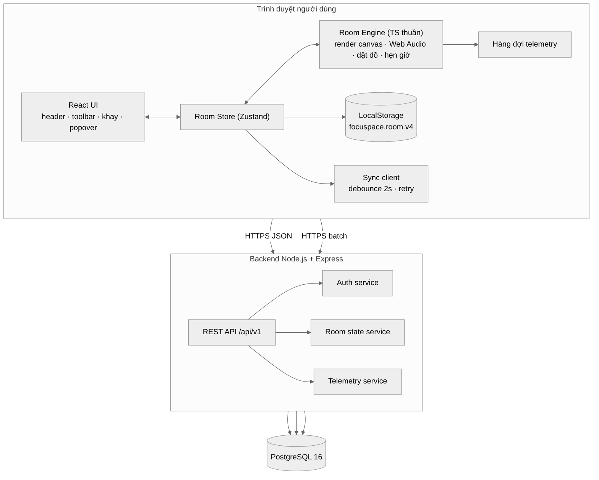
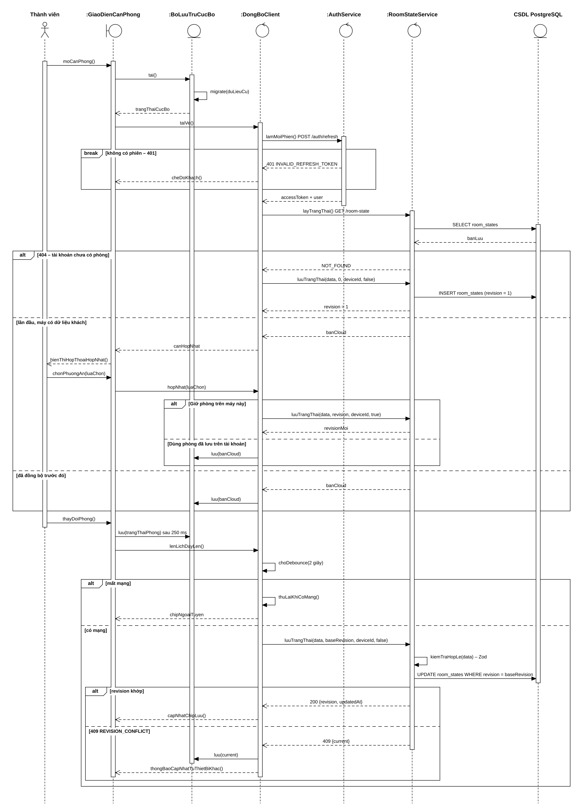
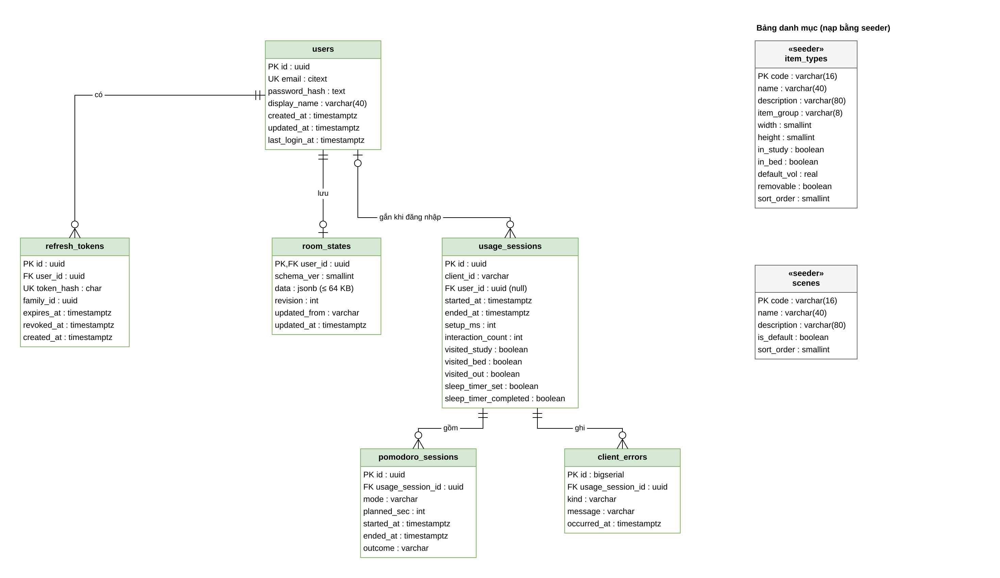
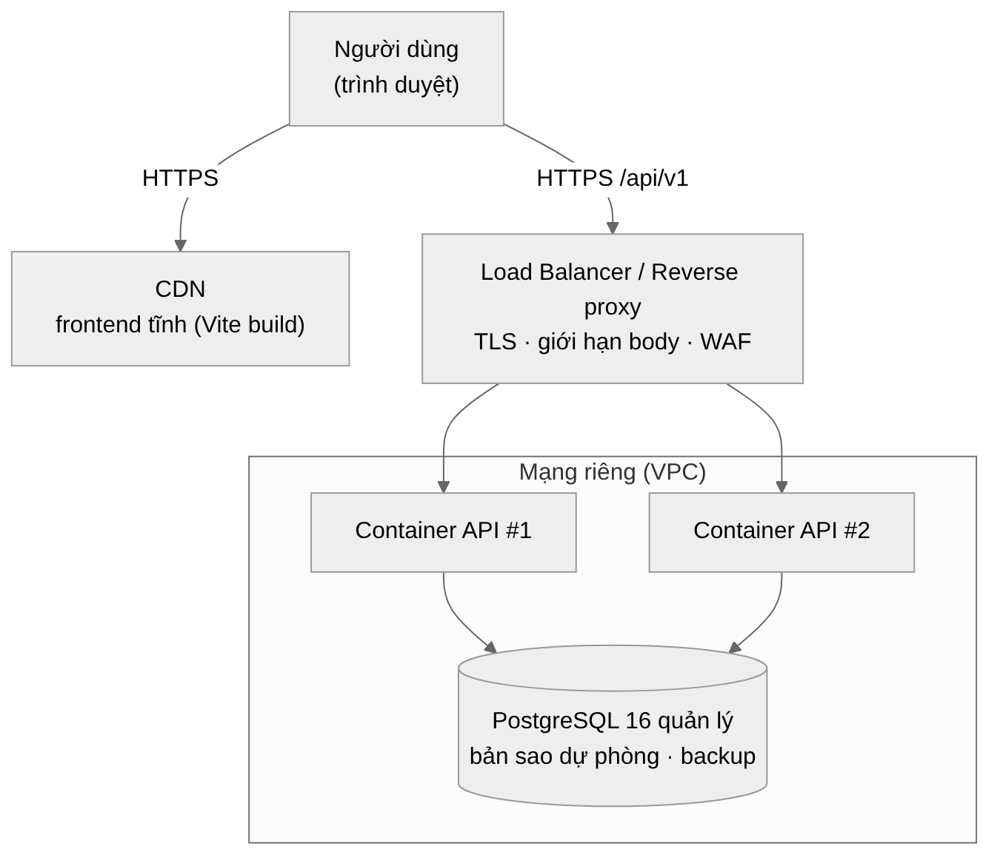
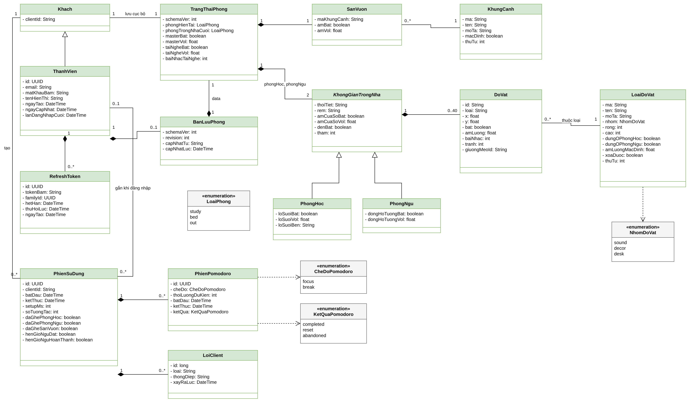
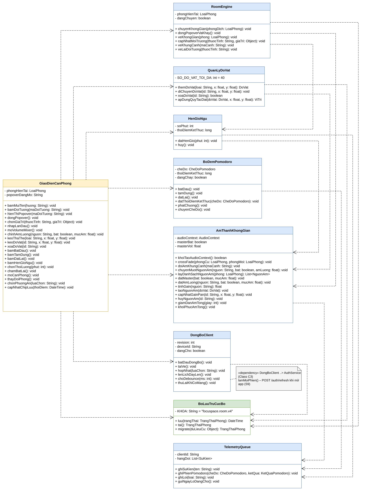
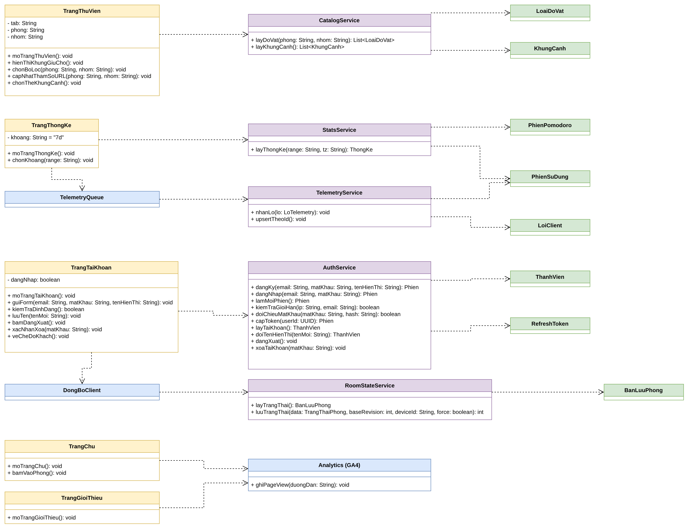

> Bản chính thức duy nhất (bản Word cũ `docs/FocuSpace_Kien_truc_giai_phap.docx` đã gộp vào file này ngày 13/11/2026; cần bản Word thì xuất bằng `pandoc docs/ARCHITECTURE.md -o FocuSpace_Kien_truc_giai_phap.docx`). Đối chiếu lần cuối với `prototype/FocuSpace-Semi-Sandbox.html` ngày 10/11/2026.

# FocuSpace — Tài liệu Kiến trúc giải pháp

Solution Architecture Document — FocuSpace bản chính thức

|                   |                                                                                                                    |
|-------------------|--------------------------------------------------------------------------------------------------------------------|
| **Sản phẩm**      | FocuSpace — web app pixel art Lo-fi Semi-Sandbox                                                                   |
| **Phiên bản**     | v1.3 (Hình 2 thay bằng Sequence UC.09, ERD vẽ trong drawio, mã FR chi tiết; thay v1.2) |
| **Trạng thái**    | v1.0 đã phê duyệt phần kiến trúc ứng dụng và dữ liệu (07/11/2026); v1.1 – v1.3 đã duyệt ở buổi họp kế hoạch 13/11/2026. Phần hạ tầng, giám sát, chi phí giữ nhãn [Đề xuất] vì ngoài phạm vi chấm đồ án |
| **Ngày cập nhật** | 13/11/2026 (v1.3) |
| **Nguồn**         | prototype/FocuSpace-Semi-Sandbox.html · docs/PRD.md · docs/ARCHITECTURE.md · docs/DATABASE.md · docs/API.md · docs/PLAN.md · docs/analysis/FocuSpace_Diagrams.drawio, Chương 1 Phân tích hệ thống      |

> **Cách đọc:** Mục có nhãn \[Đề xuất\] là phương án kiến trúc sư đưa ra khi tài liệu nguồn chưa quyết định (nơi triển khai, SLA, công cụ giám sát, chi phí). Mục có nhãn \[Cần xác nhận\] cần số liệu từ đội dự án.

# 1. Giới thiệu & Tổng quan dự án

## 1.1 Mục đích tài liệu

Tài liệu mô tả thiết kế giải pháp CNTT cho FocuSpace bản chính thức, nối các yêu cầu trong PRD v5.1 với cách triển khai: thành phần phần mềm, dữ liệu, tích hợp, hạ tầng, bảo mật và vận hành. Đối tượng đọc: Tech Lead, developer frontend/backend, QA, người vận hành hệ thống.

## 1.2 Phạm vi

- Yêu cầu chức năng: ba không gian, đồ vật kéo thả, âm thanh không gian 2D, Volume mixer, Pomodoro, Hẹn giờ ngủ, lưu cục bộ, tài khoản, đồng bộ cloud, đo KPI, website 6 trang với Thư viện và Thống kê lấy dữ liệu từ cơ sở dữ liệu, theo dõi bằng Google Analytics 4 và Sentry (PRD mục 5).

- Yêu cầu phi chức năng: hiệu năng, sẵn sàng, bảo mật, tương thích (PRD mục 6).

- Ngoài phạm vi: phòng học nhóm thời gian thực, tích hợp dịch vụ nhạc, đăng nhập OAuth, ứng dụng native.

- Ràng buộc đồ án: đề bài môn Web Design and Development (CSB25022) — Tailwind CSS, ít nhất 3 trang, PostgreSQL có migration và seeder, tối ưu Lighthouse, Google Analytics, Sentry, quy trình GitHub (PRD mục 2.4).

## 1.3 Bối cảnh & Mục tiêu kinh doanh

### Hiện trạng (AS-IS)

- Một file HTML tĩnh prototype/FocuSpace-Semi-Sandbox.html (~240 KB) chứa toàn bộ giao diện, đồ họa canvas và âm thanh tổng hợp bằng Web Audio.

- Trạng thái phòng chỉ lưu trong LocalStorage của một trình duyệt (khóa focuspace.room.v4); không có tài khoản, không đồng bộ giữa thiết bị.

- Không đo được KPI (thời lượng phiên, tỷ lệ hoàn thành Pomodoro, retention).

- Mã nguồn một khối, khó kiểm thử và mở rộng.

### Tương lai (TO-BE)

- Frontend React + TypeScript, giao diện bằng Tailwind CSS, 6 trang định tuyến bằng React Router; engine (render, âm thanh, đặt đồ, hẹn giờ) tách thành module thuần có unit test và chỉ tải ở trang Căn phòng.

- Backend REST (Node.js + Express) cho tài khoản, đồng bộ trạng thái phòng có kiểm soát phiên bản, thu thập số liệu KPI và cung cấp dữ liệu cho trang Thư viện, Thống kê.

- PostgreSQL 16 lưu người dùng, trạng thái phòng (JSONB), số liệu và danh mục đồ vật, khung cảnh (nạp bằng seeder).

- Kiến trúc **local-first**: không đăng nhập hoặc mất mạng vẫn dùng đủ tính năng.

- Google Analytics 4 theo dõi hành vi người dùng; Sentry ghi lỗi frontend và backend.

### Bản đồ năng lực kinh doanh

| **Năng lực**           | **Mô tả**                                                    | **Thành phần đảm nhận**                                |
|------------------------|--------------------------------------------------------------|--------------------------------------------------------|
| Trải nghiệm không gian | Ba không gian pixel art, chuyển phòng, thời tiết, khung cảnh | Frontend · Room Engine (render)                        |
| Âm thanh không gian    | Spatial Audio 2D, mixer, Master, nhạc Lo-fi tổng hợp         | Frontend · Room Engine (audio)                         |
| Tùy biến Semi-Sandbox  | Thêm/xóa/kéo đồ vật theo quy tắc đặt                         | Frontend · placement + UI                              |
| Quản lý thời gian      | Pomodoro dùng chung, Hẹn giờ ngủ                             | Frontend · timers                                      |
| Lưu & đồng bộ          | LocalStorage, đồng bộ cloud, xử lý xung đột                  | Frontend sync client · Room state service · PostgreSQL |
| Tài khoản              | Đăng ký, đăng nhập, phiên, xóa tài khoản                     | Auth service · PostgreSQL                              |
| Đo lường               | Phiên dùng, Pomodoro, lỗi âm thanh, báo cáo KPI              | Telemetry queue · Telemetry service · PostgreSQL       |
| Nội dung động | Thư viện đồ vật, khung cảnh; thống kê học tập | Trang Thư viện, Thống kê · Catalog service · Stats service · PostgreSQL |
| Quan sát | Lượt xem, sự kiện, lỗi ứng dụng | Google Analytics 4 · Sentry · log JSON |

# 2. Yêu cầu hệ thống (Requirements)

## 2.1 Yêu cầu chức năng

| **Nhóm**               | **Nghiệp vụ cốt lõi**                                      | **Mã PRD**                | **Use case** |
|------------------------|------------------------------------------------------------|---------------------------|---|
| Giao diện & điều hướng | Bố cục, thanh công cụ, popover, chuyển ba không gian       | FR-UI-01→06, FR-NAV-01→03, FR-PAGE-03 | UC.01, UC.12 |
| Ba không gian          | Phòng học, Phòng ngủ, Sân vườn với 5 khung cảnh            | FR-STUDY-01→08, FR-BED-01→07, FR-OUT-01→04 | UC.02 |
| Đồ vật                 | Danh mục 17 loại, thêm/xóa/kéo, quy tắc đặt, giường mèo    | FR-ITEM-01→08 | UC.04 |
| Âm thanh               | Chuỗi xử lý, công thức gain/pan, mixer, Master, mèo        | FR-AUD-01→07              | UC.03 |
| Thời gian              | Pomodoro, Hẹn giờ ngủ                                      | FR-TIME-01→03             | UC.05, UC.06 |
| Lưu trữ                | LocalStorage, migrate dữ liệu cũ                           | FR-SAVE-01→04             | include Tự động lưu cục bộ |
| Tài khoản & đồng bộ    | Khách, đăng ký/đăng nhập, đồng bộ, hợp nhất, xung đột, xóa | FR-ACC-01→08 | UC.08, UC.09, UC.11 |
| Đo lường               | Phiên, Pomodoro, lỗi                                       | FR-TEL-01→03              | include Ghi nhận số liệu sử dụng |
| Website nhiều trang | 6 trang, thanh điều hướng chung, trang 404 | FR-PAGE-01→08 | UC.12 |
| Trang động | Thư viện lọc theo phòng và nhóm; Thống kê theo khoảng thời gian | FR-LIB-01→06, FR-STAT-01→06 | UC.07, UC.10 |
| Theo dõi và ghi lỗi | Google Analytics 4, Sentry | FR-OBS-01→04 | UC.12, UC.03 |

## 2.2 Yêu cầu phi chức năng (Quality Attributes)

### Hiệu năng & Khối lượng

| **Thuộc tính**                        | **Mục tiêu**                                       | **Ghi chú**                                                  |
|---------------------------------------|----------------------------------------------------|--------------------------------------------------------------|
| Phản hồi âm thanh khi kéo đồ          | \< 30 ms                                           | Xử lý hoàn toàn ở client                                     |
| First Contentful Paint                | \< 2 giây (4G)                                     | Gói JS nén \< 300 KB                                         |
| Thời gian phản hồi API                | p95 \< 300 ms                                      | Mọi endpoint                                                 |
| Độ trễ dữ liệu đồng bộ giữa thiết bị  | ≤ 2 giây sau thay đổi + thời gian mở app ở máy kia | PUT debounce 2 giây; máy kia nhận khi mở app hoặc khi bị 409 |
| Kích thước trạng thái phòng           | ≤ 64 KB / người dùng                               | Ràng buộc DB + validate                                      |
| Người dùng đồng thời / lưu lượng đỉnh | \[Cần xác nhận\]                                   | Xem ước tính tải bên dưới                                    |
| Điểm Google Lighthouse | ≥ 90 cho Performance, Accessibility, Best Practices, SEO | Cấu hình mobile, cả 6 trang; đo trong CI |

**Ước tính tải theo hành vi client** (để định cỡ khi có số người dùng): mỗi người dùng đang đăng nhập gửi tối đa 1 PUT /room-state mỗi 2 giây khi đang chỉnh liên tục (thường vài lần mỗi phiên), 1 POST /telemetry/batch mỗi 60 giây, và vài request lúc mở app. Với **1.000 người dùng đồng thời**: trung bình ≈ 17 request/giây cho telemetry, đỉnh lý thuyết ≈ 500 request/giây nếu tất cả cùng kéo đồ một lúc.

### Tính sẵn sàng & Khôi phục (Availability & DR) \[Đề xuất\]

- Uptime mục tiêu API: **99,5%/tháng** (≈ 3,6 giờ gián đoạn). Mức này đủ vì kiến trúc local-first: API ngừng chỉ làm chậm đồng bộ, không làm hỏng trải nghiệm.

- Frontend tĩnh trên CDN: sẵn sàng theo SLA của nhà cung cấp CDN.

- Database: dịch vụ PostgreSQL quản lý, có bản sao dự phòng ở vùng sẵn sàng (AZ) khác; sao lưu hằng ngày giữ 14 ngày + Point-in-Time Recovery 7 ngày.

- RPO ≤ 5 phút, RTO ≤ 1 giờ. Multi-Region: không cần ở giai đoạn này.

### Bảo mật

| **Khía cạnh**              | **Giải pháp**                                                                                                                                                                                                                                                        |
|----------------------------|----------------------------------------------------------------------------------------------------------------------------------------------------------------------------------------------------------------------------------------------------------------------|
| Xác thực (Authentication)  | Email + mật khẩu (Argon2id). Access token JWT HS256 15 phút trong bộ nhớ trình duyệt; refresh token 256 bit ngẫu nhiên, 30 ngày, cookie httpOnly · Secure · SameSite=Strict · Path=/api/v1/auth; xoay vòng mỗi lần refresh, phát hiện dùng lại thì thu hồi cả chuỗi. |
| Phân quyền (Authorization) | Một vai trò duy nhất (người dùng). Mỗi người chỉ đọc/ghi room_states và tài khoản của chính mình, xác định bằng sub trong JWT; không có tham số user id trên URL. Danh mục (/catalog) công khai, chỉ đọc.                                                                                                    |
| Mã hóa khi truyền          | HTTPS/TLS 1.2+ cho mọi kết nối; HSTS. Kết nối API → DB dùng TLS.                                                                                                                                                                                                     |
| Mã hóa khi lưu             | Mã hóa đĩa của dịch vụ DB quản lý \[Đề xuất\]; mật khẩu và refresh token chỉ lưu bản băm.                                                                                                                                                                            |
| Chống lạm dụng             | Rate limit đăng nhập/đăng ký 10 lần/15 phút/IP; telemetry 60 lô/giờ/clientId; giới hạn body 64 KB / 256 KB; CORS chỉ cho origin frontend; validate Zod mọi request.                                                                                                  |
| Audit log \[Đề xuất\]      | Ghi log có cấu trúc cho đăng ký, đăng nhập thành công/thất bại, refresh bị từ chối, thu hồi chuỗi token, xóa tài khoản (user id, IP, thời điểm; không ghi mật khẩu hay token).                                                                                       |

# 3. Kiến trúc giải pháp chi tiết

## 3.1 Kiến trúc khái niệm (Conceptual Architecture)

Hai khối lớn: **ứng dụng trong trình duyệt** chịu toàn bộ trải nghiệm và lưu cục bộ; **backend** chỉ lo tài khoản, đồng bộ và số liệu. Hai khối nói chuyện qua REST/JSON trên HTTPS.

*Hình 1 — Kiến trúc khái niệm*

## 3.2 Kiến trúc ứng dụng (Application Architecture)

### Kiểu kiến trúc

- **Modular monolith**, không dùng microservice: chỉ có 5 miền nghiệp vụ nhỏ (auth, room state, telemetry, catalog, stats), tương ứng 5 lớp service AuthService, RoomStateService, TelemetryService, CatalogService, StatsService, 14 endpoint; tách service sẽ tăng chi phí vận hành mà không có lợi về mở rộng.

- Backend phân lớp: routes (HTTP, validate) → services (nghiệp vụ) → Prisma (dữ liệu). Phụ thuộc bên ngoài truyền vào qua tham số (ví dụ createApp({ db })) để test được — tinh thần Ports & Adapters.

- Frontend: React chỉ lo UI; **Room Engine** viết bằng TypeScript thuần, không phụ thuộc React, chạy vòng vẽ 10 FPS và đồ thị Web Audio riêng.

- Frontend nhiều trang: React Router định tuyến phía client, mỗi trang tải lười (code splitting); Tailwind CSS cho mọi giao diện ngoài canvas, cấu hình màu và font lấy từ prototype.

- **Local-first + optimistic concurrency:** client luôn ghi LocalStorage trước, đồng bộ sau; server dùng số revision để phát hiện xung đột (409).

- Schema dữ liệu dùng chung (shared/, Zod) cho validate và migrate ở cả client lẫn server.

### Thành phần

| **Thành phần**       | **Công nghệ**       | **Trách nhiệm**                                                                                                |
|----------------------|---------------------|----------------------------------------------------------------------------------------------------------------|
| UI                   | React 18, Zustand, Tailwind CSS   | Header, thanh công cụ, khay, popover, mixer, chọn khung cảnh, mũi tên/cửa nhà, hộp thoại hợp nhất |
| Room Engine — render | Canvas 2D           | 4 lớp: nền tĩnh, hoạt họa 10 FPS, DOM đồ vật, ánh sáng 160×90; dừng khi tab ẩn                                 |
| Room Engine — audio  | Web Audio API       | AudioContext, Master, nhánh âm mỗi nguồn, công thức gain/pan, âm tổng hợp, nhạc Lo-fi bằng OfflineAudioContext |
| Room Engine — logic  | TypeScript          | Quy tắc đặt đồ, Pomodoro, Hẹn giờ ngủ, bảng chuyển phòng                                                       |
| Persistence          | LocalStorage, fetch | Lưu 250 ms, migrate, sync client (debounce 2 s, keepalive, backoff, xử lý 409)                                 |
| Telemetry queue      | TypeScript          | Gom sự kiện, gửi lô mỗi 60 s hoặc khi ẩn tab                                                                   |
| API                  | Node.js 20, Express | Định tuyến /api/v1, CORS, giới hạn body, rate limit, định dạng lỗi chuẩn                                       |
| Auth service         | Argon2id, JWT       | Đăng ký, đăng nhập, refresh xoay vòng, đăng xuất, xóa tài khoản                                                |
| Room state service   | Zod, Prisma         | Validate, migrate, ghi có kiểm tra revision, force khi hợp nhất                                                |
| Telemetry service    | Prisma              | Upsert idempotent phiên, Pomodoro, lỗi                                                                         |
| Trang và điều hướng | React Router 6, Tailwind CSS | 6 trang, thanh điều hướng, chân trang, trang 404; tải lười từng trang; title và meta description theo trang |
| Catalog service | Prisma | Đọc item_types, scenes theo bộ lọc; trả kèm Cache-Control 1 giờ |
| Stats service | Prisma, SQL tổng hợp | Tính phút tập trung, số Pomodoro, số phiên theo ngày cho một người dùng |
| Seeder | Prisma seed, shared/catalog | Nạp danh mục ban đầu; upsert theo code nên chạy lại không bị trùng |
| Observability | gtag.js (GA4), Sentry SDK, pino | Lượt xem, sự kiện, lỗi frontend và backend, log JSON có requestId |

### Ánh xạ lớp thiết kế ↔ thành phần

| **Lớp (Chương 1, Class C2/C3)** | **Module mã nguồn** |
|---|---|
| GiaoDienCanPhong | `frontend/src/pages/Room` + `ui/` (Header, Toolbar, Tray, Popover, Mixer, ScenePicker, RoomNav, MergeDialog) + `store/` (Zustand) |
| RoomEngine | `engine/logic/rooms` + `engine/render/*` |
| QuanLyDoVat | `engine/logic/placement` (+ `spatial`) |
| AmThanhKhongGian | `engine/audio/*` (context, graph, synth, lofi, routing) |
| BoDemPomodoro | `engine/logic/pomodoro` |
| HenGioNgu | `engine/logic/sleepTimer` |
| BoLuuTruCucBo | `persistence/local` + `shared/src/migrate.ts` |
| DongBoClient | `persistence/sync` + `persistence/api` |
| TelemetryQueue | `persistence/telemetry` |
| TrangThuVien / TrangThongKe / TrangTaiKhoan | `pages/Library` / `pages/Stats` / `pages/Account` |
| TrangChu / TrangGioiThieu | `pages/Home` / `pages/About` (kèm `pages/NotFound`) |
| AuthService, RoomStateService, CatalogService, StatsService, TelemetryService | `backend/src/services/*` (route tương ứng trong `backend/src/routes/`) |

Thông điệp trong biểu đồ Sequence (Chương 1 §1.4) dùng đúng tên phương thức của các lớp này. Hình các biểu đồ lớp: Phụ lục A.

### Luồng chính

*Hình 2 — Mở ứng dụng, đồng bộ và xử lý xung đột (Sequence UC.09; cùng hình với Chương 1, Hình 1.22; nguồn: `docs/analysis/FocuSpace_Diagrams.drawio`, trang S9)*

Hình 2 gồm hai luồng chính của hệ thống:

- **Mở ứng dụng:** đọc LocalStorage và `migrate()` về RoomState v4; `POST /auth/refresh` bằng cookie — không có phiên (401) thì thoát sang chế độ khách (khối `break`); có phiên thì `GET /room-state`. Tài khoản chưa có phòng (404) thì tải phòng của máy lên với baseRevision = 0; lần đầu đăng nhập trên máy có dữ liệu khách thì hiện hộp thoại hợp nhất và ghi bản được chọn với `force = true`.
- **Lưu thay đổi:** áp ngay vào hình và âm, lưu LocalStorage sau 250 ms, đẩy `PUT /room-state` sau 2 giây; backend kiểm tra Zod rồi `UPDATE … WHERE revision = baseRevision`. Khớp thì trả revision mới; máy khác đã ghi trước thì trả 409 REVISION_CONFLICT kèm bản hiện có, client áp bản server và báo “Phòng đã được cập nhật từ thiết bị khác”. Mất mạng thì thử lại khi có mạng, chip báo ngoại tuyến.

AudioContext được tạo ở trạng thái tạm dừng và chỉ bật sau cú nhấp/phím đầu tiên (PRD FR-AUD-07): xem Sequence UC.03 (Chương 1, Hình 1.16).

*Hình 3 của v1.2 (lưu thay đổi và xung đột) đã gộp vào Hình 2 từ v1.3; số Hình 4, 5 giữ nguyên để không đổi tham chiếu.*

## 3.3 Kiến trúc dữ liệu (Data Architecture)

*Hình 4 — Sơ đồ quan hệ dữ liệu (ERD), gồm hai bảng danh mục item_types và scenes (nguồn: `docs/analysis/FocuSpace_Diagrams.drawio`, trang ERD; khớp từng cột với `docs/DATABASE.md` §3)*

### Ánh xạ lớp thực thể ↔ bảng (Chương 1, Class C1)

| **Lớp (Class C1)** | **Bảng / đối tượng** | **Ánh xạ thuộc tính** |
|---|---|---|
| ThanhVien | users | id↔id, email↔email, matKhauBam↔password_hash, tenHienThi↔display_name, ngayTao↔created_at, ngayCapNhat↔updated_at, lanDangNhapCuoi↔last_login_at |
| RefreshToken | refresh_tokens | id, tokenBam↔token_hash, familyId↔family_id, hetHan↔expires_at, thuHoiLuc↔revoked_at, ngayTao↔created_at |
| BanLuuPhong | room_states | schemaVer↔schema_ver, data (= TrangThaiPhong, JSONB), revision, capNhatTu↔updated_from, capNhatLuc↔updated_at |
| TrangThaiPhong, KhongGianTrongNha, PhongHoc, PhongNgu, SanVuon, DoVat | Đối tượng RoomState (API Phụ lục A; shared/src/roomState.ts) | Không phải bảng riêng; nằm trong room_states.data và LocalStorage focuspace.room.v4 |
| LoaiDoVat | item_types | ma↔code, ten↔name, moTa↔description, nhom↔item_group, rong↔width, cao↔height, dungOPhongHoc↔in_study, dungOPhongNgu↔in_bed, amLuongMacDinh↔default_vol, xoaDuoc↔removable, thuTu↔sort_order |
| KhungCanh | scenes | ma↔code, ten↔name, moTa↔description, macDinh↔is_default, thuTu↔sort_order |
| PhienSuDung | usage_sessions | id, clientId↔client_id, (user_id: liên kết ThanhVien), batDau↔started_at, ketThuc↔ended_at, setupMs↔setup_ms, soTuongTac↔interaction_count, daGhePhongHoc/PhongNgu/SanVuon↔visited_study/bed/out, henGioNguDat↔sleep_timer_set, henGioNguHoanThanh↔sleep_timer_completed |
| PhienPomodoro | pomodoro_sessions | id, cheDo↔mode, thoiLuongDuKien↔planned_sec, batDau↔started_at, ketThuc↔ended_at, ketQua↔outcome |
| LoiClient | client_errors | id (bigserial), loai↔kind, thongDiep↔message, xayRaLuc↔occurred_at |
| Khach | (chỉ phía trình duyệt) | clientId ẩn danh + LocalStorage |

### Chiến lược lưu trữ

| **Dữ liệu**                      | **Nơi lưu**                                                                    | **Lý do**                                                                                                 |
|----------------------------------|--------------------------------------------------------------------------------|-----------------------------------------------------------------------------------------------------------|
| Trạng thái phòng                 | LocalStorage (focuspace.room.v4) + room_states.data (JSONB), 1 dòng/người dùng | Client luôn đọc/ghi cả khối; cấu trúc đổi theo phiên bản và đã có migrate; không cần truy vấn từng đồ vật |
| Tài khoản, token                 | Bảng quan hệ users, refresh_tokens                                             | Ràng buộc duy nhất, khóa ngoại, cascade khi xóa                                                           |
| Số liệu KPI                      | Bảng quan hệ usage_sessions, pomodoro_sessions, client_errors                  | Cần truy vấn tổng hợp (trung bình, tỷ lệ, retention)                                                      |
| Pomodoro / Hẹn giờ ngủ đang chạy | Chỉ trong bộ nhớ trình duyệt                                                   | Không giữ qua lần tải lại (FR-SAVE-04)                                                                    |
| Danh mục đồ vật, khung cảnh | Bảng item_types, scenes; nạp bằng seeder từ shared/catalog | Trang Thư viện truy vấn và lọc theo phòng, nhóm; cùng một nguồn với engine (DRY) |

### Phân vùng, sao lưu và lưu trữ lâu dài

- Không phân vùng ở giai đoạn đầu. Khi usage_sessions vượt khoảng 10 triệu dòng \[Đề xuất\], phân vùng theo tháng của started_at để xóa dữ liệu cũ nhanh.

- Dữ liệu telemetry giữ 400 ngày, job hằng đêm xóa phần quá hạn (đủ cho so sánh theo năm).

- Sao lưu: theo dịch vụ DB quản lý (mục 2.2); diễn tập khôi phục mỗi quý \[Đề xuất\].

- Thay đổi cấu trúc RoomState: tăng schemaVer, thêm bước migrate; server migrate khi đọc và ghi lại ở lần PUT kế tiếp, không chạy migrate hàng loạt.

- Migration bằng prisma migrate (chỉ thêm cột, bảng); seeder bằng prisma db seed, upsert theo code nên chạy lại an toàn; seeder không tạo người dùng hay số liệu mẫu.

## 3.4 Kiến trúc tích hợp (Integration Architecture)

| **Kênh**                        | **Dùng?** | **Ghi chú**                                                                                    |
|---------------------------------|-----------|------------------------------------------------------------------------------------------------|
| REST/JSON qua HTTPS             | Có        | Toàn bộ giao tiếp client ↔ backend, tiền tố /api/v1 (chi tiết trong API Docs)                  |
| Cookie httpOnly                 | Có        | Chỉ cho refresh token, phạm vi /api/v1/auth                                                    |
| fetch keepalive                 | Có        | Lần đồng bộ cuối khi đóng tab                                                                  |
| API Gateway                     | Không     | Một backend duy nhất; reverse proxy/load balancer đảm nhận TLS, giới hạn body                  |
| Message broker (Kafka/RabbitMQ) | Không     | Không có xử lý bất đồng bộ giữa các service; telemetry ghi thẳng DB theo lô                    |
| gRPC, Webhook                   | Không     | Không có hệ thống bên thứ ba tích hợp                                                          |
| Google Fonts                    | Có        | Font Press Start 2P, Be Vietnam Pro, Pixelify Sans, VT323; có font dự phòng nếu không tải được |
| Google Analytics 4 (gtag.js) | Có | Lượt xem trang và sự kiện; chỉ ở bản production; không gửi dữ liệu cá nhân |
| Sentry | Có | SDK frontend và backend gửi lỗi qua HTTPS; DSN đặt trong biến môi trường |

## 3.5 Kiến trúc hạ tầng & Cloud

### Triển khai cho đồ án (đã chốt 13/11/2026, D-04)

| **Lớp** | **Dịch vụ (gói miễn phí)** | **Cấu hình** |
|---|---|---|
| Frontend | Vercel | Build `vite build` từ thư mục `frontend/`; rewrite mọi đường dẫn về `index.html`; biến `VITE_API_URL`, `VITE_GA_ID`, `VITE_SENTRY_DSN` |
| Backend | Render — Web Service Node 20 | Lệnh chạy `npm run start -w backend`; health check `GET /api/v1/health`; biến `DATABASE_URL`, `JWT_SECRET`, `SENTRY_DSN`, `CORS_ORIGIN` (domain Vercel). Gói miễn phí ngủ sau 15 phút không dùng: mở link trước khi demo khoảng 1 phút |
| Database | Neon — PostgreSQL 16 | `prisma migrate deploy` và `prisma db seed` chạy một lần sau mỗi migration mới; dùng chuỗi kết nối có `sslmode=require` |
| Theo dõi | Google Analytics 4, Sentry | Tài khoản do Phúc Thịnh tạo; mã chỉ đặt trong biến môi trường của Vercel/Render và `.env` máy cá nhân |

Cookie refresh token đặt `SameSite=None; Secure` vì frontend và backend khác domain; CORS chỉ cho domain Vercel. Chi phí: 0 đồng trong thời gian đồ án.

### Kiến trúc tham chiếu khi mở rộng \[Đề xuất\]

Ngoài phạm vi đồ án. Kiến trúc dưới đây không phụ thuộc nhà cung cấp; áp dụng được trên AWS, GCP, Azure hoặc nhà cung cấp trong nước.

*Hình 5 — Kiến trúc hạ tầng tham chiếu*

| **Lớp**      | **Thành phần**                                           | **Cấu hình khởi điểm**                                                       |
|--------------|----------------------------------------------------------|------------------------------------------------------------------------------|
| Frontend     | Object storage + CDN                                     | File tĩnh từ vite build, cache dài cho asset có hash, không cache index.html; mọi đường dẫn trang trả về index.html (định tuyến phía client) |
| Mạng         | VPC, subnet công khai cho LB, subnet riêng cho API và DB | DB không có IP công khai                                                     |
| Cân bằng tải | Load balancer L7 / reverse proxy                         | Kết thúc TLS, health check GET /api/v1/health, giới hạn body                 |
| Compute      | Container (Docker) chạy Node.js 20                       | 2 bản chạy song song (0,5 vCPU, 512 MB mỗi bản); tự mở rộng khi CPU \> 60%   |
| Database     | PostgreSQL 16 quản lý                                    | 2 vCPU, 4 GB RAM, 20 GB SSD, có bản dự phòng AZ khác                         |
| Môi trường   | local · staging · production                             | local dùng docker-compose hoặc PostgreSQL cài trực tiếp                      |

## 3.6 Kiến trúc bảo mật & IAM

- Quản lý danh tính tự xây (email/mật khẩu), không OAuth2/OIDC ở phiên bản này (đã chốt). Nếu bổ sung sau, thêm bảng auth_identities và luồng OIDC mà không đổi cấu trúc token hiện tại.

- Secret (JWT_SECRET, DATABASE_URL, SENTRY_DSN) lưu trong trình quản lý secret của nền tảng, không nằm trong mã nguồn; .env chỉ dùng cho máy dev.

- WAF/firewall \[Đề xuất\]: bật bộ luật cơ bản (OWASP) ở load balancer; security group chỉ cho LB gọi API, chỉ API gọi DB.

- Quyền truy cập vận hành: tài khoản cá nhân, xác thực hai lớp, nguyên tắc quyền tối thiểu cho console cloud và DB.

# 4. Vận hành & Quản lý giải pháp

## 4.1 Giám sát & Logging

| **Hạng mục**       | **Giải pháp**                                                                                          | **Ngưỡng cảnh báo**                         |
|--------------------|--------------------------------------------------------------------------------------------------------|---------------------------------------------|
| Log tập trung      | Log JSON (pino) có requestId, gửi về dịch vụ log của nền tảng; không ghi mật khẩu, token, nội dung room state | —                                           |
| Metrics            | \[Đề xuất\] Prometheus (endpoint metrics nội bộ) + Grafana: request/giây, p95, tỷ lệ 5xx, số 409, kết nối DB       | p95 \> 300 ms trong 5 phút; 5xx \> 1%       |
| Health check       | GET /api/v1/health từ load balancer và dịch vụ kiểm tra uptime bên ngoài                               | 2 lần thất bại liên tiếp                    |
| Database           | CPU, dung lượng, kết nối, độ trễ bản sao                                                               | Dung lượng \> 80%; CPU \> 80% trong 10 phút |
| APM / lỗi frontend | Sentry cho frontend và backend (lỗi, phiên bản phát hành, môi trường, không gửi dữ liệu cá nhân); tỷ lệ lỗi Audio Context lấy từ client_errors                         | Lỗi Audio Context \> 0,05% phiên/ngày       |
| KPI sản phẩm       | Truy vấn tổng hợp theo DATABASE §5, bảng điều khiển hằng ngày                                          | —                                           |
| Hành vi người dùng | Google Analytics 4: lượt xem từng trang, sự kiện room_switch, item_add, scene_change, pomodoro_start, pomodoro_complete, sleep_timer_set, sign_up, login | — |
| Hiệu năng trang | Lighthouse CI trên bản build cho cả 6 trang | Điểm \< 90 ở bất kỳ nhóm nào |

## 4.2 DevOps & CI/CD

Mã nguồn là monorepo npm workspaces (shared, backend, frontend). Quy trình đề xuất:

1.  Pull request: npm run lint, format:check, unit test (shared, engine).

2.  Integration test backend với PostgreSQL chạy dạng service trong CI (DB focuspace_test, tài khoản tạm tạo và xóa trong mỗi lần chạy).

3.  Build: shared → backend (image Docker gắn tag theo commit) → frontend (file tĩnh).

4.  E2E Playwright trên Chromium, Firefox, WebKit với bản build ở 3 cỡ màn hình (375, 768, 1280 px); Lighthouse CI đo 6 trang.

5.  Merge vào nhánh chính: tự triển khai staging, chạy prisma migrate deploy và prisma db seed, smoke test health.

6.  Triển khai production cần duyệt thủ công; rolling update từng container.

**Rollback:** triển khai lại image và bản frontend của lần phát hành trước. Migration DB phải tương thích ngược (chỉ thêm cột/bảng; xóa cột ở lần phát hành sau) để rollback không cần hạ cấp DB. Định dạng RoomState mới luôn đọc được bởi hàm migrate nên frontend cũ không làm hỏng dữ liệu.

### Quy trình làm việc trên GitHub

- **Repo:** một repo GitHub cho cả monorepo, mọi thành viên có quyền ghi; README.md ở thư mục gốc theo mẫu nộp bài (cách chạy, tổng quan và công cụ, tính năng kèm ảnh, ERD, thông tin khác).

- **Nhánh:** main luôn chạy được và được bảo vệ (chỉ merge qua Pull Request, CI phải xanh, ít nhất 1 người duyệt). Mỗi việc một nhánh chủ đề tách từ main: feat/\<số-issue\>-\<mô-tả\>, fix/…, docs/…, test/…, chore/….

- **Ticket:** mỗi việc là một GitHub Issue theo mẫu (Tính năng, Lỗi), gắn nhãn loại (`type:*`), khu vực (`area:items-audio`, `area:garden`, `area:bedroom`, `area:study`, `area:pages`, `area:repo`, `area:backend`, `area:shared` — theo `docs/TASKS.md`) và ưu tiên (P0, P1), gắn milestone theo sprint; theo dõi trên bảng GitHub Projects: Backlog → To do → In progress → Review → Done.

- **Commit:** theo Conventional Commits, mỗi commit một thay đổi, kèm số issue: \<type\>(\<phạm vi\>): \<mô tả ngắn\> (#\<số\>), ví dụ feat(library): lọc đồ vật theo phòng (#24). type gồm feat, fix, docs, test, refactor, chore.

- **Pull Request:** mô tả theo mẫu (làm gì, cách kiểm tra, ảnh chụp nếu đổi giao diện) và dòng Closes #\<số\> để liên kết, tự đóng issue; merge bằng merge commit để giữ lịch sử commit của nhánh.

- **Thư mục .github/:** ISSUE_TEMPLATE/ (feature.md, bug.md), pull_request_template.md, workflows/ci.yml.

## 4.3 Ước tính chi phí (Cost Estimation)

> Trong thời gian đồ án chi phí là 0 đồng (Vercel, Render, Neon, GA4, Sentry đều dùng gói miễn phí, §3.5). Bảng dưới chỉ dùng để báo giá khi mở rộng theo kiến trúc tham chiếu; số người dùng tham chiếu khoảng 50 đồng thời (PRD Q-10).

| **Hạng mục**          | **Cấu hình khởi điểm**                                  | **Cách tối ưu**                                         | **Chi phí/tháng** |
|-----------------------|---------------------------------------------------------|---------------------------------------------------------|-------------------|
| Compute API           | 2 container × 0,5 vCPU, 512 MB                          | Reserved/Savings Plan cho phần nền; tự mở rộng theo CPU | \[Cần báo giá\]   |
| Database              | PostgreSQL quản lý 2 vCPU, 4 GB, 20 GB, có bản dự phòng | Reserved 1 năm; tắt bản dự phòng ở staging              | \[Cần báo giá\]   |
| Load balancer         | 1 LB L7                                                 | Dùng chung cho staging và production nếu được           | \[Cần báo giá\]   |
| CDN + lưu trữ tĩnh    | Vài MB file tĩnh, băng thông theo lượt truy cập         | Cache dài cho asset có hash                             | \[Cần báo giá\]   |
| Log, metrics, sao lưu | Giữ log 30 ngày, backup 14 ngày                         | Lọc log mức debug ở production                          | \[Cần báo giá\]   |
| Môi trường staging    | 1 container, DB nhỏ không dự phòng                      | Có thể dùng Spot/preemptible; tắt ngoài giờ             | \[Cần báo giá\]   |
| Google Analytics 4 | Bản miễn phí | — | 0 |
| Sentry | Gói miễn phí cho nhóm nhỏ | Lấy mẫu trace 10%, chỉ gửi lỗi production | [Cần xác nhận gói] |

Âm thanh và đồ họa tạo bằng code nên không tốn chi phí lưu trữ/băng thông cho file media — một lợi thế chi phí của quyết định Q-03.

# Phụ lục A — Mô hình lớp thiết kế

Ba biểu đồ lớp xuất từ FocuSpace_Diagrams.drawio (trang C1–C3), cùng nội dung với Chương 1 §1.5. Đặt ở phụ lục để không đổi số Hình 1–5 đang được các tài liệu khác tham chiếu.

*Hình A1 — Lớp thực thể (Class C1)*

Lớp thực thể ánh xạ với bảng dữ liệu (users, refresh_tokens, room_states, item_types, scenes, ba bảng telemetry) và với đối tượng RoomState lưu dạng JSONB. Khach chỉ tồn tại phía trình duyệt; ThanhVien liên kết 0..1 với PhienSuDung khi đăng nhập. Bảng ánh xạ thuộc tính ở mục 3.3.

*Hình A2 — Lớp giao diện và điều khiển trang Căn phòng (Class C2)*

GiaoDienCanPhong là lớp giao diện (boundary) của trang Căn phòng; các lớp điều khiển RoomEngine, QuanLyDoVat, AmThanhKhongGian, BoDemPomodoro, HenGioNgu, BoLuuTruCucBo, DongBoClient, TelemetryQueue tạo thành Room Engine và tầng lưu trữ chạy trong trình duyệt. DongBoClient phụ thuộc AuthService (Class C3) để làm mới phiên khi mở app.

*Hình A3 — Lớp trang động và dịch vụ backend (Class C3)*

Các lớp trang (TrangChu, TrangGioiThieu, TrangThuVien, TrangThongKe, TrangTaiKhoan) gọi 5 service backend qua API; Analytics (GA4) ghi lượt xem trang. Tên phương thức service khớp endpoint trong API Docs mục 1.

# Lịch sử thay đổi

| **Phiên bản** | **Ngày** | **Thay đổi** |
|---|---|---|
| v1.0 | 07/11/2026 | Bản đã phê duyệt phần kiến trúc ứng dụng và dữ liệu. |
| v1.1 | 10/11/2026 | Bổ sung theo đề bài đồ án CSB25022. |
| v1.2 | 12/11/2026 | Đồng bộ với Chương 1 Phân tích hệ thống: 2.1 thêm cột Use case; 3.2 bổ sung tên 5 lớp service, bảng ánh xạ lớp thiết kế ↔ module, ghi chú chi tiết dưới Hình 2, Hình 3; 3.3 thêm bảng ánh xạ lớp thực thể ↔ bảng; thêm Phụ lục A (Hình A1–A3, biểu đồ lớp). |
| v1.3 | 13/11/2026 | Hình 2 thay bằng Sequence UC.09 xuất từ drawio (trang S9), Hình 3 gộp vào Hình 2; Hình 4 (ERD) vẽ lại trong drawio (trang ERD); 2.1 ghi mã FR chi tiết theo PRD v5.4; 4.2 nhãn khu vực theo `docs/TASKS.md`; trạng thái: v1.1 – v1.3 đã duyệt ở buổi họp kế hoạch 13/11/2026. |
| v1.3 (bổ sung) | 13/11/2026 | 3.5 chốt nơi triển khai cho đồ án (D-04): Vercel + Render + Neon, gói miễn phí; kiến trúc cloud cũ giữ làm tham chiếu khi mở rộng; 4.3 ghi chi phí 0 đồng. |
