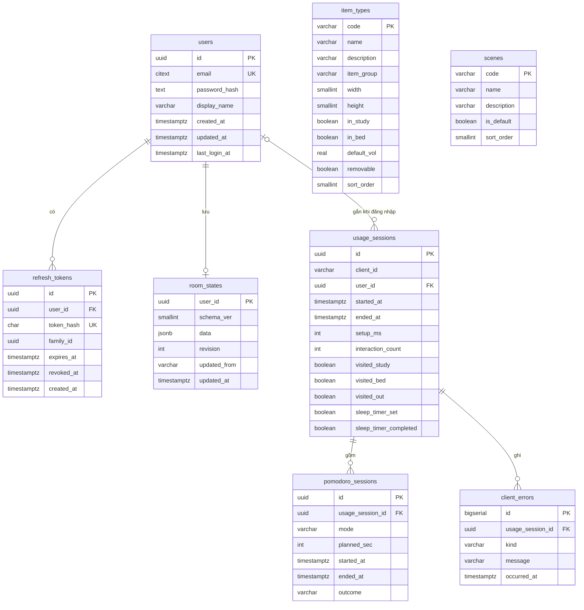

# FocuSpace — Thiết kế Database

> Trạng thái: **BẢN NHÁP — chờ duyệt** · 08/11/2026 · cập nhật 10/11/2026 theo đề bài đồ án CSB25022 (thêm bảng danh mục, seeder, truy vấn trang Thống kê) · cập nhật 12/11/2026 theo Chương 1 Phân tích hệ thống (truy vết use case, ánh xạ lớp ↔ bảng)
> Nguồn: ERD trong `docs/ARCHITECTURE.md` (Hình 4, mục 3.3) · `docs/API.md` · `docs/PRD.md` (mục 4.2, 5.2, 6.2) · `FocuSpace_Diagrams.drawio`, Chương 1 Phân tích hệ thống (Class C1).
> Các cột/ràng buộc có nhãn **[Bổ sung]** không có trong ERD nhưng API hoặc PRD cần — cần duyệt trước Phase 6.

## 1. Tổng quan

- PostgreSQL 16, truy cập qua Prisma.
- Extension: `citext` (email không phân biệt hoa thường), `pgcrypto` (`gen_random_uuid()`).
- Tên bảng/cột `snake_case`; API dùng `camelCase` (Prisma `@map`).
- Thời gian: `timestamptz`, lưu UTC.
- Seeder chỉ nạp dữ liệu danh mục có sẵn trong prototype: 17 loại đồ vật và 5 khung cảnh (mục 3.7, 3.8). Không tạo người dùng, phòng hay số liệu mẫu (PRD Q-13).
- Đề bài cho phép MySQL hoặc PostgreSQL; dự án dùng PostgreSQL.

## 2. ERD



`item_types` và `scenes` là bảng danh mục, không có khóa ngoại: `Item.type` trong `room_states.data` (JSONB) và `out.scene` tham chiếu tới `code` về mặt logic, được kiểm tra bằng schema Zod dùng chung.

### Ánh xạ với biểu đồ lớp thực thể (Chương 1, Class C1)

| Lớp (Class C1) | Bảng / đối tượng | Ánh xạ thuộc tính |
|---|---|---|
| ThanhVien | `users` | id↔id, email↔email, matKhauBam↔password_hash, tenHienThi↔display_name, ngayTao↔created_at, ngayCapNhat↔updated_at, lanDangNhapCuoi↔last_login_at |
| RefreshToken | `refresh_tokens` | id↔id, tokenBam↔token_hash, familyId↔family_id, hetHan↔expires_at, thuHoiLuc↔revoked_at, ngayTao↔created_at |
| BanLuuPhong | `room_states` | schemaVer↔schema_ver, data (= TrangThaiPhong, JSONB)↔data, revision↔revision, capNhatTu↔updated_from, capNhatLuc↔updated_at |
| TrangThaiPhong, KhongGianTrongNha, PhongHoc, PhongNgu, SanVuon, DoVat | Đối tượng `RoomState` (API Phụ lục A; `shared/src/roomState.ts`) | Không phải bảng riêng; nằm trong `room_states.data` và LocalStorage `focuspace.room.v4` |
| LoaiDoVat | `item_types` | ma↔code, ten↔name, moTa↔description, nhom↔item_group, rong↔width, cao↔height, dungOPhongHoc↔in_study, dungOPhongNgu↔in_bed, amLuongMacDinh↔default_vol, xoaDuoc↔removable, thuTu↔sort_order |
| KhungCanh | `scenes` | ma↔code, ten↔name, moTa↔description, macDinh↔is_default, thuTu↔sort_order |
| PhienSuDung | `usage_sessions` | id↔id, clientId↔client_id, (liên kết ThanhVien 0..1)↔user_id, batDau↔started_at, ketThuc↔ended_at, setupMs↔setup_ms, soTuongTac↔interaction_count, daGhePhongHoc/PhongNgu/SanVuon↔visited_study/bed/out, henGioNguDat↔sleep_timer_set, henGioNguHoanThanh↔sleep_timer_completed |
| PhienPomodoro | `pomodoro_sessions` | id↔id, cheDo↔mode, thoiLuongDuKien↔planned_sec, batDau↔started_at, ketThuc↔ended_at, ketQua↔outcome |
| LoiClient | `client_errors` | id (bigserial)↔id, loai↔kind, thongDiep↔message, xayRaLuc↔occurred_at |
| Khach | (chỉ phía trình duyệt) | clientId ẩn danh + LocalStorage |

## 3. Chi tiết bảng

### 3.1 `users`

| Cột | Kiểu | Null | Mặc định | Ràng buộc / ghi chú |
|---|---|---|---|---|
| id | uuid | Không | `gen_random_uuid()` | PK |
| email | citext | Không | | UNIQUE; ≤ 254 ký tự (BR-08) |
| password_hash | text | Không | | Argon2id (PRD 6.2) |
| display_name | varchar(40) | Không | | 1–40 ký tự |
| created_at | timestamptz | Không | `now()` | |
| updated_at | timestamptz | Không | `now()` | Prisma `@updatedAt` |
| last_login_at | timestamptz | Có | | Cập nhật khi `POST /auth/login` |

### 3.2 `refresh_tokens`

| Cột | Kiểu | Null | Mặc định | Ràng buộc / ghi chú |
|---|---|---|---|---|
| id | uuid | Không | `gen_random_uuid()` | PK |
| user_id | uuid | Không | | FK → users.id, `ON DELETE CASCADE` |
| token_hash | char(64) | Không | | UNIQUE; SHA-256 hex của token 256 bit — chỉ lưu bản băm |
| family_id | uuid | Không | | Chuỗi xoay vòng; dùng lại token đã thu hồi → thu hồi cả family |
| expires_at | timestamptz | Không | | created_at + 30 ngày |
| revoked_at | timestamptz | Có | | Khác NULL = đã thu hồi |
| created_at | timestamptz | Không | `now()` | **[Bổ sung]** để audit |

Index: `(user_id)`, `(family_id)`.

### 3.3 `room_states`

| Cột | Kiểu | Null | Mặc định | Ràng buộc / ghi chú |
|---|---|---|---|---|
| user_id | uuid | Không | | PK, FK → users.id, `ON DELETE CASCADE` (1 dòng/người dùng) |
| schema_ver | smallint | Không | | Hiện là 4 |
| data | jsonb | Không | | RoomState (API Phụ lục A); **[Bổ sung]** `CHECK (octet_length(data::text) <= 65536)` (BR-06) |
| revision | int | Không | | ≥ 1; tăng 1 mỗi lần ghi (optimistic concurrency) |
| updated_from | varchar(64) | Không | | `deviceId` của lần ghi cuối |
| updated_at | timestamptz | Không | `now()` | |

Ghi có kiểm tra revision trong một câu lệnh:

```sql
UPDATE room_states
SET data = $data, schema_ver = $ver, revision = revision + 1, updated_from = $device, updated_at = now()
WHERE user_id = $uid AND (revision = $baseRevision OR $force)
RETURNING revision, updated_at;
-- 0 dòng → đọc bản hiện tại, trả 409 REVISION_CONFLICT
-- chưa có dòng và baseRevision = 0 → INSERT revision = 1
```

### 3.4 `usage_sessions`

| Cột | Kiểu | Null | Mặc định | Ràng buộc / ghi chú |
|---|---|---|---|---|
| id | uuid | Không | | PK, client sinh; gửi lại → upsert |
| client_id | varchar(64) | Không | | Id ẩn danh của trình duyệt |
| user_id | uuid | Có | | FK → users.id, `ON DELETE SET NULL` |
| started_at | timestamptz | Không | | |
| ended_at | timestamptz | Có | | NULL = chưa kết thúc |
| setup_ms | int | Có | | ≥ 0; KPI thiết lập < 15 giây |
| interaction_count | int | Không | 0 | ≥ 0 |
| visited_study | boolean | Không | false | **[Bổ sung]** từ `sessions[].visited` |
| visited_bed | boolean | Không | false | **[Bổ sung]** |
| visited_out | boolean | Không | false | **[Bổ sung]** — PRD 4.2 dùng `usage_sessions.visited_out` |
| sleep_timer_set | boolean | Không | false | **[Bổ sung]** — PRD 4.2 `sleep_timer_*` |
| sleep_timer_completed | boolean | Không | false | **[Bổ sung]** |

Index: `(client_id, started_at)`, `(user_id, started_at)`, `(started_at)`.

Ghi chú: `user_id` NULL khi Khách; gắn khi gửi lô kèm access token; đặt NULL khi xóa tài khoản (UC.11) nhờ `ON DELETE SET NULL` — khớp đặc tả UC.11 (“số liệu telemetry được giữ nhưng tách khỏi tài khoản”).

### 3.5 `pomodoro_sessions`

| Cột | Kiểu | Null | Mặc định | Ràng buộc / ghi chú |
|---|---|---|---|---|
| id | uuid | Không | | PK, client sinh; upsert |
| usage_session_id | uuid | Không | | FK → usage_sessions.id, `ON DELETE CASCADE` |
| mode | varchar(8) | Không | | `CHECK (mode IN ('focus','break'))` |
| planned_sec | int | Không | | > 0 (focus 1500, break 300) |
| started_at | timestamptz | Không | | **[Bổ sung]** — API `pomodoros[].startedAt` |
| ended_at | timestamptz | Có | | **[Bổ sung]** — API `pomodoros[].endedAt` |
| outcome | varchar(12) | Không | | `CHECK (outcome IN ('completed','reset','abandoned'))` |

Index: `(usage_session_id)`.

Ý nghĩa `outcome` (PRD Tính năng G): `completed` — hết giờ; `reset` — người dùng bấm Đặt lại; `abandoned` — phiên đang chạy khi tải lại hoặc đóng tab (**[Đề xuất]** gửi trong lô khi tab bị ẩn bằng `fetch keepalive`).

### 3.6 `client_errors`

| Cột | Kiểu | Null | Mặc định | Ràng buộc / ghi chú |
|---|---|---|---|---|
| id | bigserial | Không | | PK |
| usage_session_id | uuid | Không | | FK → usage_sessions.id, `ON DELETE CASCADE` |
| kind | varchar(32) | Không | | `CHECK (kind IN ('audio_context_create','audio_context_resume','storage_write'))` |
| message | varchar(500) | Có | | **[Bổ sung]** — API `errors[].message ≤ 500` |
| occurred_at | timestamptz | Không | | |

Index: `(usage_session_id)`, `(occurred_at)`.
**[Bổ sung]** `UNIQUE (usage_session_id, kind, occurred_at)` để gửi trùng lô không ghi trùng lỗi (API không gửi id cho lỗi).

### 3.7 `item_types` (danh mục đồ vật — có seeder)

| Cột | Kiểu | Null | Mặc định | Ràng buộc / ghi chú |
|---|---|---|---|---|
| code | varchar(16) | Không | | PK; trùng `Item.type` (API Phụ lục A) |
| name | varchar(40) | Không | | Tên hiển thị |
| description | varchar(80) | Có | | Mô tả âm thanh/công dụng (`sub` trong prototype) |
| item_group | varchar(8) | Không | | `CHECK (item_group IN ('sound','decor','desk'))` |
| width, height | smallint | Không | | > 0; kích thước theo hệ 320×180 |
| in_study | boolean | Không | false | Dùng được ở Phòng học |
| in_bed | boolean | Không | false | Dùng được ở Phòng ngủ |
| default_vol | real | Có | | 0–1; chỉ đồ phát âm thanh |
| removable | boolean | Không | true | false với đèn bàn, ly cà phê (BR-03) |
| sort_order | smallint | Không | | UNIQUE; thứ tự hiển thị |

Dữ liệu seeder (lấy nguyên từ hằng số `TYPES`, `STUDY_TYPES`, `BED_ITEM_TYPES` của prototype):

| sort | code | name | group | w×h | Phòng học | Phòng ngủ | default_vol | description |
|---|---|---|---|---|---|---|---|---|
| 1 | tv | Tivi CRT | sound | 26×26 | ✓ | | 0.35 | Nhiễu sóng trắng |
| 2 | cat | Mèo ngủ | sound | 24×13 | ✓ | ✓ | 0.6 | Rù rù khẽ, êm dịu |
| 3 | clock | Đồng hồ Pomodoro | sound | 24×12 | ✓ | ✓ | 0.4 | Tích tắc nhẹ, đếm giờ Pomodoro |
| 4 | radio | Radio | sound | 20×12 | | ✓ | 0.5 | Nhạc Lo-fi |
| 5 | diffuser | Máy xông tinh dầu | sound | 14×16 | | ✓ | 0.4 | Nước sủi bọt lăn tăn |
| 6 | vinyl | Đĩa than | sound | 26×16 | | ✓ | 0.5 | Lofi Sleep, rãnh đĩa |
| 7 | musicbox | Hộp nhạc | sound | 14×16 | | ✓ | 0.45 | Nhạc chuông ru ngủ |
| 8 | fan | Quạt bàn | sound | 18×22 | | ✓ | 0.35 | Gió nhẹ ru ngủ |
| 9 | bigplant | Chậu cây lớn | decor | 24×50 | ✓ | ✓ | | |
| 10 | catbed | Giường mèo | decor | 30×10 | | ✓ | | |
| 11 | plant | Chậu cây | decor | 12×16 | ✓ | ✓ | | |
| 12 | cactus | Xương rồng | decor | 10×14 | ✓ | ✓ | | |
| 13 | books | Chồng sách | decor | 14×10 | ✓ | ✓ | | |
| 14 | frame | Khung ảnh | decor | 14×12 | ✓ | ✓ | | |
| 15 | candle | Nến | decor | 6×12 | ✓ | ✓ | | |
| 16 | lamp | Đèn bàn | desk | 20×24 | ✓ | | | Ánh sáng vàng ấm |
| 17 | cup | Ly cà phê | desk | 12×14 | ✓ | | | Kéo để di chuyển |

`removable = false` cho `lamp`, `cup`; còn lại `true`.

### 3.8 `scenes` (khung cảnh Sân vườn — có seeder)

| Cột | Kiểu | Null | Mặc định | Ràng buộc / ghi chú |
|---|---|---|---|---|
| code | varchar(16) | Không | | PK; trùng `out.scene` (API Phụ lục A) |
| name | varchar(40) | Không | | |
| description | varchar(80) | Không | | Mô tả âm nền |
| is_default | boolean | Không | false | Đúng một dòng true (partial unique index `WHERE is_default`) |
| sort_order | smallint | Không | | UNIQUE |

Dữ liệu seeder (hằng số `SCENES` của prototype; mặc định theo `DEFAULT_STATE`):

| sort | code | name | is_default | description |
|---|---|---|---|---|
| 1 | city | Thành phố | | Buổi tối, xe cộ lofi chill êm dịu |
| 2 | forest | Khu rừng | ✓ | Gió xào xạc lá, chim hót |
| 3 | beach | Bãi biển | | Sóng vỗ bờ, hải âu |
| 4 | glacier | Núi băng | | Hồ núi, suối băng róc rách êm |
| 5 | hill | Đồi ven biển | | Biển xa, mây trôi, gió nhẹ |

## 4. Ánh xạ API ↔ bảng

| Endpoint | Bảng | Use case |
|---|---|---|
| POST /auth/register | users (INSERT), refresh_tokens (INSERT) | UC.08 |
| POST /auth/login | users (đọc, cập nhật last_login_at), refresh_tokens (INSERT) | UC.08 |
| POST /auth/refresh | refresh_tokens (thu hồi cũ, INSERT mới; dùng lại → thu hồi cả family) | UC.09 |
| POST /auth/logout | refresh_tokens (thu hồi) | UC.11 |
| GET / PATCH /me | users | UC.11 |
| DELETE /me | users (DELETE → cascade refresh_tokens, room_states; usage_sessions.user_id = NULL) | UC.11 |
| GET / PUT /room-state | room_states | UC.09 (PUT kích hoạt bởi UC.02–UC.04) |
| POST /telemetry/batch | usage_sessions, pomodoro_sessions, client_errors (upsert) | UC.05, UC.06 (include Ghi nhận số liệu sử dụng), UC.03, UC.10 |
| GET /catalog/items | item_types (lọc `in_study`/`in_bed`, `item_group`) | UC.07 |
| GET /catalog/scenes | scenes | UC.07 |
| GET /me/stats | pomodoro_sessions ⨝ usage_sessions (lọc `user_id`) | UC.10 |
| GET /health | `SELECT 1` | — (vận hành) |

Use case không đọc/ghi bảng trực tiếp: UC.01, UC.12 (chỉ phía trình duyệt); UC.02 – UC.04 ghi LocalStorage, lên `room_states.data` gián tiếp qua UC.09.

## 5. Truy vấn KPI (PRD 4)

```sql
-- North Star: thời lượng phiên trung bình (phút)
SELECT avg(extract(epoch FROM ended_at - started_at)) / 60 FROM usage_sessions WHERE ended_at IS NOT NULL;

-- Thời gian thiết lập trung bình (ms), mục tiêu < 15000
SELECT avg(setup_ms) FROM usage_sessions WHERE setup_ms IS NOT NULL;

-- Tỷ lệ hoàn thành Pomodoro focus, mục tiêu ≥ 70%
SELECT avg((outcome = 'completed')::int) FROM pomodoro_sessions WHERE mode = 'focus';

-- Tỷ lệ phiên có lỗi Audio Context, mục tiêu < 0,05%
SELECT count(DISTINCT e.usage_session_id)::float / nullif((SELECT count(*) FROM usage_sessions), 0)
FROM client_errors e WHERE e.kind LIKE 'audio_context_%';

-- Tỷ lệ ghé Sân vườn / phiên ngủ chạy hết
SELECT avg(visited_out::int), avg(sleep_timer_completed::int) FILTER (WHERE sleep_timer_set) FROM usage_sessions;

-- Retention D7 theo client_id (thay 7 bằng 30 cho D30)
WITH first AS (SELECT client_id, min(started_at)::date AS d0 FROM usage_sessions GROUP BY client_id)
SELECT avg((EXISTS (SELECT 1 FROM usage_sessions s WHERE s.client_id = f.client_id
                     AND s.started_at::date = f.d0 + 7))::int)
FROM first f WHERE f.d0 <= current_date - 7;

-- GET /me/stats (dùng cho UC.10 – StatsService.layThongKe): tổng trong khoảng [$from, $to] (ngày theo múi giờ $tz) của một người dùng
SELECT
  coalesce(sum(extract(epoch FROM p.ended_at - p.started_at))
           FILTER (WHERE p.mode = 'focus' AND p.ended_at IS NOT NULL), 0)::int / 60 AS focus_minutes,
  count(*) FILTER (WHERE p.mode = 'focus' AND p.outcome = 'completed')        AS pomodoro_completed,
  count(*) FILTER (WHERE p.mode = 'focus')                                    AS pomodoro_started
FROM pomodoro_sessions p
JOIN usage_sessions u ON u.id = p.usage_session_id
WHERE u.user_id = $uid
  AND (p.started_at AT TIME ZONE $tz)::date BETWEEN $from AND $to;
-- daily: cùng điều kiện, GROUP BY (p.started_at AT TIME ZONE $tz)::date, ghép với generate_series($from, $to, '1 day') để có cả ngày bằng 0
-- sessions: count(*) FROM usage_sessions WHERE user_id = $uid AND (started_at AT TIME ZONE $tz)::date BETWEEN $from AND $to
```

## 6. Lưu giữ & migration

- Telemetry giữ 400 ngày; job hằng đêm xóa `usage_sessions` có `started_at` quá hạn (cascade sang hai bảng con).
- Token: job hằng đêm xóa `refresh_tokens` hết hạn > 30 ngày.
- Migration bằng `prisma migrate`; chỉ thêm cột/bảng, xóa cột ở lần phát hành sau (ARCHITECTURE 4.2).
- Đổi cấu trúc RoomState: tăng `schemaVer`, thêm bước migrate trong `shared/`; server migrate khi đọc, không migrate hàng loạt.
- Seeder `backend/prisma/seed.ts` đọc `shared/src/catalog.ts` (cùng nguồn với engine — DRY) và `upsert` theo `code`, nên chạy lại không trùng; khai báo trong `package.json` (`"prisma": { "seed": … }`).
- Lệnh: `npx prisma migrate dev` (máy dev, tạo migration), `npx prisma migrate deploy` (staging/production), `npx prisma db seed` (nạp danh mục; tự chạy sau `migrate reset`).

## 7. Câu hỏi cần duyệt

1. Lưu `visited` dạng 3 cột boolean (theo tên `visited_out` trong PRD) hay một cột `text[]`? Bản nháp chọn 3 cột boolean.
2. Ràng buộc chống trùng cho `client_errors` như mục 3.6 có được không?
3. Băm refresh token bằng SHA-256 (char(64)) có được không?
4. Hai bảng danh mục `item_types`, `scenes` và dữ liệu seeder ở mục 3.7, 3.8 (lấy từ prototype) có được duyệt không?
5. Có cần tài khoản demo / số liệu mẫu cho video demo không (PRD Q-13)? Nếu có, nhóm cung cấp nội dung; seeder hiện chỉ nạp danh mục.

## 8. Lịch sử thay đổi

| Ngày | Thay đổi |
|---|---|
| 08/11/2026 | Bản nháp đầu. |
| 10/11/2026 | Thêm bảng danh mục, seeder, truy vấn trang Thống kê theo đề bài đồ án. |
| 12/11/2026 | Đồng bộ với Chương 1 Phân tích hệ thống: thêm bảng ánh xạ lớp thực thể (Class C1) ↔ bảng sau ERD; ghi chú `usage_sessions.user_id` và ý nghĩa `pomodoro_sessions.outcome`; mục 4 thêm cột Use case; truy vấn `/me/stats` ghi chú UC.10. Không đổi bảng, cột, ràng buộc. |
