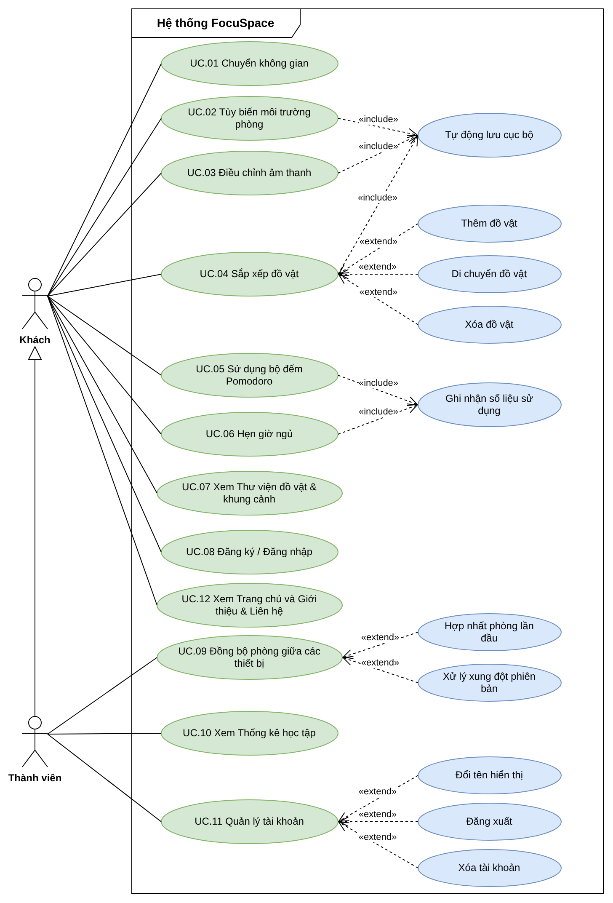
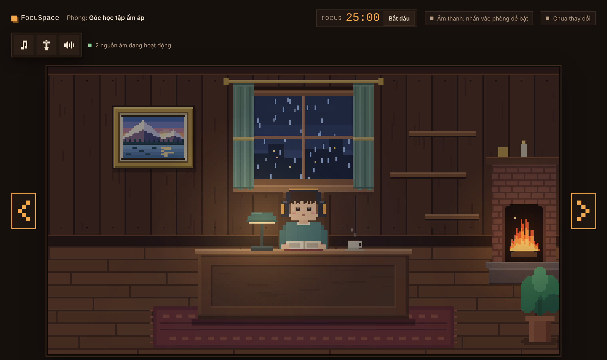
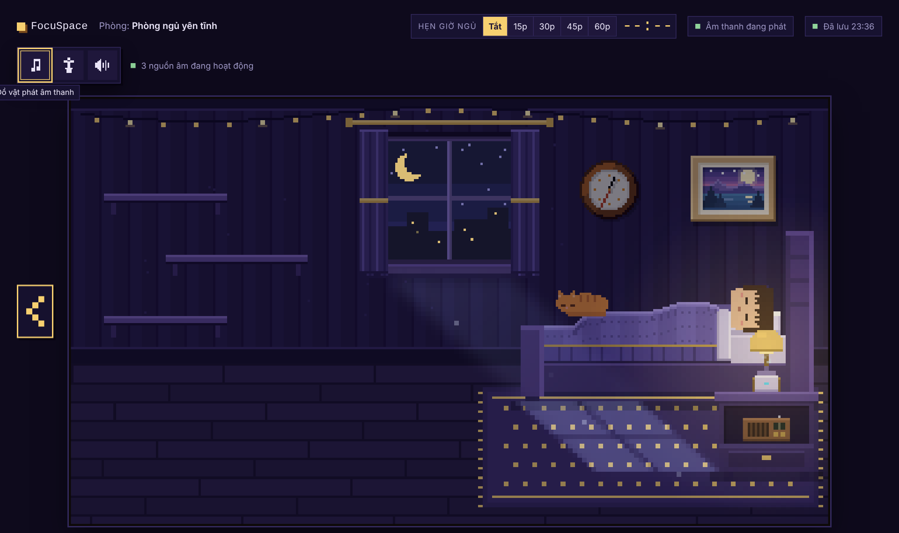
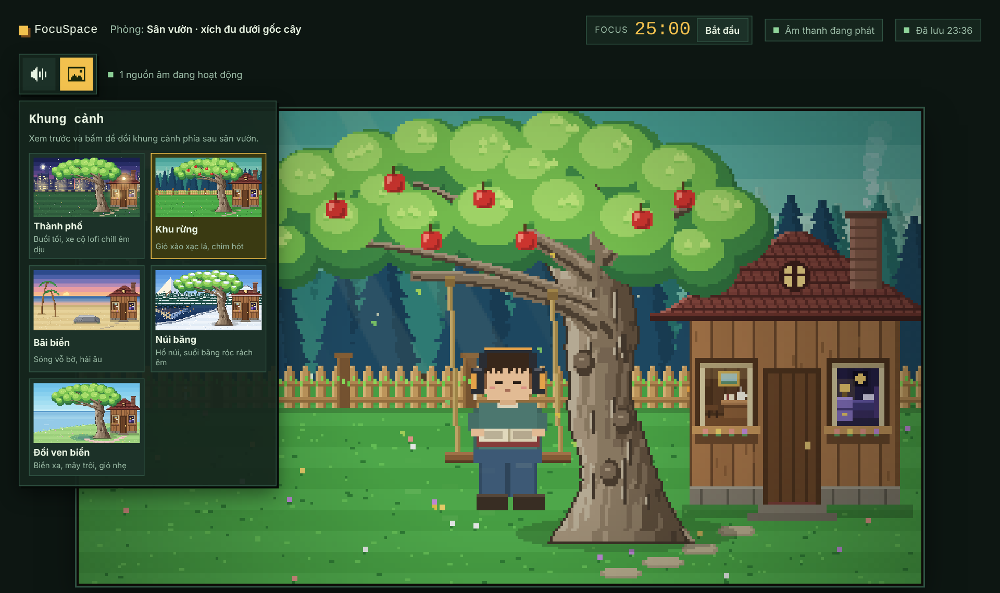
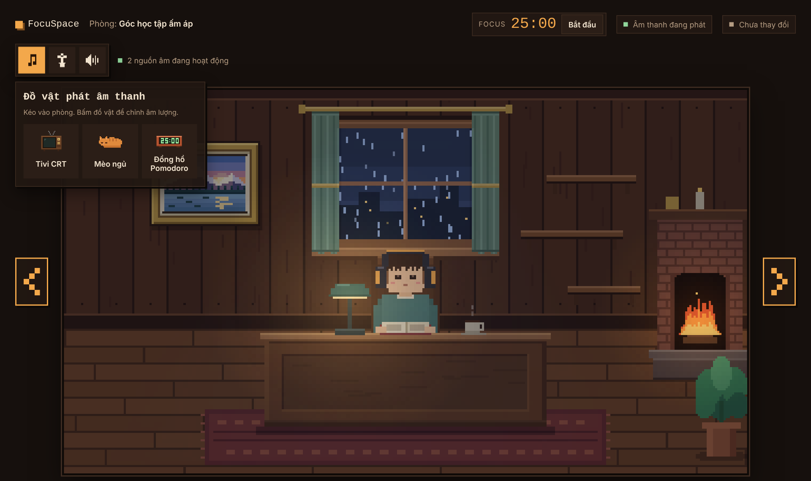
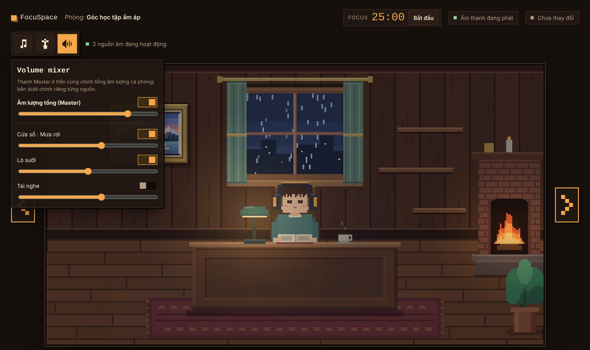
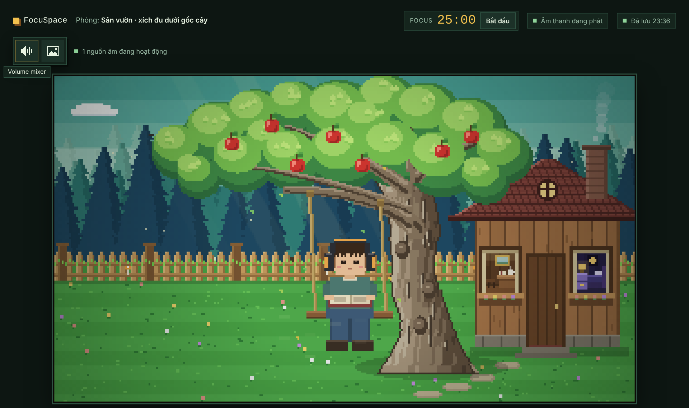

> Bản chính thức duy nhất (bản Word cũ `docs/FocuSpace_PRD.docx` đã gộp vào file này ngày 13/11/2026; cần bản Word thì xuất bằng `pandoc docs/PRD.md -o FocuSpace_PRD.docx`). Đối chiếu lần cuối với `prototype/FocuSpace-Semi-Sandbox.html` ngày 10/11/2026.

# FocuSpace — Tài liệu yêu cầu sản phẩm (PRD)

Căn phòng Semi-Sandbox · Phòng học · Phòng ngủ · Sân vườn

|                   |                                                                                                  |
|-------------------|--------------------------------------------------------------------------------------------------|
| **Sản phẩm**      | FocuSpace — web app pixel art Lo-fi Semi-Sandbox                                                 |
| **Phiên bản**     | v5.4 (bảng mã FR đầy đủ, bỏ mốc Go-live; thay v5.3) |
| **Trạng thái**    | v5.0 đã phê duyệt 07/11/2026 · v5.1 – v5.4 đã duyệt ở buổi họp kế hoạch 13/11/2026 |
| **Ngày cập nhật** | 13/11/2026 (v5.4 — bảng mã FR, bỏ Go-live) |
| **Nguồn**         | prototype/FocuSpace-Semi-Sandbox.html (tiêu đề trang “FocuSpace Semi-Sandbox 9”) · docs/PRD.md · PRD v2–v4 · FocuSpace_Semi_Sandbox_PRD · đề bài Final Project Brief CSB25022 · FocuSpace_Diagrams.drawio, Chương 1 Phân tích hệ thống |

# 1. Thông tin chung (Metadata)

| **Tên sản phẩm / tính năng** | FocuSpace — Căn phòng Semi-Sandbox ba không gian (Góc học tập ấm áp · Phòng ngủ yên tĩnh · Sân vườn · xích đu dưới gốc cây), bản chính thức |
|---|---|
| **Chủ sở hữu (Product Owner / PM)** | Cao Lê Phúc Thịnh (theo PRD Semi-Sandbox gốc) |
| **Đội ngũ tham gia** | Tuấn Hưng (đồ vật, âm thanh) · Đình Nhiên (Sân vườn) · Tuấn Lộc (Phòng ngủ) · Phúc Thịnh (Phòng học, quản lý repo, các trang còn lại) · chi tiết docs/PLAN.md mục 2 |
| **Trạng thái tài liệu** | v5.0 đã phê duyệt 07/11/2026 · v5.1 – v5.4 đã duyệt ở buổi họp kế hoạch 13/11/2026 |
| **Ngày cập nhật** | 13/11/2026 (v5.4 — bảng mã FR, bỏ Go-live) |
| **Phiên bản** | v5.4 |
| **Tài liệu liên quan** | Tài liệu Kiến trúc giải pháp · API Docs · docs/DATABASE.md · docs/PLAN.md · Final Project Brief CSB25022 · FocuSpace_Diagrams.drawio · Chương 1 Phân tích hệ thống (FocuSpace_Chuong2_PhanTich.docx) |

> **Quy tắc nguồn:** Khi hai nguồn mâu thuẫn, nguồn mới hơn thắng: tài liệu này \> prototype FocuSpace-Semi-Sandbox.html \> PRD .docx cũ. Mọi hành vi giao diện mô tả theo prototype FocuSpace-Semi-Sandbox.html. Yêu cầu của đề bài đồ án môn Web (CSB25022) đứng trên mọi nguồn.

# 2. Tổng quan & Bối cảnh (Overview & Context)

## 2.1 Mục tiêu sản phẩm (Objective)

FocuSpace giải quyết bốn vấn đề của người học và làm việc buổi tối bằng tai nghe:

- **Canvas thiên nhiên tĩnh nhanh nhàm:** các web âm thanh nền dạng “chấm icon trên ảnh phong cảnh” thiếu câu chuyện thị giác và gắn kết cảm xúc.

- **Sandbox hoàn toàn gây kiệt sức vì lựa chọn (Decision Fatigue):** phải tự kê bàn, xếp ghế, chọn kích thước khiến người dùng mất tập trung khỏi việc học.

- **Âm stereo đơn điệu, chói tai:** người đeo tai nghe nhiều giờ khó chịu với âm nền phẳng hoặc gắt.

- **Thiếu chuyển mạch mượt giữa học – nghỉ – ngủ:** người dùng phải đổi qua lại nhiều ứng dụng (Pomodoro, nhạc, hẹn giờ ngủ).

**Lời giải Semi-Sandbox:** cho sẵn ba không gian pixel art dựng hoàn chỉnh; người dùng chỉ tùy biến âm thanh không gian 2D, môi trường (thời tiết, rèm, khung cảnh) và vài đồ vật kéo thả. Mục tiêu: vào phòng là học được ngay, thiết lập dưới 15 giây.

**Vì sao làm ngay lúc này:** prototype đã qua 10 vòng chỉnh sửa và được duyệt ngày 07/11/2026 (FocuSpace-Semi-Sandbox.html); tài liệu kỹ thuật đã duyệt cùng ngày; mốc cuối là nộp đồ án ngày 27/11/2026 (không có mốc ra mắt riêng, Q-08).

## 2.2 Tầm nhìn (Vision)

FocuSpace hướng tới trở thành “người bạn học ảo” (Virtual Body Doubling): một không gian ấm cúng người dùng quay lại mỗi ngày để học, nghỉ và ngủ. Lộ trình dài hạn theo các PRD trước gồm: chia sẻ ảnh góc pixel lên mạng xã hội để lan tỏa tự nhiên, phòng học nhóm thời gian thực và kết nối dịch vụ nhạc. Các hạng mục này nằm ngoài phạm vi phiên bản hiện tại.

> **Cần xác nhận:** Tài liệu nguồn không mô tả chiến lược dài hạn của công ty; phần Tầm nhìn tổng hợp từ mục tiêu tăng trưởng và roadmap trong các PRD trước. Cần PO xác nhận.

## 2.3 Phạm vi (Scope)

### Trong phạm vi (In-scope)

- Ba không gian dựng sẵn: Góc học tập ấm áp, Phòng ngủ yên tĩnh, Sân vườn · xích đu dưới gốc cây; chuyển phòng bằng mũi tên và cửa nhà.

- Đồ vật phát âm và đồ trang trí kéo thả, tự bám bề mặt, giá để đồ, ngăn tủ, giường mèo.

- Âm thanh không gian 2D theo vị trí, Volume mixer có âm lượng tổng (Master).

- Thời tiết cửa sổ, rèm 3 mức, lò sưởi, thảm đổi họa tiết, đèn; 5 khung cảnh Sân vườn có ảnh xem trước.

- Một bộ đếm Pomodoro dùng chung; Hẹn giờ ngủ ở Phòng ngủ.

- Tự động lưu cục bộ; chế độ khách; tài khoản email/mật khẩu tùy chọn và đồng bộ cloud.

- Ghi số liệu để đo KPI (phiên dùng, Pomodoro, lỗi âm thanh).

- Website nhiều trang có thanh điều hướng chung: Trang chủ, Căn phòng, Thư viện, Thống kê, Tài khoản, Giới thiệu & Liên hệ (Tính năng J).

- Hai trang động lấy dữ liệu từ PostgreSQL: Thư viện đồ vật và khung cảnh, Thống kê học tập (Tính năng K, L).

- Giao diện dựng bằng Tailwind CSS, responsive cho mobile, tablet và desktop.

- Theo dõi hành vi bằng Google Analytics 4, ghi lỗi bằng Sentry, tối ưu theo Google Lighthouse (Tính năng M).

- Cơ sở dữ liệu có migration và seeder nạp dữ liệu danh mục ban đầu.

### Ngoài phạm vi (Out-of-scope)

- Phòng học nhóm thời gian thực (WebSocket).

- Kết nối Spotify / Apple Music.

- Đăng nhập Google/OAuth (đã chốt chỉ email/mật khẩu).

- Xây/phá tường, di chuyển nhân vật, bàn, ghế, giường, tủ, nhà, cây, xích đu.

- Xoay hoặc đổi kích thước đồ vật; va chạm vật lý.

- File âm thanh thu sẵn (đã chốt âm thanh tổng hợp bằng code).

### Ma trận giới hạn tương tác Semi-Sandbox

| **Thao tác**                                                | **Có?** | **Ghi chú**                                               |
|-------------------------------------------------------------|---------|-----------------------------------------------------------|
| Bật/tắt âm thanh đồ vật                                     | CÓ      | Chuyển mượt 0,2 giây; làm trong popover hoặc Volume mixer |
| Thêm đồ vật từ khay                                         | CÓ      | Khay mở xuống dưới thanh công cụ                          |
| Xóa đồ vật                                                  | CÓ      | Trừ đèn bàn và ly cà phê                                  |
| Di chuyển đồ vật                                            | CÓ      | Theo quy tắc đặt đồ (mục 5, BR-04)                        |
| Đổi chỗ lò sưởi trái/phải                                   | CÓ      | Chọn trong popover, không kéo                             |
| Di chuyển nhân vật, bàn, ghế, giường, tủ, nhà, cây, xích đu | KHÔNG   | Cấu trúc nền tĩnh, giữ điểm nghe cố định                  |
| Xoay, đổi kích thước                                        | KHÔNG   | Giữ pixel art 2D đúng tỷ lệ                               |
| Va chạm vật lý                                              | KHÔNG   | Thứ tự hiển thị theo toạ độ Y                             |

## 2.4 Bối cảnh đồ án môn học

FocuSpace là đồ án cuối kỳ làm theo nhóm của môn Web Design and Development (CSB25022, VNUK), chiếm 50% điểm, làm từ 27/10 đến 27/11/2026, chia 5 sprint (S1–S2 thiết kế và lập kế hoạch, S3–S5 lập trình). Bảng dưới là các ràng buộc của đề bài và cách sản phẩm đáp ứng; bảng đối chiếu đầy đủ từng tiêu chí chấm với tài liệu và phase nằm trong docs/PLAN.md mục 1.

| **Ràng buộc của đề bài** | **Cách FocuSpace đáp ứng** | **Mục trong PRD** |
|---|---|---|
| Website ít nhất 3 trang (trang chủ, trang nội dung, About/Contact), liên kết với nhau | 6 trang, thanh điều hướng chung ở mọi trang | Tính năng J |
| Style bằng Tailwind CSS | Mọi giao diện ngoài canvas dùng utility class của Tailwind | 6.3 |
| Tương tác bằng JavaScript | Kéo thả, popover, mixer, Pomodoro, form đăng ký có kiểm tra dữ liệu, bộ lọc Thư viện | Tính năng A–L |
| Responsive trên nhiều cỡ màn hình | Mobile \< 640 px, tablet 640–1023 px, desktop ≥ 1024 px | 6.3 |
| Cơ sở dữ liệu MySQL/PostgreSQL, thao tác CRUD | PostgreSQL 16; tạo, đọc, sửa, xóa tài khoản và trạng thái phòng | Tính năng H |
| Ít nhất 2 trang động lấy dữ liệu từ cơ sở dữ liệu | Thư viện và Thống kê (thêm Tài khoản) | Tính năng K, L |
| Migration và seeder dữ liệu ban đầu | Prisma migrate; seeder nạp 17 loại đồ vật và 5 khung cảnh lấy từ prototype | BR-12 |
| Tối ưu theo Google Lighthouse | Mục tiêu ≥ 90 cho cả 4 nhóm điểm ở mọi trang | 6.1 |
| Google Analytics và công cụ ghi lỗi (Sentry) | GA4 cho lượt xem và sự kiện; Sentry cho lỗi frontend và backend | Tính năng M |
| Wireframe cho mọi trang chính | Wireframe Figma cho 6 trang, kèm prototype tương tác của Căn phòng | 5.3 |

# 3. Người dùng mục tiêu & Bài toán

## 3.1 Chân dung người dùng (User Persona)

|                 |                                                                                                                                              |
|-----------------|----------------------------------------------------------------------------------------------------------------------------------------------|
| **Tên / tuổi**  | Linh, 20 tuổi                                                                                                                                |
| **Nghề nghiệp** | Sinh viên CNTT / freelancer                                                                                                                  |
| **Thói quen**   | Học và chạy deadline buổi tối; đeo tai nghe chống ồn liên tục nhiều giờ                                                                      |
| **Nỗi đau**     | Ngột ngạt khi quá yên tĩnh nhưng nhạy cảm với âm chói, stereo đơn điệu; mất thời gian bật nhiều app cho nhạc, Pomodoro, hẹn giờ ngủ          |
| **Kỳ vọng**     | Mở web là có ngay căn phòng pixel ấm áp như đang học cùng một người bạn; nghỉ giữa giờ ở góc ngoài trời; đi ngủ với âm dịu có hẹn giờ tự tắt |

## 3.2 Câu chuyện người dùng (User Stories)

| **Mã** | **Câu chuyện**                                                                                                                                              | **Yêu cầu liên quan**  | **Use case** |
|--------|-------------------------------------------------------------------------------------------------------------------------------------------------------------|------------------------|---|
| US-01  | Với tư cách là người dùng bận rộn, tôi muốn căn phòng có sẵn bàn ghế và nhân vật ngồi học ngay khi mở ứng dụng, để không mất thời gian chuẩn bị không gian. | FR-STUDY-01, 08        | UC.01, UC.02 |
| US-02  | Với tư cách là người dùng, tôi muốn bấm vào cửa sổ để đổi thời tiết và kéo rèm, để tạo bầu không khí hợp tâm trạng.                                         | FR-STUDY-02, FR-BED-02 | UC.02 |
| US-03  | Với tư cách là người đeo tai nghe, tôi muốn kéo chiếc Tivi sang góc trái phòng, để tiếng nhiễu sóng phát chủ yếu bên tai trái như thật.                     | FR-ITEM-04, FR-AUD-02  | UC.03, UC.04 |
| US-04  | Với tư cách là người dùng, tôi muốn bật/tắt lò sưởi và chỉnh to nhỏ tiếng củi, để kiểm soát âm nền ấm áp.                                                   | FR-STUDY-03            | UC.02, UC.03 |
| US-05  | Với tư cách là người dùng, tôi muốn kéo thêm một chú mèo ngủ đặt cạnh mình, để có bạn đồng hành ảo kêu rù rù.                                               | FR-ITEM-02, FR-AUD-05  | UC.04 |
| US-06  | Với tư cách là người dùng, tôi muốn phòng được lưu tự động, để khi quay lại căn phòng vẫn nguyên vẹn.                                                       | FR-SAVE-01, 02         | UC.02–UC.04 (include Tự động lưu cục bộ), UC.09 |
| US-07  | Với tư cách là người học theo Pomodoro, tôi muốn một bộ đếm dùng chung ở mọi không gian, để không mất nhịp khi ra Sân vườn nghỉ.                            | FR-TIME-01, 02         | UC.05 |
| US-08  | Với tư cách là người dùng sắp đi ngủ, tôi muốn hẹn giờ âm thanh tự nhỏ dần rồi tắt, để không phải dậy tắt máy.                                              | FR-TIME-03             | UC.06 |
| US-09  | Với tư cách là người dùng, tôi muốn ra Sân vườn và chọn khung cảnh có ảnh xem trước, để đổi gió giữa giờ học.                                               | FR-OUT-02, 03          | UC.01, UC.02 |
| US-10  | Với tư cách là người dùng, tôi muốn một bảng chỉnh âm lượng tất cả nguồn âm, để cân bằng nhanh mà không phải bấm từng đồ vật.                               | FR-AUD-04              | UC.03 |
| US-11  | Với tư cách là người dùng nhiều thiết bị, tôi muốn đăng nhập để thấy cùng một căn phòng ở laptop và máy tính bàn.                                           | FR-ACC-02, 03          | UC.08, UC.09 |
| US-12  | Với tư cách là người dùng mới, tôi muốn dùng thử không cần tài khoản, để biết sản phẩm có hợp không trước khi đăng ký.                                      | FR-ACC-01              | UC.01–UC.07 (chế độ khách), UC.08 |
| US-13 | Với tư cách là người dùng mới, tôi muốn xem trang chủ giới thiệu FocuSpace và hình ba không gian, để quyết định có vào thử không. | FR-PAGE-01, 04 | UC.12 |
| US-14 | Với tư cách là người dùng, tôi muốn xem thư viện đồ vật và khung cảnh, lọc theo phòng, để biết có gì trước khi bày phòng. | FR-LIB-01→06 | UC.07 |
| US-15 | Với tư cách là người dùng đã đăng nhập, tôi muốn xem số phút tập trung và số Pomodoro hoàn thành theo ngày, để theo dõi tiến bộ. | FR-STAT-01→06 | UC.10 |
| US-16 | Với tư cách là người dùng, tôi muốn có trang Giới thiệu & Liên hệ, để biết nhóm phát triển và cách gửi góp ý. | FR-PAGE-05 | UC.12 |
| US-17 | Với tư cách là thành viên, tôi muốn đổi tên hiển thị, đăng xuất hoặc xóa tài khoản cùng dữ liệu, để tự quản lý thông tin của mình. | FR-ACC-07, 08 | UC.11 |

## 3.3 Mô hình use case

Hệ thống có hai tác nhân. **Khách** là người dùng chưa đăng nhập, dùng đầy đủ căn phòng ở chế độ local-first và được định danh bằng `clientId` ẩn danh. **Thành viên** là Khách đã đăng nhập bằng email/mật khẩu; quan hệ tổng quát hóa cho Thành viên kế thừa mọi use case của Khách, cộng thêm đồng bộ phòng, thống kê học tập và quản lý tài khoản. Hai use case dùng chung: «include» Tự động lưu cục bộ (UC.02, UC.03, UC.04) và «include» Ghi nhận số liệu sử dụng (UC.05, UC.06).

*Hình 1 — Biểu đồ use case tổng quát (nguồn: FocuSpace_Diagrams.drawio, trang UC-TQ)*

| **Mã** | **Tên use case** | **Tác nhân** | **User story** | **FR / BR** | **Ưu tiên** |
|---|---|---|---|---|---|
| UC.01 | Chuyển không gian | Khách, Thành viên | US-01, US-09 | FR-UI-01→06, FR-NAV-01→03, FR-STUDY-01, 08, FR-BED-01, 07, FR-OUT-01, 04, FR-PAGE-03; BR-02 | High |
| UC.02 | Tùy biến môi trường phòng | Khách, Thành viên | US-02, US-04, US-09 | FR-STUDY-02→05, FR-BED-02→05, FR-OUT-02, 03, FR-ITEM-07, FR-SAVE-01, 03 | High |
| UC.03 | Điều chỉnh âm thanh | Khách, Thành viên | US-03, US-04, US-10 | FR-AUD-01→07; BR-07 | High |
| UC.04 | Sắp xếp đồ vật | Khách, Thành viên | US-03, US-05 | FR-ITEM-01→06, 08, FR-STUDY-06, 07, FR-BED-06; BR-03, BR-04, BR-05, BR-06 | High |
| UC.05 | Sử dụng bộ đếm Pomodoro | Khách, Thành viên | US-07 | FR-TIME-01, 02, FR-SAVE-04, FR-TEL-01→03; BR-01 | High |
| UC.06 | Hẹn giờ ngủ | Khách, Thành viên | US-08 | FR-TIME-03, FR-SAVE-04, FR-TEL-01, 03; BR-02 | High |
| UC.07 | Xem Thư viện đồ vật & khung cảnh | Khách, Thành viên | US-14 | FR-LIB-01→06; BR-12 | High |
| UC.08 | Đăng ký / Đăng nhập | Khách | US-11, US-12 | FR-ACC-01, 02; BR-08, BR-09 | High |
| UC.09 | Đồng bộ phòng giữa các thiết bị | Thành viên | US-06, US-11 | FR-SAVE-01, 02, FR-ACC-03→05; BR-06, BR-10 | High |
| UC.10 | Xem Thống kê học tập | Thành viên | US-15 | FR-STAT-01→06; BR-11 | High |
| UC.11 | Quản lý tài khoản | Thành viên | US-17 | FR-ACC-07, 08; BR-11, BR-13 | Medium |
| UC.12 | Xem Trang chủ và Giới thiệu & Liên hệ | Khách, Thành viên | US-13, US-16 | FR-PAGE-01→08, FR-OBS-01→04 | High |

Mã FR theo bảng mã yêu cầu chức năng ở cuối mục 5.1 (85 mã, 15 nhóm). Đặc tả chi tiết, biểu đồ Activity và Sequence của từng use case: xem *Chương 1 – Phân tích hệ thống*.

# 4. Chỉ số thành công (Success Metrics / KPIs)

## 4.1 North Star Metric

**Thời lượng phiên làm việc sâu (Deep Work) trung bình ≥ 50 phút.** Chỉ số này phản ánh trực tiếp mục tiêu “vào phòng là học được ngay và ở lại học lâu”, và chịu tác động của mọi tính năng cốt lõi: không gian dựng sẵn, âm thanh dịu, Pomodoro.

> **Cần xác nhận:** Các PRD nguồn liệt kê KPI nhưng không chỉ định North Star; lựa chọn này cần PO xác nhận.

## 4.2 Chỉ số hỗ trợ (Supporting Metrics)

| **Chỉ số**                                                 | **Mục tiêu**              | **Nguồn dữ liệu**                       |
|------------------------------------------------------------|---------------------------|-----------------------------------------|
| Thời gian thiết lập phòng mặc định (tới thao tác đầu tiên) | \< 15 giây                | usage_sessions.setup_ms                 |
| Độ trễ phản hồi âm thanh không gian khi kéo                | \< 30 ms                  | Kiểm thử hiệu năng                      |
| Tỷ lệ hoàn thành phiên Pomodoro                            | ≥ 70%                     | pomodoro_sessions.outcome               |
| Tương tác đồ vật mỗi phiên (tính cả mixer, đổi khung cảnh) | 2 – 3                     | usage_sessions.interaction_count        |
| Retention D7 / D30                                         | ≥ 32% / ≥ 20%             | usage_sessions theo client_id / user_id |
| Tỷ lệ lỗi Audio Context                                    | \< 0,05% phiên            | client_errors                           |
| Tỷ lệ phiên ngủ hẹn giờ chạy đến hết                       | Chưa đặt ngưỡng (Q-05)    | usage_sessions.sleep_timer\_\*          |
| Tỷ lệ phiên có ghé Sân vườn                                | Chưa đặt ngưỡng (Q-05)    | usage_sessions.visited_out              |
| Tỷ lệ rơi rụng: phiên \< 5 phút                            | Theo dõi, chưa đặt ngưỡng | usage_sessions                          |
| Điểm Google Lighthouse (Performance, Accessibility, Best Practices, SEO) | ≥ 90 mỗi nhóm, ở mọi trang | Báo cáo Lighthouse (docs/reports/lighthouse/) |
| Lượt xem trang; tỷ lệ đi từ Trang chủ vào Căn phòng | Theo dõi, chưa đặt ngưỡng | Google Analytics 4 |
| Lỗi JavaScript và lỗi API chưa xử lý | Không còn lỗi mới chưa xử lý khi nộp bài | Sentry |

# 5. Yêu cầu tính năng chi tiết (Functional Requirements)

Mức ưu tiên: **P0** bắt buộc trong bản nộp, **P1** nên có, **P2** sau đồ án. Toạ độ dùng hệ logic 320×180 điểm ảnh. Mã từng yêu cầu (FR-xx-NN) ở bảng cuối mục 5.1.

## 5.1 Mô tả tính năng (Feature Breakdown)

### Tính năng A — Giao diện chung và chuyển không gian (FR-UI, FR-NAV) · P0

**Use case liên quan:** UC.01 – Chuyển không gian

**Logic hoạt động**

- Bố cục ba hàng: thanh đầu trang · thanh công cụ · sân khấu phòng 16:9 phóng nguyên tỷ lệ 320×180; không có dòng mẹo hay chân trang.

- Thanh đầu trang: logo font pixel, tên phòng, Pomodoro mini (Phòng học, Sân vườn), Hẹn giờ ngủ (Phòng ngủ), chip âm thanh (gợi ý đeo tai nghe khi rê chuột), chip lưu.

- Thanh công cụ: Đồ vật phát âm thanh, Đồ vật trang trí, Volume mixer, Khung cảnh. Sân vườn chỉ có Volume mixer và Khung cảnh; trong nhà ẩn Khung cảnh. Chip “N nguồn âm đang hoạt động” cập nhật mỗi 0,7 giây.

- Điều hướng: Phòng học — mũi tên trái “Ra sân vườn”, mũi tên phải “Sang phòng ngủ”; Phòng ngủ — mũi tên trái “Về phòng học”; Sân vườn — bấm cửa chính ngôi nhà “Vào phòng học”.

- Chuyển phòng: đóng popover/khay, hủy Hẹn giờ ngủ, mờ màn hình 0,3 giây, âm nền cross-fade 0,3 giây; ghi nhớ phòng đang ở.

- Tone màu theo phòng: Phòng học nâu gỗ, Phòng ngủ tím than, Sân vườn xanh rêu.

**Luồng chính (Happy path)**

1.  Người dùng mở trang, thấy Phòng học (hoặc phòng đã ở lần trước).

2.  Bấm mũi tên phải, màn hình mờ 0,3 giây, Phòng ngủ hiện ra với âm nền của Phòng ngủ.

3.  Bấm mũi tên trái về Phòng học, rồi mũi tên trái lần nữa ra Sân vườn.

4.  Ở Sân vườn bấm cửa nhà để vào lại Phòng học.

**Luồng ngoại lệ / lỗi (Edge cases)**

- Bấm liên tục khi đang chuyển: lệnh mới bị bỏ qua cho tới khi chuyển xong.

- Đang hẹn giờ ngủ mà rời Phòng ngủ: hẹn giờ bị hủy.

- Màn hình \< 720 px: sân khấu chiếm hết chiều rộng, mũi tên thu nhỏ 40–44 px, khay rộng toàn màn hình trừ lề 16 px.

- Escape đóng popover và khay đang mở.

*Hình 2 — Góc học tập ấm áp: thanh đầu trang, thanh công cụ và hai mũi tên chuyển phòng*

### Tính năng B — Góc học tập ấm áp (FR-STUDY) · P0

**Use case liên quan:** UC.02 – Tùy biến môi trường phòng

**Logic hoạt động**

- Cảnh tĩnh: tường gỗ, bàn hộp (mặt bàn x 92–228, y 115), nhân vật ngồi học có nhịp chớp mắt/lật sách, tranh 52×40, giá để đồ 3 tầng lệch. Điểm nghe tại nhân vật (160, 100).

- Cửa sổ lớn: 4 thời tiết Thoáng đãng, Mưa rơi, Sấm giông, Hoàng hôn; rèm Mở / Che một phần / Che kín; công tắc và âm lượng âm ngoài trời.

- Lò sưởi: bật/tắt lửa và tiếng củi, âm lượng, vị trí Bên trái/Bên phải; mặt trên lò là bề mặt đặt đồ; lò ở bên trái thì tranh tự dời sang x 58.

- Thảm dưới bàn: 4 họa tiết Đỏ rượu (mặc định), Xanh rêu, Xanh lam, Kem len.

- Tai nghe trên tai nhân vật: bật/tắt, âm lượng, 3 bài Lo-fi (72, 80, 66 BPM), dùng chung với Sân vườn, phát thẳng vào tai.

- Đèn bàn, ly cà phê chỉ trượt dọc mặt bàn, không xóa được. Khay Âm thanh: Tivi CRT, Mèo ngủ, Đồng hồ Pomodoro.

- Mặc định lần đầu: Mưa rơi, rèm mở, âm cửa sổ 60%, lò sưởi bên phải đang cháy 50%, thảm Đỏ rượu, đèn bàn bật, ly cà phê, chậu cây lớn ở (296, 125), giá trống, tai nghe tắt.

**Luồng chính (Happy path)**

1.  Bấm cửa sổ → chọn Sấm giông → tiếng mưa lớn và sấm, có chớp.

2.  Bấm lò sưởi → chọn Bên trái → lò và đồ trên mặt lò chuyển sang trái, tranh dời sang phải.

3.  Bấm tai nghe → bật nhạc bài 2 → nốt nhạc bay lên trên đầu nhân vật.

**Luồng ngoại lệ / lỗi (Edge cases)**

- Rèm Che kín: ánh sáng ngoài trời gần như tắt nhưng âm thanh vẫn theo công tắc riêng.

- Người dùng cố xóa đèn bàn hoặc ly cà phê: không có nút xóa; thả lên thanh công cụ cũng không xóa.

### Tính năng C — Phòng ngủ yên tĩnh (FR-BED) · P0

**Use case liên quan:** UC.02 – Tùy biến môi trường phòng

**Logic hoạt động**

- Cảnh tĩnh: giường và tủ đầu giường bên phải, giá treo tường 3 tầng bên trái, cửa sổ giữa tường, dây đèn nhấp nháy, người ngủ có nhịp thở. Điểm nghe tại gối (286, 92).

- Cửa sổ: Đêm sao (tiếng dế), Mưa đêm (mưa êm trên mái), Tuyết rơi (tuyết rơi lặng, gió khẽ ngoài hiên); rèm 3 mức; công tắc và âm lượng.

- Đèn ngủ bật/tắt; tắt thì phòng tối hẳn, chỉ còn ánh trăng.

- Đồng hồ treo tường gỗ tròn 25×25: chỉ trang trí, kim quay thuận chiều; bật/tắt tiếng tích tắc và âm lượng; không có Pomodoro.

- Thảm dưới giường: Tím sao, Xanh đêm, Hồng nhạt, Kem len.

- Chỗ đặt đồ: 3 tầng giá, ngăn trên tủ đầu giường, mặt tủ, mặt chăn. Khay Âm thanh: Radio, Máy xông tinh dầu, Đĩa than, Hộp nhạc, Quạt bàn, Mèo ngủ, Đồng hồ Pomodoro.

- Mặc định lần đầu: Đêm sao, đèn ngủ bật, Radio trong ngăn tủ (tắt), máy xông trên mặt tủ (bật), mèo trên chăn (bật 50%).

**Luồng chính (Happy path)**

1.  Vào Phòng ngủ → đặt Hẹn giờ ngủ 30 phút.

2.  Kéo Đĩa than lên giá treo tường → tự khớp vào tầng giá → bấm đĩa chọn bài Lofi Sleep 2.

3.  Tắt đèn ngủ → phòng tối, chỉ còn ánh trăng qua cửa sổ.

**Luồng ngoại lệ / lỗi (Edge cases)**

- Đồ cao hơn 28 px không khớp lên giá, đứng trên sàn.

- Ngăn tủ đầu giường có độ hút ±9 px (nhỏ hơn giá 13 px) để không hút nhầm đồ đặt trên mặt tủ.

*Hình 3 — Phòng ngủ yên tĩnh: Hẹn giờ ngủ trên thanh đầu trang, giá treo tường, tủ đầu giường*

### Tính năng D — Sân vườn · xích đu dưới gốc cây (FR-OUT) · P0

**Use case liên quan:** UC.02 – Tùy biến môi trường phòng; UC.01 – Chuyển không gian (vào/ra Sân vườn)

**Logic hoạt động**

- Cảnh: người ngồi xích đu đọc sách dưới cây lớn, nhà gỗ bên phải có cửa sổ nhìn vào Phòng học và Phòng ngủ, ống khói có khói. Riêng Bãi biển: người ngồi ghế sọc đọc sách thay cho xích đu. Lá rơi ở Thành phố, Khu rừng, Đồi ven biển; Núi băng có tuyết rơi; Khu rừng có táo chín trên tán cây. Không có đồ vật kéo thả, không có Hẹn giờ ngủ. Điểm nghe (160, 100).

- 5 khung cảnh, mỗi cảnh một âm nền lặp riêng: Thành phố (buổi tối, xe cộ lofi chill êm dịu; mỗi 20–40 giây có tiếng còi hoặc tiếng người nói chuyện rất nhỏ ở xa), Khu rừng (gió xào xạc lá, chim hót — mặc định), Bãi biển (bình minh, sóng vỗ bờ, hải âu), Núi băng (hồ núi, suối băng róc rách êm, gió xa, tuyết rơi), Đồi ven biển (biển xa, mây trôi, gió nhẹ).

- Icon Khung cảnh mở lưới ảnh xem trước 16:9 kèm tên và mô tả âm; bấm là đổi ngay. Công tắc và âm lượng âm khung cảnh dùng chung cho mọi cảnh.

- Tai nghe dùng chung trạng thái với Phòng học; Pomodoro mini dùng chung bộ đếm.

**Luồng chính (Happy path)**

1.  Từ Phòng học bấm mũi tên trái → Sân vườn với cảnh Khu rừng.

2.  Bấm icon Khung cảnh → chọn Bãi biển → hình và âm sóng biển đổi ngay.

3.  Bấm tai nghe của người ngồi xích đu → nhạc Lo-fi tiếp tục như ở Phòng học.

**Luồng ngoại lệ / lỗi (Edge cases)**

- Âm các cảnh chưa dựng xong (dựng nền lần lượt sau khi mở trang): cảnh vẫn đổi hình ngay, âm vào ngay khi dựng xong, không giật.

- Đổi cảnh liên tục: âm cũ cross-fade ra, không chồng nhiều lớp.

*Hình 4 — Sân vườn: khay Khung cảnh với 5 ảnh xem trước*

### Tính năng E — Hệ thống đồ vật kéo thả (FR-ITEM) · P0/P1

**Use case liên quan:** UC.04 – Sắp xếp đồ vật

**Logic hoạt động**

- Danh mục: Tivi CRT 26×26, Mèo ngủ 24×13, Đồng hồ Pomodoro 24×12, Radio 20×12, Máy xông 14×16, Đĩa than 26×16, Hộp nhạc 14×16, Quạt bàn 18×22 (phát âm); Chậu cây lớn 24×50, Giường mèo 30×10 (chỉ Phòng ngủ), Chậu cây, Xương rồng, Chồng sách, Khung ảnh, Nến (trang trí); Đèn bàn, Ly cà phê (cố định trên bàn).

- Thêm: kéo thẻ từ khay thả vào phòng; bấm thẻ hoặc focus thẻ rồi Enter/Space thì đồ được đặt xuống sàn ở vị trí ngang ngẫu nhiên. Xóa: thả lên thanh công cụ (“Thả để xóa”), nút “Xóa khỏi phòng”, hoặc phím Delete/Backspace.

- Phím mũi tên dịch 2 đơn vị (Shift: 8); thứ tự hiển thị theo toạ độ Y.

- Popover đồ phát âm: công tắc, âm lượng, chọn bài (Radio, Đĩa than), thanh Trái/Phải và hệ số suy giảm, nút Xóa. Đồng hồ Pomodoro có thêm bảng Pomodoro. Khung ảnh có “Đổi bức tranh khác” (10 tranh pixel tự vẽ).

- Giường mèo: mèo kéo lại gần thì tự nằm vào; kéo giường thì mèo đi theo (P1).

**Luồng chính (Happy path)**

1.  Mở khay Âm thanh → kéo Tivi CRT vào góc trái phòng.

2.  Thanh Trái/Phải trong popover cho thấy âm lệch trái; tai trái nghe rõ hơn.

3.  Kéo Tivi lên tầng giá → tự khớp, trượt dọc tầng; kéo xuống sàn → gỡ khớp.

**Luồng ngoại lệ / lỗi (Edge cases)**

- Thả đồ ra ngoài phòng: đồ bị giữ trong khung phòng.

- Chậu cây lớn không lên được bàn/giá và không đứng đè sau bàn.

- Hai đồ trên cùng tầng giá có thể chồng nhau (Q-01).

- Phòng đã có 40 đồ vật (BR-06): không thêm, hiện thông báo **[Đề xuất] “Phòng đã đủ 40 đồ vật”** (Q-16).

*Hình 5 — Khay Đồ vật phát âm thanh mở xuống dưới thanh công cụ*

### Tính năng F — Âm thanh không gian & Volume mixer (FR-AUD) · P0

**Use case liên quan:** UC.03 – Điều chỉnh âm thanh

**Logic hoạt động**

- Mỗi nguồn âm có chuỗi: nguồn lặp liền mạch → (lọc highpass 120 Hz, chỉ âm ngoài cửa sổ và tivi) → âm lượng người dùng → suy giảm khoảng cách → cân bằng trái/phải → chuyển phòng → hẹn giờ ngủ → Master.

- Công thức: d = √((x−Lx)² + (y−Ly)²); Gdist = max(0,15; 1 − d/Dmax), Dmax = √(320² + 180²); Pan = clamp((x−Lx) / max(40; x\<Lx ? Lx : 320−Lx); −1; 1).

- Mọi thay đổi bật/tắt, âm lượng chuyển mượt 0,2 giây (Master 0,1 giây), không có tiếng nổ.

- Volume mixer: hàng đầu “Âm lượng tổng (Master)” mặc định 80%; bên dưới là mọi nguồn âm của phòng hiện tại, mỗi hàng có công tắc và thanh trượt.

- Tiếng mèo: rù rù êm liên tục (nhịp khoảng 23 Hz, hơi thở chậm 3 giây), không nhấp nhô to nhỏ. Bấm vào mèo: mèo mở mắt, kêu “meo” một tiếng kèm chữ “Meow!”, rồi ngủ tiếp và rù rù trở lại.

- Âm thanh tổng hợp bằng code; nhạc Lo-fi dựng nền; AudioContext chỉ bật sau cú nhấp/phím đầu tiên.

**Luồng chính (Happy path)**

1.  Người dùng nhấp lần đầu vào phòng → chip âm thanh đổi thành “Âm thanh đang phát”.

2.  Mở Volume mixer → kéo Master xuống 50% → mọi âm nhỏ lại ở cả ba không gian.

3.  Tắt riêng tiếng lò sưởi ngay trong mixer.

**Luồng ngoại lệ / lỗi (Edge cases)**

- Trình duyệt chặn tự phát âm: chưa có âm cho tới cú nhấp đầu, không báo lỗi.

- Không tạo được AudioContext (trình duyệt cũ): app vẫn chạy phần hình, ghi lỗi vào telemetry.

- Đồ ở góc xa nhất vẫn nghe được (gain ≥ 0,15).

*Hình 6 — Volume mixer với hàng Master ở đầu*

### Tính năng G — Pomodoro và Hẹn giờ ngủ (FR-TIME) · P0

**Use case liên quan:** UC.05 – Sử dụng bộ đếm Pomodoro; UC.06 – Hẹn giờ ngủ

**Logic hoạt động**

- Một bộ đếm Pomodoro duy nhất cho cả ba không gian: Focus 25 phút, Nghỉ 5 phút; Bắt đầu / Tạm dừng / Đặt lại; chuông nhẹ khi hết phiên rồi tự chuyển chế độ.

- Hiển thị ở Pomodoro mini (Phòng học, Sân vườn) và popover Đồng hồ Pomodoro (đồ vật). Màn hình đồng hồ xanh lá khi Focus, xanh dương khi Nghỉ, dấu hai chấm nhấp nháy khi chạy.

- Hẹn giờ ngủ (chỉ Phòng ngủ): Tắt / 15 / 30 / 45 / 60 phút; 2 phút cuối âm tổng giảm dần về 0; hết giờ hiện “Đã hết giờ ngủ · chạm để bật lại”.

**Luồng chính (Happy path)**

1.  Bấm Bắt đầu ở Pomodoro mini trong Phòng học.

2.  Ra Sân vườn: Pomodoro mini vẫn đếm cùng thời gian.

3.  Hết 25 phút: chuông nhẹ, chuyển sang Nghỉ 5 phút.

**Luồng ngoại lệ / lỗi (Edge cases)**

- Tab bị ẩn: bộ đếm tính theo thời điểm kết thúc nên không bị trôi.

- Tải lại trang: Pomodoro và Hẹn giờ ngủ không được giữ (FR-SAVE-04); phiên Pomodoro đang chạy được ghi kết quả `abandoned`.

- Kết quả phiên Pomodoro: `completed` khi hết giờ; `reset` khi bấm Đặt lại; `abandoned` khi phiên đang chạy mà người dùng tải lại hoặc đóng tab. **[Đề xuất]** Kết quả `abandoned` được ghi vào lô gửi khi tab bị ẩn bằng `fetch keepalive`.

### Tính năng H — Lưu trữ, tài khoản và đồng bộ (FR-SAVE, FR-ACC) · P0/P1

**Use case liên quan:** UC.08 – Đăng ký / Đăng nhập; UC.09 – Đồng bộ phòng giữa các thiết bị; UC.11 – Quản lý tài khoản

**Logic hoạt động**

- Mọi thay đổi tự lưu vào LocalStorage sau 250 ms; chip lưu hiện “Đang lưu…” / “Đã lưu HH:MM” / “Trình duyệt chặn lưu cục bộ”.

- Tải dữ liệu cũ không lỗi, không mất đồ: đồ trong “ngăn” kiểu cũ thành đồ vật đứng đúng chỗ trên giá; thêm lại đèn/ly nếu thiếu; giá trị lạ về mặc định.

- Chế độ khách dùng đầy đủ không cần đăng nhập. Tài khoản email + mật khẩu (≥ 8 ký tự) và tên hiển thị.

- Khi đăng nhập: tải phòng khi mở app, đẩy lên sau mỗi thay đổi (2 giây) và khi đóng tab.

- Lần đầu đăng nhập trên máy có dữ liệu khách: tài khoản chưa có phòng thì tải phòng của máy lên; cả hai đều có thì hỏi “Giữ phòng trên máy này” hoặc “Dùng phòng đã lưu trên tài khoản”.

- Hai thiết bị cùng sửa: bản gửi sau mang số phiên bản; nếu cloud mới hơn thì tải bản cloud và báo “Phòng đã được cập nhật từ thiết bị khác” (P1). Mỗi lần ghi tăng revision thêm 1; server trả 409 REVISION_CONFLICT kèm bản hiện có khi baseRevision cũ (UC.09 – extend Xử lý xung đột phiên bản). Xóa tài khoản (P1). Quên mật khẩu (P2).

- Trang Tài khoản (/account): form Đăng nhập / Đăng ký kiểm tra dữ liệu ngay khi nhập (email hợp lệ, mật khẩu ≥ 8 ký tự, tên hiển thị 1–40 ký tự) và hiện lỗi từ server cạnh ô nhập; khi đã đăng nhập hiện email, ngày tạo, đổi tên hiển thị, đăng xuất, xóa tài khoản (có hộp thoại xác nhận).

**Luồng chính (Happy path)**

1.  Linh dùng thử ở chế độ khách, sắp xếp phòng.

2.  Đăng ký tài khoản → phòng hiện tại được tải lên tài khoản.

3.  Mở máy khác, đăng nhập → thấy đúng căn phòng.

**Luồng ngoại lệ / lỗi (Edge cases)**

- Mất mạng: vẫn dùng và lưu cục bộ, chip báo “Chưa đồng bộ – đang ngoại tuyến”; có mạng lại thì tự đồng bộ.

- Phiên đăng nhập hết hạn — ở Căn phòng: thử `POST /auth/refresh`; thất bại thì quay về chế độ khách, không xóa dữ liệu cục bộ (UC.09 ngoại lệ 3). Ở Thống kê và Tài khoản: chuyển về form đăng nhập ở trang Tài khoản (UC.10, UC.11 ngoại lệ 3).

- LocalStorage bị chặn (chế độ riêng tư): app vẫn chạy, báo không lưu được.

### Tính năng I — Đo lường KPI (FR-TEL) · P1

**Use case liên quan:** «include» Ghi nhận số liệu sử dụng (UC.05, UC.06)

**Logic hoạt động**

- Ghi phiên sử dụng: bắt đầu/kết thúc, thời gian tới thao tác đầu tiên, số lần tương tác, không gian đã ghé, phiên ngủ hẹn giờ chạy hết hay không.

- Ghi phiên Pomodoro (chế độ, thời lượng, hoàn thành / đặt lại / bỏ dở) và lỗi Audio Context. Kết quả theo quy tắc ở Tính năng G: `completed` (hết giờ), `reset` (bấm Đặt lại), `abandoned` (phiên đang chạy khi tải lại hoặc đóng tab; **[Đề xuất]** gửi trong lô khi tab bị ẩn bằng `fetch keepalive`).

- Gửi theo lô mỗi 60 giây hoặc khi ẩn tab; khách dùng id ẩn danh của trình duyệt.

**Luồng chính (Happy path)**

1.  Phiên kết thúc → lô cuối cùng gửi lên khi ẩn tab.

2.  Báo cáo KPI tính từ dữ liệu đã ghi.

**Luồng ngoại lệ / lỗi (Edge cases)**

- Gửi lỗi: bỏ qua, không ảnh hưởng trải nghiệm.

- Gửi trùng lô: server bỏ trùng theo id.

### Tính năng J — Website nhiều trang và điều hướng (FR-PAGE) · P0

**Use case liên quan:** UC.12 – Xem Trang chủ và Giới thiệu & Liên hệ

**Logic hoạt động**

- 6 trang, mỗi trang có URL và tiêu đề trình duyệt riêng: Trang chủ (/), Căn phòng (/room), Thư viện (/library), Thống kê (/stats), Tài khoản (/account), Giới thiệu & Liên hệ (/about).

- Thanh điều hướng chung ở đầu mọi trang trừ Căn phòng: logo về Trang chủ, liên kết các trang còn lại, trạng thái đăng nhập; trang hiện tại được đánh dấu. Dưới 640 px thu thành nút menu mở danh sách dọc.

- Căn phòng giữ bố cục của prototype (Tính năng A); bấm logo trên thanh đầu trang mở menu tới các trang khác.

- Trang chủ: tên và câu giới thiệu sản phẩm, hình xem trước ba không gian vẽ bằng code, nút “Vào phòng”, ba điểm nổi bật (Semi-Sandbox, âm thanh không gian 2D, Pomodoro và Hẹn giờ ngủ), liên kết tới Thư viện.

- Giới thiệu & Liên hệ: mục tiêu dự án, cách dùng nhanh, thành viên nhóm và vai trò, email liên hệ, liên kết repo GitHub [Cần bổ sung, Q-15].

- Chân trang ở mọi trang trừ Căn phòng: tên dự án, môn học, năm học, liên kết GitHub.

- Chuyển trang không tải lại toàn bộ (định tuyến phía client); mở thẳng một URL vẫn ra đúng trang.

**Luồng chính (Happy path)**

1.  Người dùng mở Trang chủ, đọc giới thiệu, bấm “Vào phòng” → Căn phòng.

2.  Trong Căn phòng bấm logo → menu → Thư viện.

3.  Từ thanh điều hướng mở Giới thiệu & Liên hệ.

**Luồng ngoại lệ / lỗi (Edge cases)**

- URL không tồn tại: trang “Không tìm thấy” kèm liên kết về Trang chủ.

- Rời Căn phòng khi đang phát âm thanh: âm tắt dần 0,3 giây; phòng đã tự lưu; Pomodoro vẫn đếm khi chuyển trang trong cùng tab (BR-01).

- Mở Thống kê khi chưa đăng nhập: hiện lời mời đăng nhập và liên kết tới Tài khoản.

### Tính năng K — Trang Thư viện: đồ vật và khung cảnh (FR-LIB) · P0

**Use case liên quan:** UC.07 – Xem Thư viện đồ vật & khung cảnh

**Logic hoạt động**

- Dữ liệu lấy từ cơ sở dữ liệu qua GET /catalog/items và GET /catalog/scenes; bảng item_types và scenes do seeder nạp từ danh mục của prototype (BR-12).

- Hai thẻ: “Đồ vật” (17 loại) và “Khung cảnh” (5 cảnh).

- Thẻ đồ vật: hình pixel vẽ bằng code của engine, tên, mô tả âm thanh (nếu có), kích thước, phòng dùng được, nhóm (Phát âm thanh / Trang trí / Trên bàn).

- Bộ lọc theo phòng (Tất cả / Phòng học / Phòng ngủ) và theo nhóm; mỗi lần đổi bộ lọc gọi lại API với tham số tương ứng; URL giữ tham số lọc (ví dụ ?room=bed&group=sound) để chia sẻ được.

- Thẻ khung cảnh: hình xem trước vẽ bằng code, tên, mô tả âm nền.

**Luồng chính (Happy path)**

1.  Mở Thư viện → thấy đủ 17 đồ vật.

2.  Chọn Phòng ngủ và nhóm Phát âm thanh → còn 7 đồ: Radio, Máy xông tinh dầu, Đĩa than, Hộp nhạc, Quạt bàn, Mèo ngủ, Đồng hồ Pomodoro.

3.  Sang thẻ Khung cảnh → thấy 5 cảnh của Sân vườn.

**Luồng ngoại lệ / lỗi (Edge cases)**

- Đang tải: hiện khung giữ chỗ thay cho thẻ.

- API lỗi hoặc mất mạng: thông báo “Không tải được thư viện” kèm nút Thử lại.

- Bộ lọc không có kết quả: “Không có đồ vật phù hợp”.

### Tính năng L — Trang Thống kê học tập (FR-STAT) · P0

**Use case liên quan:** UC.10 – Xem Thống kê học tập

**Logic hoạt động**

- Chỉ dành cho người dùng đã đăng nhập, chỉ hiện dữ liệu của chính người đó (BR-11), lấy qua GET /me/stats.

- Chọn khoảng thời gian: 7 ngày (mặc định), 30 ngày, Tất cả.

- 4 ô số liệu: tổng phút tập trung, số Pomodoro Focus hoàn thành, tỷ lệ hoàn thành Focus, số phiên sử dụng.

- Biểu đồ cột số phút tập trung theo ngày, vẽ bằng SVG, không thêm thư viện.

- Bảng 10 phiên Pomodoro gần nhất: thời điểm bắt đầu, chế độ, thời lượng dự kiến, kết quả.

- Số liệu lấy từ telemetry (Tính năng I); chỉ phiên gửi lên khi đã đăng nhập mới được tính cho tài khoản.

**Luồng chính (Happy path)**

1.  Linh đăng nhập, học hai phiên Focus trọn vẹn ở Căn phòng.

2.  Mở Thống kê → thấy 50 phút tập trung, 2 Pomodoro hoàn thành.

3.  Chọn 30 ngày → biểu đồ và ô số liệu cập nhật theo khoảng mới.

**Luồng ngoại lệ / lỗi (Edge cases)**

- Chưa có dữ liệu: “Chưa có phiên Pomodoro nào — vào phòng để bắt đầu” kèm nút Vào phòng.

- Telemetry gửi theo lô nên số liệu có thể trễ tới 60 giây; khi mở trang, client gửi ngay lô đang chờ rồi mới tải thống kê.

- Phiên đăng nhập hết hạn: chuyển về form đăng nhập ở trang Tài khoản (UC.10 ngoại lệ 3); ở Căn phòng thì xử lý như Tính năng H (thử `POST /auth/refresh`, thất bại thì về chế độ khách).

### Tính năng M — Theo dõi hành vi và ghi lỗi (FR-OBS) · P0

**Use case liên quan:** UC.12 – Xem Trang chủ và Giới thiệu & Liên hệ (page_view); UC.03 – Điều chỉnh âm thanh (lỗi audio)

**Logic hoạt động**

- Google Analytics 4 ghi lượt xem mỗi trang (kể cả chuyển trang phía client) và các sự kiện: room_switch, item_add, scene_change, pomodoro_start, pomodoro_complete, sleep_timer_set, sign_up, login.

- Không gửi email, tên hay nội dung phòng lên Google Analytics (BR-13); chỉ bật ở bản production khi có mã đo lường.

- Sentry bắt lỗi JavaScript chưa xử lý và lỗi gọi API ở frontend, lỗi 5xx ở backend; gắn phiên bản phát hành và môi trường; không gửi dữ liệu cá nhân.

- Telemetry KPI riêng (Tính năng I) giữ nguyên; Google Analytics và Sentry bổ sung chứ không thay thế.

**Luồng chính (Happy path)**

1.  Người dùng vào Trang chủ rồi Căn phòng → Google Analytics ghi 2 lượt xem trang.

2.  Bấm Bắt đầu Pomodoro → ghi sự kiện pomodoro_start.

3.  Xảy ra một lỗi JavaScript → Sentry nhận báo lỗi kèm trang và phiên bản.

**Luồng ngoại lệ / lỗi (Edge cases)**

- Trình chặn quảng cáo chặn Google Analytics hoặc Sentry: app vẫn chạy bình thường, không báo lỗi.

- Không có mã đo lường hoặc DSN (máy dev): không tải script theo dõi.

### Bảng mã yêu cầu chức năng (FR)

Mỗi gạch đầu dòng ở Tính năng A–M ứng với một hoặc vài mã dưới đây. Mã dùng để truy vết: User Story (3.2) → Use case (3.3) → FR → AC (5.4) → test (`docs/PLAN.md` Phase 0). Mã đã dùng từ v5.0 giữ nguyên nghĩa; FR-ACC-08 và các nhóm FR-PAGE, FR-LIB, FR-STAT, FR-OBS đánh mã mới ở v5.4.

| Mã | Yêu cầu | Ưu tiên | Use case | AC |
|---|---|---|---|---|
| FR-UI-01 | Bố cục ba hàng: thanh đầu trang · thanh công cụ · sân khấu 16:9 phóng nguyên tỷ lệ 320×180 | P0 | UC.01 | AC-NF.3 |
| FR-UI-02 | Thanh đầu trang: logo, tên phòng, Pomodoro mini, Hẹn giờ ngủ, chip âm thanh, chip lưu | P0 | UC.01 | AC-03.1 |
| FR-UI-03 | Thanh công cụ theo không gian (Đồ vật phát âm, Trang trí, Volume mixer, Khung cảnh) và chip số nguồn âm cập nhật 0,7 giây | P0 | UC.01 | — |
| FR-UI-04 | Popover và khay: mở một cái mỗi lần; Escape hoặc bấm ra ngoài thì đóng, trạng thái không đổi | P0 | UC.01, UC.02 | AC-02.2 |
| FR-UI-05 | Tone màu theo phòng: Phòng học nâu gỗ, Phòng ngủ tím than, Sân vườn xanh rêu | P0 | UC.01 | AC-01.1 |
| FR-UI-06 | Màn hình < 720 px: sân khấu chiếm hết chiều rộng, mũi tên 40–44 px, khay toàn màn hình trừ lề 16 px | P0 | UC.01 | AC-NF.3 |
| FR-NAV-01 | Chuyển ba không gian: mũi tên ở Phòng học, Phòng ngủ; cửa nhà ở Sân vườn luôn vào Phòng học | P0 | UC.01 | AC-01.1, AC-01.3 |
| FR-NAV-02 | Khi chuyển: đóng popover/khay, hủy Hẹn giờ ngủ, mờ 0,3 giây, cross-fade âm nền 0,3 giây; bỏ qua lệnh mới khi đang chuyển | P0 | UC.01 | AC-01.1, AC-01.2, AC-01.4 |
| FR-NAV-03 | Ghi nhớ phòng đang ở, mở lại vào đúng phòng | P0 | UC.01 | — |
| FR-STUDY-01 | Cảnh tĩnh Phòng học: tường gỗ, bàn, nhân vật ngồi học có hoạt ảnh, tranh, giá 3 tầng; điểm nghe (160, 100) | P0 | UC.01 | — |
| FR-STUDY-02 | Cửa sổ 4 thời tiết, rèm 3 mức, công tắc và âm lượng âm ngoài trời | P0 | UC.02 | AC-02.1 |
| FR-STUDY-03 | Lò sưởi: bật/tắt lửa và tiếng củi, âm lượng, vị trí Trái/Phải (tranh tự dời); mặt lò là bề mặt đặt đồ | P0 | UC.02, UC.03 | AC-02.4 |
| FR-STUDY-04 | Thảm dưới bàn 4 họa tiết | P0 | UC.02 | — |
| FR-STUDY-05 | Tai nghe nhân vật: bật/tắt, âm lượng, 3 bài Lo-fi, dùng chung với Sân vườn | P0 | UC.02, UC.03 | — |
| FR-STUDY-06 | Đèn bàn, ly cà phê chỉ trượt dọc mặt bàn, không xóa được | P0 | UC.04 | AC-04.3 |
| FR-STUDY-07 | Khay Âm thanh Phòng học: Tivi CRT, Mèo ngủ, Đồng hồ Pomodoro | P0 | UC.04 | — |
| FR-STUDY-08 | Trạng thái mặc định lần đầu của Phòng học (Mưa rơi, lò sưởi phải 50%, thảm Đỏ rượu, đèn bàn, ly, chậu cây lớn) | P0 | UC.01 | — |
| FR-BED-01 | Cảnh tĩnh Phòng ngủ: giường, tủ đầu giường, giá treo tường 3 tầng, dây đèn, người ngủ có nhịp thở; điểm nghe (286, 92) | P0 | UC.01 | — |
| FR-BED-02 | Cửa sổ 3 thời tiết (Đêm sao, Mưa đêm, Tuyết rơi), rèm 3 mức, công tắc và âm lượng | P0 | UC.02 | — |
| FR-BED-03 | Đèn ngủ bật/tắt; tắt thì chỉ còn ánh trăng | P0 | UC.02 | — |
| FR-BED-04 | Đồng hồ treo tường trang trí: bật/tắt tiếng tích tắc, âm lượng; không có Pomodoro | P0 | UC.02, UC.03 | — |
| FR-BED-05 | Thảm dưới giường 4 họa tiết | P0 | UC.02 | — |
| FR-BED-06 | Chỗ đặt đồ (3 tầng giá, ngăn tủ hút ±9 px, mặt tủ, mặt chăn) và khay Âm thanh 7 đồ của Phòng ngủ | P0 | UC.04 | AC-04.4 |
| FR-BED-07 | Trạng thái mặc định lần đầu của Phòng ngủ (Đêm sao, đèn ngủ bật, Radio, máy xông, mèo trên chăn) | P0 | UC.01 | — |
| FR-OUT-01 | Cảnh Sân vườn: xích đu dưới cây, nhà gỗ, ống khói; hiệu ứng lá rơi/tuyết theo khung cảnh | P0 | UC.01 | — |
| FR-OUT-02 | 5 khung cảnh, mỗi cảnh một âm nền lặp riêng; Khu rừng mặc định; đổi cảnh thì cross-fade, không chồng lớp | P0 | UC.02 | AC-02.3 |
| FR-OUT-03 | Khay Khung cảnh: lưới ảnh xem trước 16:9 kèm tên và mô tả âm, bấm là đổi ngay; công tắc và âm lượng chung | P0 | UC.02 | AC-02.3 |
| FR-OUT-04 | Tai nghe và Pomodoro mini dùng chung trạng thái với Phòng học | P0 | UC.01, UC.05 | AC-05.1 |
| FR-ITEM-01 | Danh mục 17 loại đồ vật, mỗi loại thuộc nhóm (phát âm / trang trí / trên bàn) và phòng dùng được | P0 | UC.04, UC.07 | AC-07.1 |
| FR-ITEM-02 | Thêm đồ: kéo thẻ từ khay thả vào phòng, hoặc bấm/Enter/Space để đặt xuống sàn | P0 | UC.04 | AC-04.1 |
| FR-ITEM-03 | Xóa đồ: thả lên thanh công cụ, nút “Xóa khỏi phòng”, phím Delete/Backspace | P0 | UC.04 | AC-04.5 |
| FR-ITEM-04 | Di chuyển đồ: kéo thả, phím mũi tên 2 đơn vị (Shift: 8); khớp tầng giá; thứ tự vẽ theo toạ độ Y | P0 | UC.04 | AC-04.4, AC-04.5 |
| FR-ITEM-05 | Quy tắc đặt: giữ trong khung phòng, chậu cây lớn chỉ đứng sàn, tối đa 40 đồ mỗi phòng (BR-03→06) | P0 | UC.04 | AC-04.2, AC-04.4 |
| FR-ITEM-06 | Popover đồ phát âm: công tắc, âm lượng, chọn bài (Radio, Đĩa than), thanh Trái/Phải, hệ số suy giảm, nút Xóa; Đồng hồ có bảng Pomodoro | P0 | UC.03, UC.04 | AC-03.4 |
| FR-ITEM-07 | Khung ảnh: “Đổi bức tranh khác” (10 tranh pixel) | P0 | UC.02 | — |
| FR-ITEM-08 | Giường mèo: mèo lại gần thì tự nằm vào, kéo giường thì mèo đi theo | P1 | UC.04 | AC-04.4 |
| FR-AUD-01 | Chuỗi xử lý mỗi nguồn âm: nguồn lặp → highpass (nếu có) → âm lượng → suy giảm khoảng cách → pan → chuyển phòng → hẹn giờ ngủ → Master | P0 | UC.03 | — |
| FR-AUD-02 | Âm thanh không gian 2D: gain và pan theo vị trí đồ so với điểm nghe; góc xa nhất gain ≥ 0,15 | P0 | UC.03 | AC-03.3, AC-03.4 |
| FR-AUD-03 | Mọi thay đổi bật/tắt, âm lượng chuyển mượt 0,2 giây (Master 0,1 giây), không tiếng nổ | P0 | UC.03 | AC-03.2 |
| FR-AUD-04 | Volume mixer: hàng Master (mặc định 80%) và mọi nguồn âm của phòng hiện tại, mỗi hàng có công tắc và thanh trượt | P0 | UC.03 | AC-03.2 |
| FR-AUD-05 | Tiếng mèo rù rù liên tục; bấm vào mèo thì mở mắt, kêu “meo”, rồi ngủ tiếp | P0 | UC.03, UC.04 | AC-04.1 |
| FR-AUD-06 | Âm thanh tổng hợp bằng code; nhạc Lo-fi và âm khung cảnh dựng nền, cảnh đổi hình ngay cả khi âm chưa dựng xong | P0 | UC.03 | — |
| FR-AUD-07 | AudioContext chỉ bật sau cú nhấp/phím đầu tiên; không tạo được thì app vẫn chạy phần hình và ghi lỗi | P0 | UC.03 | AC-03.1 |
| FR-TIME-01 | Pomodoro Focus 25 phút / Nghỉ 5 phút; Bắt đầu, Tạm dừng, Đặt lại; chuông khi hết phiên rồi tự chuyển chế độ | P0 | UC.05 | AC-05.3, AC-05.4 |
| FR-TIME-02 | Một bộ đếm dùng chung cho ba không gian (Pomodoro mini, popover Đồng hồ); tính theo thời điểm kết thúc nên không trôi khi tab ẩn | P0 | UC.05 | AC-05.1, AC-05.2 |
| FR-TIME-03 | Hẹn giờ ngủ (chỉ Phòng ngủ): Tắt / 15 / 30 / 45 / 60 phút; 2 phút cuối âm tổng giảm dần; hết giờ hiện thông báo chạm để bật lại | P0 | UC.06 | AC-06.1, AC-06.2 |
| FR-SAVE-01 | Tự lưu LocalStorage sau 250 ms; chip lưu hiện “Đang lưu…” / “Đã lưu HH:MM” | P0 | UC.02–UC.04, UC.09 | AC-02.1 |
| FR-SAVE-02 | Tải dữ liệu cũ không lỗi, không mất đồ (migrate về RoomState v4; giá trị lạ về mặc định) | P0 | UC.09 | — |
| FR-SAVE-03 | LocalStorage bị chặn: app vẫn chạy, chip báo “Trình duyệt chặn lưu cục bộ” | P0 | UC.02–UC.04 | — |
| FR-SAVE-04 | Pomodoro và Hẹn giờ ngủ không giữ qua lần tải lại; phiên đang chạy ghi `abandoned` | P0 | UC.05, UC.06 | — |
| FR-ACC-01 | Chế độ khách dùng đầy đủ Căn phòng, không cần tài khoản | P0 | UC.01–UC.07, UC.08 | AC-11.2 |
| FR-ACC-02 | Đăng ký / đăng nhập bằng email + mật khẩu (≥ 8 ký tự) và tên hiển thị (1–40 ký tự); form kiểm tra ngay khi nhập | P0 | UC.08 | AC-08.1→08.4 |
| FR-ACC-03 | Đồng bộ phòng: tải khi mở app, đẩy lên 2 giây sau thay đổi và khi đóng tab; mất mạng thì chờ, có mạng tự đẩy; phiên hết hạn thì làm mới, thất bại về chế độ khách | P0 | UC.09 | AC-09.1, AC-09.4 |
| FR-ACC-04 | Hợp nhất lần đầu trên máy có dữ liệu khách: tài khoản chưa có phòng thì tải lên; cả hai có thì hỏi giữ bản nào | P0 | UC.09 | AC-08.1, AC-09.3 |
| FR-ACC-05 | Xử lý xung đột hai thiết bị theo revision: 409 REVISION_CONFLICT, áp bản server và báo người dùng | P1 | UC.09 | AC-09.2 |
| FR-ACC-06 | Quên mật khẩu qua email | P2 | — | — |
| FR-ACC-07 | Xóa tài khoản và toàn bộ dữ liệu trên server, có hộp thoại xác nhận bằng mật khẩu | P1 | UC.11 | AC-11.3 |
| FR-ACC-08 | Trang Tài khoản khi đã đăng nhập: xem email, ngày tạo; đổi tên hiển thị; đăng xuất (phòng cục bộ giữ nguyên) | P0 | UC.11 | AC-11.1, AC-11.2 |
| FR-TEL-01 | Ghi phiên sử dụng: bắt đầu/kết thúc, thời gian tới thao tác đầu, số tương tác, không gian đã ghé, hẹn giờ ngủ chạy hết hay không | P1 | UC.05, UC.06 | — |
| FR-TEL-02 | Ghi phiên Pomodoro: chế độ, thời lượng, kết quả `completed` / `reset` / `abandoned` | P1 | UC.05 | AC-05.3, AC-05.4 |
| FR-TEL-03 | Ghi lỗi AudioContext; gửi theo lô mỗi 60 giây hoặc khi ẩn tab, id ẩn danh cho khách, server bỏ trùng theo id | P1 | UC.03, UC.05, UC.06 | — |
| FR-PAGE-01 | 6 trang có URL và tiêu đề riêng (/, /room, /library, /stats, /account, /about); định tuyến phía client, mở thẳng URL vẫn đúng trang | P0 | UC.12 | AC-12.1 |
| FR-PAGE-02 | Thanh điều hướng chung (trừ Căn phòng): logo, liên kết, trạng thái đăng nhập, đánh dấu trang hiện tại; < 640 px thu thành nút menu | P0 | UC.12 | AC-12.4 |
| FR-PAGE-03 | Căn phòng giữ bố cục prototype; bấm logo mở menu tới các trang khác | P0 | UC.01, UC.12 | — |
| FR-PAGE-04 | Trang chủ: giới thiệu, hình xem trước ba không gian vẽ bằng code, nút “Vào phòng”, ba điểm nổi bật, liên kết Thư viện | P0 | UC.12 | AC-12.1 |
| FR-PAGE-05 | Giới thiệu & Liên hệ: mục tiêu, cách dùng nhanh, thành viên và vai trò, email liên hệ, link GitHub | P0 | UC.12 | AC-12.2 |
| FR-PAGE-06 | Chân trang (trừ Căn phòng): tên dự án, môn học, năm học, link GitHub | P0 | UC.12 | — |
| FR-PAGE-07 | URL không tồn tại: trang “Không tìm thấy” kèm liên kết về Trang chủ | P0 | UC.12 | AC-12.3 |
| FR-PAGE-08 | Rời Căn phòng: âm tắt dần 0,3 giây, phòng đã tự lưu, Pomodoro vẫn đếm trong cùng tab | P0 | UC.12, UC.05 | — |
| FR-LIB-01 | Thư viện lấy dữ liệu từ CSDL qua GET /catalog/items, GET /catalog/scenes (bảng do seeder nạp) | P0 | UC.07 | AC-07.1, AC-07.3 |
| FR-LIB-02 | Hai thẻ “Đồ vật” (17 loại) và “Khung cảnh” (5 cảnh) | P0 | UC.07 | AC-07.1, AC-07.3 |
| FR-LIB-03 | Thẻ đồ vật: hình pixel vẽ bằng code, tên, mô tả âm, kích thước, phòng dùng được, nhóm | P0 | UC.07 | AC-07.1 |
| FR-LIB-04 | Bộ lọc theo phòng và nhóm; gọi lại API theo tham số; URL giữ tham số lọc | P0 | UC.07 | AC-07.2 |
| FR-LIB-05 | Thẻ khung cảnh: hình xem trước vẽ bằng code, tên, mô tả âm nền | P0 | UC.07 | AC-07.3 |
| FR-LIB-06 | Trạng thái đang tải (khung giữ chỗ), lỗi (“Không tải được thư viện” + Thử lại), rỗng (“Không có đồ vật phù hợp”) | P0 | UC.07 | AC-07.4 |
| FR-STAT-01 | Chỉ người đã đăng nhập, chỉ dữ liệu của chính mình, qua GET /me/stats; chưa đăng nhập thì mời đăng nhập | P0 | UC.10 | AC-10.3 |
| FR-STAT-02 | Chọn khoảng thời gian: 7 ngày (mặc định), 30 ngày, Tất cả | P0 | UC.10 | AC-10.2 |
| FR-STAT-03 | 4 ô số liệu: tổng phút tập trung, số Focus hoàn thành, tỷ lệ hoàn thành, số phiên sử dụng | P0 | UC.10 | AC-10.1 |
| FR-STAT-04 | Biểu đồ cột phút tập trung theo ngày, vẽ bằng SVG | P0 | UC.10 | AC-10.1 |
| FR-STAT-05 | Bảng 10 phiên Pomodoro gần nhất: bắt đầu, chế độ, thời lượng dự kiến, kết quả | P0 | UC.10 | AC-10.1 |
| FR-STAT-06 | Gửi ngay lô telemetry đang chờ trước khi tải; chưa có dữ liệu thì hiện lời mời vào phòng; phiên hết hạn thì về form đăng nhập | P0 | UC.10 | — |
| FR-OBS-01 | Google Analytics 4 ghi lượt xem mỗi trang (cả chuyển trang phía client) và 8 sự kiện chính | P0 | UC.12 | AC-NF.2 |
| FR-OBS-02 | Không gửi email, tên, nội dung phòng lên GA4 (BR-13); chỉ bật ở production khi có mã đo lường | P0 | UC.12 | AC-NF.2 |
| FR-OBS-03 | Sentry bắt lỗi JavaScript, lỗi gọi API ở frontend và lỗi 5xx ở backend, gắn phiên bản và môi trường, không gửi dữ liệu cá nhân | P0 | UC.03, UC.12 | AC-NF.2 |
| FR-OBS-04 | Bị trình chặn quảng cáo chặn hoặc thiếu mã/DSN: app chạy bình thường, không tải script theo dõi | P0 | UC.12 | — |

## 5.2 Quy tắc nghiệp vụ (Business Rules)

| **Mã** | **Quy tắc**                                                                                                                                                                                                                                                                                                                                                           |
|--------|-----------------------------------------------------------------------------------------------------------------------------------------------------------------------------------------------------------------------------------------------------------------------------------------------------------------------------------------------------------------------|
| BR-01  | Chỉ có một bộ đếm Pomodoro cho cả ứng dụng; mọi nơi hiển thị đọc cùng bộ đếm.                                                                                                                                                                                                                                                                                         |
| BR-02  | Hẹn giờ ngủ chỉ tồn tại trong Phòng ngủ; rời Phòng ngủ là hủy.                                                                                                                                                                                                                                                                                                        |
| BR-03  | Đèn bàn và ly cà phê luôn có đúng 1 cái, chỉ nằm trên mặt bàn, không xóa được.                                                                                                                                                                                                                                                                                        |
| BR-04  | Thứ tự đặt đồ: (1) đèn/ly chỉ trượt mặt bàn → (2) mèo gần giường mèo (±4 px ngang, đáy ±14 px) thì nằm vào → (3) chậu cây lớn chỉ đứng sàn (đáy y 138–178; trước bàn Phòng học đáy ≥ 160) → (4) đồ cao ≤ 28 px gần tầng giá (≤ 13 px; ngăn tủ 9 px) thì khớp → (5) bề mặt: phía trên thì đặt sát mặt, phía trước thì đứng sàn → (6) còn lại đứng sàn (đáy y 112–178). |
| BR-05  | Giường mèo chỉ đặt được trong Phòng ngủ.                                                                                                                                                                                                                                                                                                                              |
| BR-06  | Tối đa 40 đồ vật mỗi phòng; tổng dữ liệu phòng ≤ 64 KB.                                                                                                                                                                                                                                                                                                               |
| BR-07  | Master 80% = mức chuẩn; gain = (bật ? 1 : 0) × âm lượng / 0,8 × 0,75.                                                                                                                                                                                                                                                                                                 |
| BR-08  | Mật khẩu ≥ 8 ký tự; email không phân biệt hoa thường và là duy nhất.                                                                                                                                                                                                                                                                                                  |
| BR-09  | Đăng ký tối đa 10 lần mỗi 15 phút cho mỗi IP; đăng nhập tối đa 10 lần mỗi 15 phút theo IP + email (khớp API 4.2–4.3).                                                                                                                                                                                                                                                                                                             |
| BR-10  | Khi chọn giữ một bên lúc hợp nhất, bên kia bị ghi đè hoàn toàn, không trộn từng đồ vật.                                                                                                                                                                                                                                                                               |
| BR-11 | Trang Thống kê và Tài khoản chỉ hiển thị dữ liệu của người đang đăng nhập. |
| BR-12 | Danh mục đồ vật và khung cảnh có một nguồn duy nhất là shared/catalog; seeder nạp vào cơ sở dữ liệu, trang Thư viện đọc từ cơ sở dữ liệu. Seeder không tạo người dùng hay số liệu mẫu. |
| BR-13 | Không gửi dữ liệu cá nhân (email, tên hiển thị, nội dung phòng) tới Google Analytics và Sentry. |

## 5.3 Trạng thái UI/UX (Wireframes & Mockups)

Bản thiết kế đã duyệt là prototype tương tác prototype/FocuSpace-Semi-Sandbox.html (một file HTML, mở trực tiếp bằng trình duyệt). Các trang còn lại (Tính năng J–L) có wireframe bản desktop và mobile vẽ trên Figma trong S1 (27/10 – 07/11/2026), nhóm duyệt cùng PRD v5.0 ngày 07/11/2026 (liên kết Figma: \[Cần bổ sung\]). Bản draw.io bổ sung để in vào báo cáo: docs/wireframes/FocuSpace_Wireframes.drawio (7 trang: Trang chủ, Căn phòng, Thư viện, Thống kê, Tài khoản, Giới thiệu & Liên hệ, 404), PNG cùng thư mục. Hình 1 là biểu đồ use case; các hình 2–6 ở trên chụp từ prototype; hình dưới là Sân vườn ở trạng thái mặc định.

*Hình 7 — Sân vườn · xích đu dưới gốc cây (cảnh Khu rừng mặc định)*

### Bố cục các trang (cơ sở cho wireframe)

| **Trang (URL)** | **Bố cục chính** | **Dữ liệu** | **Use case** |
|---|---|---|---|
| Trang chủ (/) | Thanh điều hướng · khối giới thiệu và nút Vào phòng · hình ba không gian · ba điểm nổi bật · chân trang | Tĩnh | UC.12 |
| Căn phòng (/room) | Như prototype: thanh đầu trang · thanh công cụ · sân khấu phòng 16:9 | LocalStorage, /room-state | UC.01–UC.06, UC.09 |
| Thư viện (/library) | Thanh điều hướng · thẻ Đồ vật / Khung cảnh · bộ lọc · lưới thẻ (4 cột desktop, 2 cột tablet, 1 cột mobile) · chân trang | /catalog/items, /catalog/scenes | UC.07 |
| Thống kê (/stats) | Thanh điều hướng · chọn khoảng thời gian · 4 ô số liệu · biểu đồ cột theo ngày · bảng phiên gần nhất · chân trang | /me/stats | UC.10 |
| Tài khoản (/account) | Thanh điều hướng · form Đăng nhập / Đăng ký (chuyển qua lại) hoặc thông tin tài khoản, đổi tên, đăng xuất, xóa · chân trang | /auth/*, /me | UC.08, UC.11 |
| Giới thiệu & Liên hệ (/about) | Thanh điều hướng · mục tiêu · cách dùng nhanh · thành viên nhóm · liên hệ · chân trang | Tĩnh | UC.12 |

## 5.4 Tiêu chí nghiệm thu (Acceptance Criteria)

Mỗi tiêu chí viết theo dạng **Cho trước – Khi – Thì**, kiểm được bằng test tự động: mỗi AC là một `test` trong file E2E `ucXX-<tên>.spec.ts` (PLAN Phase 0), trừ các dòng ghi *(unit)* hoặc *(integration)*. Một use case đạt khi mọi AC của nó đạt. Nguồn: Tính năng A–M ở 5.1, quy tắc ở 5.2 và đặc tả use case ở Chương 1.

| **Mã** | **Use case** | **Cho trước** | **Khi** | **Thì** |
|---|---|---|---|---|
| AC-01.1 | UC.01 | Đang ở Phòng học | Bấm mũi tên "Sang phòng ngủ" | Trong ≤ 0,3 giây hiển thị Phòng ngủ, tone tím than, âm nền đổi bằng cross-fade; tải lại trang vẫn mở Phòng ngủ |
| AC-01.2 | UC.01 | Đang chuyển phòng | Bấm mũi tên lần nữa | Lệnh mới bị bỏ qua, chỉ một lần chuyển xảy ra |
| AC-01.3 | UC.01 | Đang ở Sân vườn | Bấm cửa nhà | Luôn vào Phòng học (Q-07) |
| AC-01.4 | UC.01 | Hẹn giờ ngủ đang chạy ở Phòng ngủ | Chuyển sang Phòng học | Hẹn giờ ngủ bị hủy (BR-02) |
| AC-02.1 | UC.02 | Đang ở Phòng học | Bấm cửa sổ, chọn "Sấm giông" | Cửa sổ vẽ mưa lớn có chớp, âm mưa/sấm bật trong 0,2 giây; sau 250 ms chip lưu hiện "Đã lưu HH:MM" |
| AC-02.2 | UC.02 | Popover đang mở | Nhấn Escape | Popover đóng, trạng thái không đổi |
| AC-02.3 | UC.02 | Đang ở Sân vườn | Mở "Khung cảnh", chọn "Bãi biển" | Hình đổi ngay, âm nền đổi sang sóng biển; lựa chọn được lưu |
| AC-02.4 | UC.02 | Lò sưởi bên phải | Chọn "Bên trái" | Lò sưởi và đồ trên mặt lò dời sang trái, tranh dời tới x 58 |
| AC-03.1 | UC.03 | Mới mở trang, chưa nhấp | Nhấp lần đầu vào phòng | AudioContext được tạo, chip đổi thành "Âm thanh đang phát" |
| AC-03.2 | UC.03 | Volume mixer đang mở | Kéo Master xuống 50% | Mọi nguồn âm nhỏ lại tương ứng trong 0,1 giây, không tiếng nổ |
| AC-03.3 | UC.03 *(unit)* | Một nguồn âm bật, âm lượng v, Master 80% | Tính gain | gain = v / 0,8 × 0,75 (BR-07); đồ ở góc xa nhất có gain khoảng cách ≥ 0,15 |
| AC-03.4 | UC.03 | Đặt Tivi ở góc trái | Mở popover Tivi | Thanh Trái/Phải lệch trái; pan cập nhật < 30 ms khi kéo |
| AC-04.1 | UC.04 | Khay "Đồ vật phát âm thanh" đang mở | Kéo thẻ Mèo ngủ thả vào phòng | Mèo xuất hiện ở vị trí hợp lệ, có tiếng rù rù; chip lưu cập nhật |
| AC-04.2 | UC.04 | Phòng đã có 40 đồ vật | Thả thêm một đồ | Không thêm; hiện thông báo [Đề xuất] "Phòng đã đủ 40 đồ vật" (BR-06, Q-16) |
| AC-04.3 | UC.04 | Đèn bàn trên mặt bàn | Thả đèn lên thanh công cụ | Đèn không bị xóa, quay về mặt bàn (BR-03) |
| AC-04.4 | UC.04 *(unit)* | Đồ cao ≤ 28 px gần tầng giá ≤ 13 px | Thả đồ | Đồ khớp vào tầng giá; chậu cây lớn chỉ đứng sàn; giường mèo chỉ đặt được ở Phòng ngủ (BR-04, BR-05) |
| AC-04.5 | UC.04 | Một đồ vật đang được chọn | Nhấn mũi tên phải / Shift + mũi tên phải / Delete | Đồ dịch 2 / 8 đơn vị; Delete xóa đồ (trừ đèn bàn, ly cà phê) |
| AC-05.1 | UC.05 | Bộ đếm ở Focus 25:00 | Bấm "Bắt đầu", chuyển sang Sân vườn | Pomodoro mini ở Sân vườn hiện cùng thời gian còn lại (BR-01) |
| AC-05.2 | UC.05 *(unit)* | Bộ đếm đang chạy | Tab bị ẩn 5 phút rồi hiện lại | Thời gian còn lại đúng theo đồng hồ thực, không trôi |
| AC-05.3 | UC.05 | Focus chạy hết giờ | — | Phát chuông, tự chuyển Nghỉ 5:00; telemetry ghi phiên `completed` |
| AC-05.4 | UC.05 | Bộ đếm đang chạy | Bấm "Đặt lại" | Về Focus 25:00; telemetry ghi phiên `reset` |
| AC-06.1 | UC.06 | Đang ở Phòng ngủ | Chọn Hẹn giờ ngủ 15 phút | Bắt đầu đếm ngược; 2 phút cuối âm tổng giảm dần về 0; hết giờ hiện "Đã hết giờ ngủ · chạm để bật lại" |
| AC-06.2 | UC.06 | Đã hết giờ ngủ | Chạm vào thông báo | Âm tổng trở lại mức trước khi hẹn giờ |
| AC-07.1 | UC.07 | CSDL đã chạy seeder | Mở /library | Hiển thị đủ 17 đồ vật đọc từ `GET /catalog/items` |
| AC-07.2 | UC.07 | Đang ở /library | Lọc "Phòng ngủ" + "Phát âm thanh" | URL thành `?room=bed&group=sound`, hiển thị đúng 7 đồ vật |
| AC-07.3 | UC.07 | Đang ở /library | Chọn thẻ "Khung cảnh" | Hiển thị 5 khung cảnh từ `GET /catalog/scenes` |
| AC-07.4 | UC.07 | API không phản hồi | Mở /library | Hiện "Không tải được thư viện" kèm nút Thử lại |
| AC-08.1 | UC.08 | Khách có phòng đã chỉnh trên máy | Đăng ký tài khoản mới hợp lệ | Đăng nhập luôn; phòng hiện tại được tải lên tài khoản (revision 1) |
| AC-08.2 | UC.08 | Form Đăng ký | Nhập mật khẩu 7 ký tự | Lỗi hiện cạnh ô ngay khi nhập, không gửi request |
| AC-08.3 | UC.08 *(integration)* | Đã sai 10 lần trong 15 phút | Đăng nhập lần thứ 11 | 429 RATE_LIMITED, thông báo "Bạn thử quá nhiều lần. Vui lòng đợi rồi thử lại." (BR-09) |
| AC-08.4 | UC.08 | Có tài khoản | Đăng nhập sai mật khẩu | Thông báo "Email hoặc mật khẩu không đúng." |
| AC-09.1 | UC.09 | Thành viên đăng nhập trên máy A và máy B | Đổi thời tiết ở máy A, chờ 2 giây, mở lại máy B | Máy B hiển thị đúng thời tiết mới |
| AC-09.2 | UC.09 | Máy B đang giữ revision cũ | Máy B sửa phòng | Nhận 409, áp bản mới nhất, báo "Phòng đã được cập nhật từ thiết bị khác." |
| AC-09.3 | UC.09 | Lần đầu đăng nhập, cả máy và tài khoản đều có phòng | — | Hộp thoại hỏi "Giữ phòng trên máy này" / "Dùng phòng đã lưu trên tài khoản"; bên không chọn bị ghi đè hoàn toàn (BR-10) |
| AC-09.4 | UC.09 | Đã đăng nhập | Mất mạng rồi sửa phòng | Vẫn lưu cục bộ, chip "Chưa đồng bộ – đang ngoại tuyến"; có mạng lại thì tự đồng bộ |
| AC-10.1 | UC.10 | Thành viên đã hoàn thành 2 phiên Focus | Mở /stats | Hiện 50 phút tập trung, 2 Pomodoro hoàn thành, biểu đồ cột theo ngày, bảng phiên gần nhất |
| AC-10.2 | UC.10 | Đang ở /stats | Chọn "30 ngày" | Ô số liệu và biểu đồ cập nhật theo khoảng mới |
| AC-10.3 | UC.10 | Chưa đăng nhập | Mở /stats | Hiện lời mời đăng nhập và liên kết tới Tài khoản (BR-11) |
| AC-11.1 | UC.11 | Đã đăng nhập | Đổi tên hiển thị thành tên hợp lệ, bấm Lưu | Tên mới hiển thị; tên rỗng hoặc > 40 ký tự bị báo lỗi cạnh ô |
| AC-11.2 | UC.11 | Đã đăng nhập | Bấm Đăng xuất | Về chế độ khách, phòng cục bộ giữ nguyên |
| AC-11.3 | UC.11 | Đã đăng nhập | Xóa tài khoản, nhập đúng mật khẩu | Tài khoản và phòng trên server bị xóa; nhập sai mật khẩu thì báo "Mật khẩu không đúng." |
| AC-12.1 | UC.12 | — | Mở / và bấm "Vào phòng" | Chuyển tới /room không tải lại toàn trang |
| AC-12.2 | UC.12 | — | Mở /about | Hiện mục tiêu, cách dùng nhanh, thành viên nhóm, liên hệ |
| AC-12.3 | UC.12 | — | Mở URL không tồn tại | Hiện trang "Không tìm thấy" kèm liên kết về Trang chủ |
| AC-12.4 | UC.12 | Màn hình 375 px | Mở bất kỳ trang nào trừ Căn phòng | Thanh điều hướng thu thành nút menu; không có thanh cuộn ngang |
| AC-NF.1 | — | Bản build production | Chạy Lighthouse mobile cho 6 trang | Performance, Accessibility, Best Practices, SEO đều ≥ 90 (6.1) |
| AC-NF.2 | — | Có `VITE_GA_ID`, `VITE_SENTRY_DSN`, `SENTRY_DSN` | Duyệt các trang, gây một lỗi thử | GA4 Realtime thấy lượt xem theo route; Sentry nhận lỗi frontend và backend; không có email, tên hiển thị trong dữ liệu gửi đi (BR-13) |
| AC-NF.3 | — | Màn hình 375, 768, 1280 px | Mở 6 trang | Bố cục đúng wireframe, không vỡ, không cuộn ngang (6.3) |

# 6. Yêu cầu phi chức năng (Non-Functional Requirements)

## 6.1 Hiệu năng (Performance)

- Lần tải đầu: First Contentful Paint \< 2 giây trên mạng 4G; gói JS frontend nén \< 300 KB.

- Kéo đồ vật: âm thanh cập nhật trái/phải và suy giảm \< 30 ms.

- Hoạt họa 10 FPS; nền tĩnh vẽ một lần; dừng vẽ khi tab ẩn.

- Phiên 4–8 giờ không rò bộ nhớ (hủy nguồn âm, bộ hẹn giờ khi rời phòng hoặc xóa đồ).

- API: p95 \< 300 ms. Lưu lượng đồng thời mục tiêu: \[Cần xác nhận\] — tài liệu nguồn chưa có số người dùng dự kiến.

- Google Lighthouse (cấu hình mobile): Performance, Accessibility, Best Practices và SEO đều ≥ 90 ở cả 6 trang; đo trước và sau khi tối ưu, lưu báo cáo vào docs/reports/lighthouse/.

- Tách mã theo trang: engine vẽ và âm thanh chỉ tải ở Căn phòng; nhạc Lo-fi dựng sau cú nhấp đầu tiên; hình xem trước ở Trang chủ chỉ vẽ khi cuộn tới; Tailwind chỉ giữ các class được dùng.

- Mỗi trang có thẻ title và meta description riêng; html lang="vi"; mọi nút và hình có nhãn truy cập.

## 6.2 Bảo mật & Quyền riêng tư (Security & Compliance)

- Toàn bộ kết nối qua HTTPS.

- Mật khẩu băm Argon2id; không lưu mật khẩu gốc.

- Refresh token chỉ nằm trong cookie httpOnly, Secure, SameSite=Strict; server chỉ lưu bản băm; xoay vòng mỗi lần dùng.

- Giới hạn tần suất đăng nhập/đăng ký; validate mọi dữ liệu gửi lên.

- Google Analytics và Sentry không nhận dữ liệu cá nhân (BR-13). Có cần banner xin đồng ý trước khi bật Google Analytics theo Nghị định 13/2023/NĐ-CP hay không: [Cần xác nhận] (Q-14).

- Dữ liệu cá nhân tối thiểu: email, tên hiển thị, trạng thái phòng; telemetry của khách dùng id ẩn danh. Người dùng xóa được tài khoản và toàn bộ dữ liệu.

- Không xử lý thanh toán nên không thuộc PCI-DSS. Quy định áp dụng (Nghị định 13/2023/NĐ-CP về bảo vệ dữ liệu cá nhân, GDPR nếu có người dùng EU): \[Cần xác nhận với pháp chế\].

## 6.3 Khả năng mở rộng & Tương thích

- Trình duyệt: Chrome, Edge, Firefox, Safari — 2 phiên bản mới nhất; desktop và mobile web (iOS Safari, Android Chrome). Không có app native.

- Responsive 3 cỡ: mobile \< 640 px, tablet 640–1023 px, desktop ≥ 1024 px (mốc mặc định của Tailwind); trang Căn phòng giữ thêm mốc 720 px của prototype (bố cục co về một cột, mũi tên chuyển phòng thu nhỏ). Kiểm thử ở 375, 768 và 1280 px.

- Giao diện ngoài canvas dùng Tailwind CSS (utility class); bảng màu theo phòng và các font pixel khai báo trong cấu hình Tailwind, lấy đúng giá trị từ prototype.

- Dùng được bằng bàn phím: mọi nút, thẻ khay, đồ vật focus được.

- Không dùng hình ảnh, nhạc có bản quyền; đồ họa và âm thanh tạo bằng code.

- Backend không lưu trạng thái phiên trong bộ nhớ nên chạy được nhiều bản song song.

# 7. Kế hoạch phát hành & Cột mốc (Release Plan & Roadmap)

## 7.1 Phân kỳ ra mắt (Phasing)

| **Giai đoạn**                  | **Nội dung**                                                                                                                                                                                                               |
|--------------------------------|----------------------------------------------------------------------------------------------------------------------------------------------------------------------------------------------------------------------------|
| Phase 1 — MVP (bản chính thức) | Toàn bộ yêu cầu P0 và P1: ba không gian, đồ vật, âm thanh không gian, mixer, Pomodoro, Hẹn giờ ngủ, lưu cục bộ, chế độ khách, tài khoản email/mật khẩu, đồng bộ cloud, xử lý xung đột hai thiết bị, xóa tài khoản, đo KPI; website 6 trang bằng Tailwind, Thư viện và Thống kê lấy dữ liệu từ cơ sở dữ liệu, seeder danh mục, Google Analytics, Sentry, tối ưu Lighthouse. |
| Phase 2 — Nâng cao             | Quên mật khẩu qua email (FR-ACC-06); tự xếp đồ trên giá (Q-01); âm nền theo cảnh mới (Q-02); chụp/chia sẻ ảnh góc pixel (Q-06).                                                                                            |
| Sau Phase 2 (roadmap)          | Phòng học nhóm thời gian thực; kết nối Spotify / Apple Music.                                                                                                                                                              |

## 7.2 Mốc thời gian dự kiến (Milestones)

| **Mốc** | **Ngày** | **Trạng thái** |
|---|---|---|
| Họp khởi động | 27/10/2026 | Xong |
| M1 · Sprint 1: wireframe Figma 6 trang, prototype Căn phòng, PRD | 27/10 – 07/11/2026 | Xong |
| Duyệt PRD, kiến trúc, database, API, kế hoạch (v5.0) | 07/11/2026 | Xong |
| M2 · Sprint 2: PLAN, Kiến trúc, API, DATABASE, Chương 1 Phân tích hệ thống, prototype 6 trang | 08 – 12/11/2026 | Xong |
| M3 · Sprint 3: repo GitHub, monorepo, CI, khung test; dữ liệu dùng chung, logic engine, cơ sở dữ liệu (migration, seeder) | 13 – 17/11/2026 | Đang làm (phân vai chốt 13/11) |
| M4 · Sprint 4: render, âm thanh; Căn phòng, Trang chủ, Giới thiệu bằng Tailwind; API auth, catalog, telemetry | 18 – 22/11/2026 | Chưa bắt đầu |
| M5 · Sprint 5: API còn lại, Tài khoản, Thư viện, Thống kê, đồng bộ; review chéo + sửa theo góp ý; Lighthouse, Google Analytics, Sentry, README, video, nộp bài | 23 – 27/11/2026 (hạn nộp 27/11) | Chưa bắt đầu |

Thứ tự phát triển theo docs/PLAN.md: Phase 0 Khởi tạo → 1 Dữ liệu dùng chung → 2 Logic engine → 3 Render → 4 Âm thanh → 5 Giao diện & lưu cục bộ → 6 Backend → 7 Đăng nhập & đồng bộ → 8 Phi chức năng & phát hành. Ngày bắt đầu và hạn nộp theo lịch giảng viên (Q-11); lịch sprint chi tiết, phân vai và bảng đối chiếu tiêu chí chấm nằm trong docs/PLAN.md.

# 8. Các vấn đề cần lưu ý & Rủi ro

## 8.1 Câu hỏi chưa có lời giải đáp

| **Mã** | **Câu hỏi**                                                                         | **Trạng thái**              |
|--------|-------------------------------------------------------------------------------------|-----------------------------|
| Q-01   | Đồ trên cùng tầng giá chồng nhau: tự xếp cạnh nhau hay giữ như hiện tại?            | Mở                          |
| Q-02   | Âm nền có đổi theo hình mới (tiếng thác ở Núi băng, đêm thành phố, sóng sớm) không? | Mở                          |
| Q-03   | Âm thanh tổng hợp bằng code hay file OGG/MP3?                                       | Đã chốt: tổng hợp bằng code |
| Q-04   | Có cần đăng nhập Google/OAuth?                                                      | Đã chốt: chỉ email/mật khẩu |
| Q-05   | Ngưỡng KPI phiên ngủ chạy hết và tỷ lệ ghé Sân vườn.                                | Mở                          |
| Q-06   | Có làm chụp/chia sẻ ảnh góc pixel trong bản nộp?                                     | Mở                          |
| Q-07   | Cửa nhà ở Sân vườn vào Phòng học hay phòng trong nhà gần nhất?                      | Đã chốt: luôn vào Phòng học (căn cứ của UC.01 luồng phụ 1) |
| Q-08   | Ngày ra mắt vẫn là 10/12/2026? | Đã chốt 13/11: bỏ mốc ra mắt riêng; mốc cuối là nộp đồ án 27/11/2026 |
| Q-09   | Giữ độ lệch trái/phải của cửa sổ Phòng ngủ (≈ −0,44)?                               | Mở                          |
| Q-10   | Số người dùng đồng thời dự kiến và quy định dữ liệu cá nhân áp dụng.                | Mở                          |
| Q-11 | Ngày bắt đầu và hạn nộp đồ án theo lịch giảng viên (lịch sprint ở 7.2 đang là đề xuất). | Đã chốt 13/11: bắt đầu 27/10/2026 (họp khởi động), hoàn thành 27/11/2026 |
| Q-12 | Danh sách thành viên nhóm và phân vai (docs/PLAN.md mục 2). | Đã chốt 13/11: Tuấn Hưng (đồ vật, âm thanh), Đình Nhiên (Sân vườn), Tuấn Lộc (Phòng ngủ), Phúc Thịnh (Phòng học, repo, các trang còn lại) |
| Q-13 | Có cần tài khoản demo và số liệu mẫu cho video demo không? Nếu có, nhóm cung cấp nội dung; seeder hiện chỉ nạp danh mục. | Mở |
| Q-14 | Có cần banner xin đồng ý trước khi bật Google Analytics không? | Mở |
| Q-15 | Email liên hệ và địa chỉ repo GitHub hiển thị ở trang Giới thiệu & Liên hệ. | Mở |
| Q-16 | Câu thông báo khi phòng đủ 40 đồ vật (đề xuất: “Phòng đã đủ 40 đồ vật”). | Mở |
| Q-17 | PRD hiện không có bảng liệt kê từng mã FR (Kiến trúc 2.1 dùng dải FR-UI-01→06, FR-ACC-01→07…). Cần khôi phục bảng mã FR chi tiết, đánh mã cho FR-LIB, FR-STAT, FR-PAGE, FR-OBS và xác định mã FR-ACC của đổi tên hiển thị, đăng xuất, xóa tài khoản (US-17). | Đã giải quyết 13/11: bảng mã FR cuối mục 5.1 (85 mã); đổi tên hiển thị, đăng xuất = FR-ACC-08; xóa tài khoản = FR-ACC-07 |

## 8.2 Rủi ro và phương án dự phòng

| **Rủi ro**                                                          | **Ảnh hưởng**                  | **Phương án dự phòng**                                                                           |
|---------------------------------------------------------------------|--------------------------------|--------------------------------------------------------------------------------------------------|
| Chồng lấn âm thanh: mưa to + lửa + tivi + lofi gây ù tai ở dải trầm | Trải nghiệm tai nghe kém       | Lọc highpass 120 Hz cho âm ngoài cửa sổ và tivi; Master và mixer để người dùng cân bằng nhanh                |
| Người dùng nghe bằng loa laptop không cảm nhận được trái/phải       | Giảm giá trị tính năng cốt lõi | Chú thích “Đeo tai nghe để trải nghiệm…” trên chip âm thanh                                      |
| Trình duyệt chặn tự phát âm (autoplay policy)                       | Không có âm khi mở trang       | Chỉ bật AudioContext sau cú nhấp đầu; chip hướng dẫn “nhấn vào phòng để bật”                     |
| Âm tổng hợp bằng code tốn CPU trên máy yếu                          | Giật khi mở trang              | Dựng nhạc nền bằng OfflineAudioContext, dựng lần lượt từng cảnh; đo trên máy cấu hình thấp ở UAT |
| Rò bộ nhớ trong phiên dài 4–8 giờ                                   | Nóng máy, tab bị đóng          | Hủy nguồn âm và bộ hẹn giờ khi rời phòng; test chạy 6 giờ tăng tốc ở Phase 8                     |
| Mất dữ liệu khi đổi cấu trúc lưu trữ                                | Người dùng mất phòng           | Hàm migrate có test cho mọi định dạng cũ; giá trị lạ về mặc định thay vì báo lỗi                 |
| Hai thiết bị ghi đè lẫn nhau                                        | Mất chỉnh sửa                  | Số phiên bản + mã 409; client tải bản mới và thông báo                                           |
| API hoặc database ngừng hoạt động                                   | Không đồng bộ được             | Kiến trúc local-first: app vẫn chạy và lưu cục bộ, tự đồng bộ lại khi có mạng                    |
| Giả định “người bạn học ảo” không tạo động lực như kỳ vọng          | KPI phiên thấp                 | Thu phản hồi UAT về nhân vật, nhịp thở/lật sách để chỉnh hoạt ảnh                                |
| Phạm vi lớn so với 2 tuần lập trình (S3–S5) | Trễ hạn nộp | Làm P0 trước theo thứ tự sprint; dời P1 (xung đột hai thiết bị, xóa tài khoản) nếu trễ; cuối mỗi sprint luôn có bản chạy được |
| Trang Căn phòng tải nặng làm điểm Lighthouse thấp | Mất điểm tối ưu | Tách mã theo trang, dựng nhạc Lo-fi sau cú nhấp đầu, đo Lighthouse mỗi sprint |
| Trình chặn quảng cáo chặn Google Analytics | Thiếu số liệu hành vi | Telemetry riêng vẫn ghi KPI; không chức năng nào phụ thuộc Google Analytics |

# 9. Lịch sử thay đổi

| **Phiên bản** | **Ngày** | **Thay đổi** |
|---|---|---|
| v5.0 | 07/11/2026 | Bản đã phê duyệt. |
| v5.1 | 10/11/2026 | Bổ sung theo đề bài đồ án CSB25022. |
| v5.2 | 12/11/2026 | Đồng bộ với Chương 1 Phân tích hệ thống và FocuSpace_Diagrams.drawio: thêm 3.3 Mô hình use case (Hình 1, bảng 12 use case), đánh lại số Hình 2–7; thêm cột Use case vào bảng 3.2 và US-17; thêm dòng “Use case liên quan” cho Tính năng A–M; Tính năng E thêm ngoại lệ đủ 40 đồ vật [Đề xuất]; Tính năng G, I thêm quy tắc kết quả phiên Pomodoro (`completed` / `reset` / `abandoned`); Tính năng H, L viết thống nhất cách xử lý phiên hết hạn theo trang; Tính năng H thêm quy tắc revision và 409; 5.3 thêm cột Use case; Q-07 ghi căn cứ UC.01; thêm Q-16, Q-17. **BR-09 thay nội dung cũ** (“Đăng nhập / đăng ký tối đa 10 lần mỗi 15 phút cho mỗi IP”) vì mâu thuẫn với API 4.2–4.3 (đăng nhập tính theo IP + email). |
| v5.3 | 13/11/2026 | Thêm 5.4 Tiêu chí nghiệm thu (48 AC theo use case và phi chức năng) để PRD đủ Problem / Context / FR / AC; 7.2 lịch 5 sprint từ 27/10 → 27/11/2026 (S1, S2 đã xong: Figma, prototype, tài liệu kế hoạch); 5.3 wireframe Figma (bản draw.io bổ sung); Q-11, Q-12 đã chốt. |
| v5.4 | 13/11/2026 | Thêm bảng mã yêu cầu chức năng cuối mục 5.1 (85 mã FR, đóng Q-17): giữ nguyên mã cũ, thêm FR-ACC-08 (đổi tên, đăng xuất) và đánh mã FR-PAGE-01→08, FR-LIB-01→06, FR-STAT-01→06, FR-OBS-01→04; bảng 3.2, 3.3 tham chiếu mã cụ thể. Bỏ mốc Go-live 10/12/2026, mốc cuối là nộp đồ án 27/11/2026 (Q-08). 2.4, 8.2 sửa thời gian theo lịch 27/10 → 27/11. Trạng thái: v5.1 – v5.4 đã duyệt ở buổi họp kế hoạch 13/11/2026. |
