# Báo cáo đồ án cuối kỳ — FocuSpace

## Thông Tin Nhóm

| | |
|---|---|
| **Tên nhóm** | Nhóm 2 |
| **Tên dự án** | FocuSpace |
| **GitHub Repository** | https://github.com/CaoLePhucThinh2203/FocuSpace |
| **Video Demo** | https://www.youtube.com/watch?v=9J9uekvG_xA |
| **Ngày nộp** | 18/11/2026 |

### Thành viên nhóm

| Họ tên | MSSV | Vai trò |
|---|---|---|
| Cao Lê Phúc Thịnh | 24090024 | Leader · Fullstack: Phòng học, Trang chủ, Thư viện, Tài khoản, Giới thiệu & Liên hệ, đồng bộ trạng thái phòng; quản lý repo, CI, triển khai |
| Nguyễn Tuấn Hưng | 24090019 | Fullstack: đồ vật, khay đồ vật, âm thanh; API `/catalog/items`; tối ưu Lighthouse |
| Trương Đình Nhiên | 24090060 | Fullstack: Sân vườn và 5 khung cảnh; API `/catalog/scenes`, telemetry; Google Analytics, Sentry |
| Đậu Tuấn Lộc | 24090025 | Fullstack: Phòng ngủ, Hẹn giờ ngủ; đăng ký, đăng nhập, `/me`, `/me/stats`; trang Thống kê; E2E responsive |

---

## Tổng Quan Project và Công Nghệ Sử Dụng

**Mô tả ứng dụng:**

FocuSpace là web phòng học ảo phong cách pixel, có nhạc Lo-fi, cho phép tùy chỉnh đồ vật và âm thanh. Ứng dụng dành cho học sinh, sinh viên và người làm việc cần âm thanh nền để tập trung. Căn phòng gồm ba không gian (Phòng học, Phòng ngủ, Sân vườn), có đồng hồ Pomodoro, hẹn giờ ngủ và trang Thống kê thời gian tập trung.

**Tech stack:**

| Layer | Công nghệ |
|---|---|
| Frontend | Vite, React 18, TypeScript, React Router 6, Zustand, Tailwind CSS 4, Canvas 2D, Web Audio API |
| Backend | Node.js 20, Express, Prisma, Zod, Argon2id, JWT HS256, pino |
| Database | PostgreSQL 16 (Neon) |
| Deploy | Vercel (frontend), Render (backend), Neon (PostgreSQL) |

**Tính năng chính:**

- Căn phòng ba không gian, vẽ bằng Canvas 2D; kéo thả tối đa 25 đồ vật mỗi phòng; tùy chỉnh thời tiết, rèm, thảm, khung cảnh Sân vườn.
- Âm thanh tổng hợp bằng Web Audio API, to nhỏ và lệch trái phải theo vị trí đồ vật; Bảng âm lượng; 6 bản nhạc Lo-fi.
- Đồng hồ Pomodoro 4 nhịp học; Hẹn giờ ngủ 15/30/60 phút, giảm âm dần 2 phút cuối.
- Tài khoản: đăng ký, đăng nhập, đổi tên, xóa tài khoản; tự lưu và đồng bộ trạng thái phòng lên máy chủ.
- Thư viện 17 đồ vật và 5 khung cảnh lấy từ cơ sở dữ liệu, lọc theo phòng và nhóm.
- Thống kê số phút tập trung, số phiên Pomodoro theo 7 ngày, 30 ngày hoặc toàn bộ.

| | |
|:---:|:---:|
| 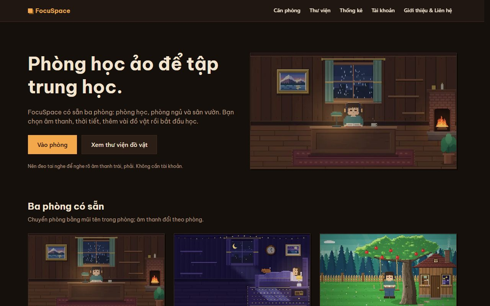<br>Trang chủ | 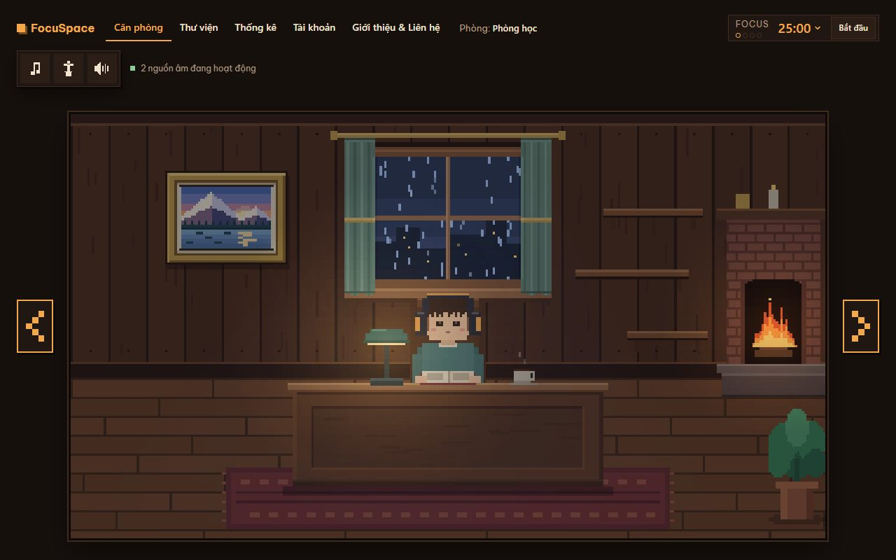<br>Căn phòng – Phòng học |
| 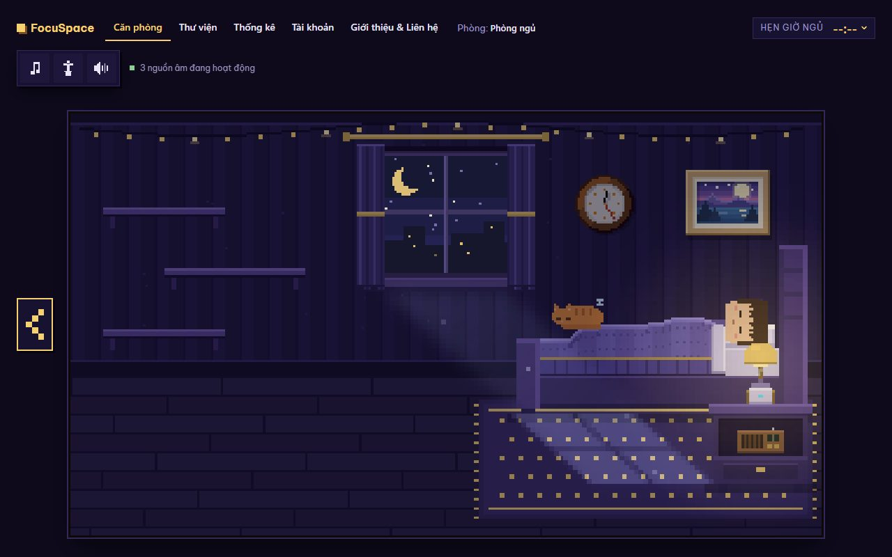<br>Căn phòng – Phòng ngủ | 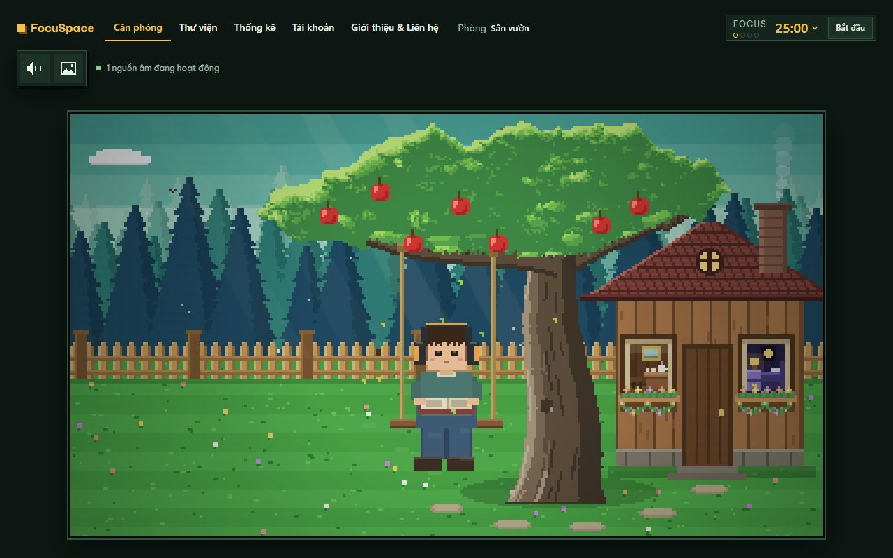<br>Căn phòng – Sân vườn |

---

## Hướng Dẫn Cài Đặt và Chạy Ứng Dụng

**Yêu cầu hệ thống:**

| Công cụ | Phiên bản |
|---|---|
| Node.js | >= 20 |
| PostgreSQL | 16 (cài cục bộ hoặc tạo miễn phí trên Neon) |

**Các bước cài đặt:**

```bash
# 1. Clone repository
git clone https://github.com/CaoLePhucThinh2203/FocuSpace.git
cd FocuSpace

# 2. Cài đặt dependencies (cả ba gói: shared, backend, frontend)
npm install

# 3. Cấu hình môi trường
cp .env.example backend/.env        # Windows: copy .env.example backend\.env
# Điền DATABASE_URL và JWT_SECRET vào backend/.env

# 4. Khởi tạo database
npm run db:migrate                  # tạo 8 bảng
npm run db:seed                     # nạp 17 đồ vật và 5 khung cảnh, chạy lại không trùng

# 5. Chạy ứng dụng
npm run dev                         # Web: http://localhost:5173 · API: http://localhost:3000/api/v1
```

Kiểm thử: `npm test` (unit và integration, tự tạo cơ sở dữ liệu tạm `focuspace_test`), `npm run test:e2e` (Playwright), `npm run lint`, `npm run typecheck`, `npm run build`.

Bản triển khai: https://focuspace-iota.vercel.app. Backend dùng gói miễn phí của Render, nghỉ sau 15 phút không có truy cập, nên lần mở đầu có thể mất khoảng một phút. Các bước triển khai lên Vercel, Render, Neon xem [README](../README.md#triển-khai-hệ-thống).

---

## Task 1 — Project Planning & Teamwork

### (a) Phân công vai trò

Nhóm họp khởi động ngày 27/10/2026 qua Discord ([biên bản](meetings/2026-10-27-khoi-dong.md)) và chốt phân vai ở buổi họp kế hoạch 13/11/2026 ([biên bản](meetings/2026-11-13-hop-ke-hoach.md)). Công việc chia theo **khu vực sản phẩm**: mỗi người làm trọn khu vực của mình từ giao diện, engine Căn phòng tới API và bảng dữ liệu liên quan, nên ai cũng có phần frontend và backend.

| Thành viên | Khu vực | Frontend | Backend & CSDL |
|---|---|---|---|
| Phúc Thịnh (Leader) | Phòng học, các trang còn lại, repo | Phòng học, Pomodoro; Trang chủ, Thư viện, Tài khoản, Giới thiệu & Liên hệ, 404, NavBar, Footer | `schema.prisma`, migration; `GET/PUT /room-state`; repo, CI, triển khai, duyệt PR |
| Tuấn Hưng | Đồ vật, âm thanh | Đồ vật, khay, kéo thả, popover, Bảng âm lượng, âm thanh | Bảng `item_types`, seeder đồ vật; `GET /catalog/items`; tối ưu Lighthouse |
| Đình Nhiên | Sân vườn | Sân vườn, 5 khung cảnh, telemetry | Bảng `scenes`, seeder khung cảnh; `GET /catalog/scenes`; `POST /telemetry/batch`; GA4, Sentry |
| Tuấn Lộc | Phòng ngủ | Phòng ngủ, Hẹn giờ ngủ, trang Thống kê | `/auth/*`, `GET/PATCH/DELETE /me`, `GET /me/stats`; E2E responsive, tổng hợp Lighthouse |

Mỗi khu vực có thư mục riêng `frontend/src/areas/<khu-vực>/` và `backend/src/areas/<khu-vực>/`; phần dùng chung (`shared/`, engine Căn phòng, `backend/prisma/`) do trưởng nhóm duyệt. Chi tiết: [`PLAN.md` §2](PLAN.md#2-phân-vai-task-1a).

### (b) Wireframe

- **Tool sử dụng:** draw.io (diagrams.net). Nhóm chọn draw.io ở buổi họp khởi động 27/10 và không dùng Figma hay Stitch như mẫu gợi ý. File nguồn: [`wireframes/FocuSpace_Wireframes.drawio`](wireframes/FocuSpace_Wireframes.drawio).
- **Các trang đã thiết kế:**
  - [x] Homepage (Trang chủ)
  - [x] Căn phòng
  - [x] Thư viện
  - [x] Thống kê
  - [x] Tài khoản
  - [x] Giới thiệu & Liên hệ
  - [x] Trang 404

| | |
|:---:|:---:|
| 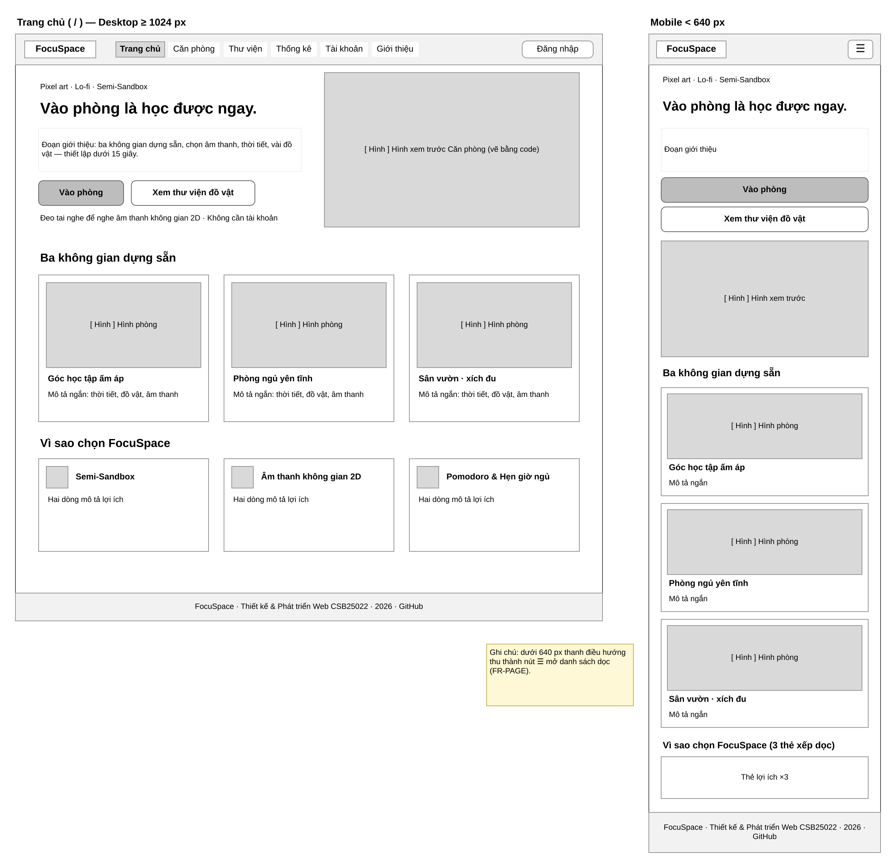<br>Trang chủ | 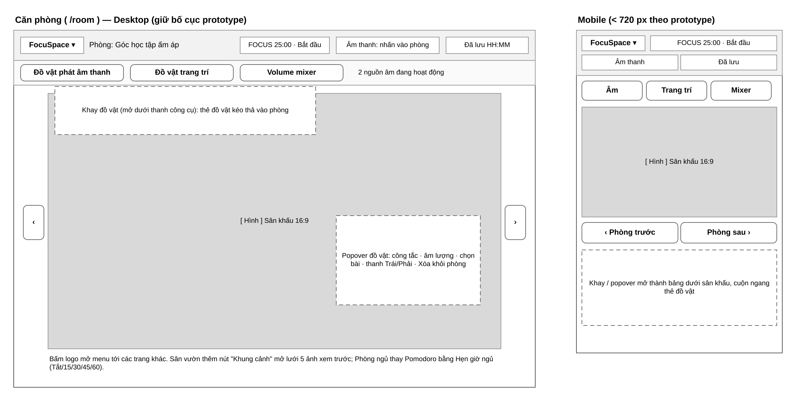<br>Căn phòng |
| 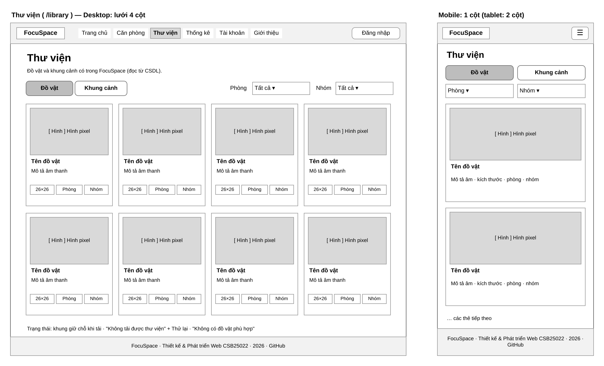<br>Thư viện | 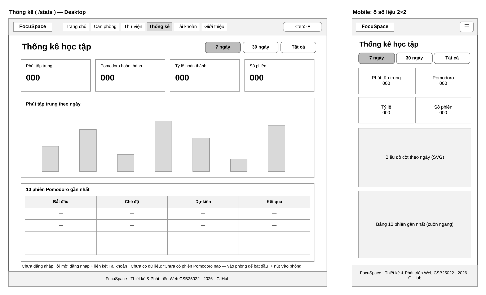<br>Thống kê |
| 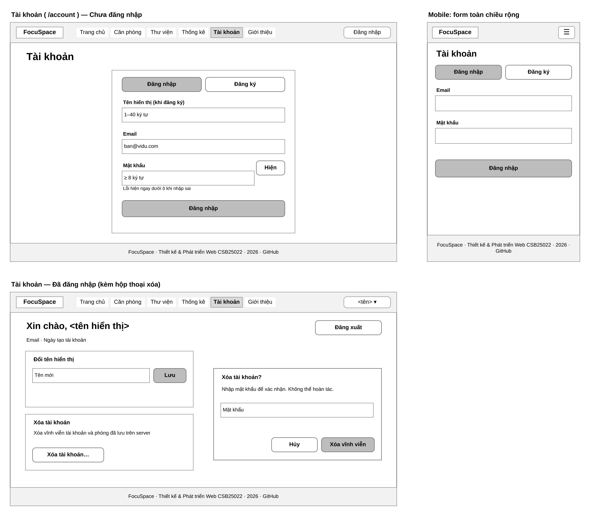<br>Tài khoản | 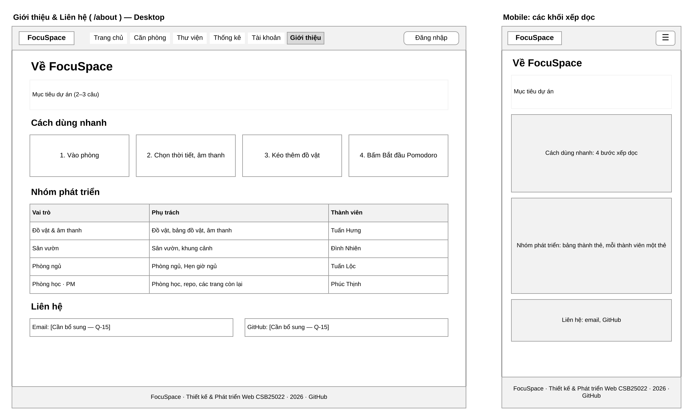<br>Giới thiệu & Liên hệ |
| 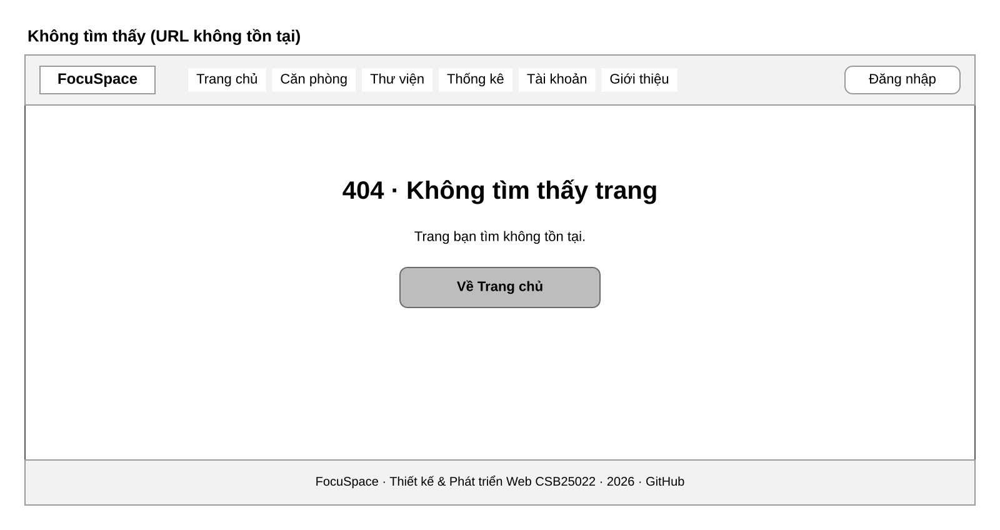<br>404 | |

### (c) Project Plan

Dự án chia 5 sprint, mỗi sprint là một milestone trên GitHub. S1–S2 thiết kế và lập kế hoạch, S3–S5 lập trình. Mỗi việc trong [`TASKS.md`](TASKS.md) là một issue có người phụ trách và sprint. Chi tiết: [`PLAN.md` §3](PLAN.md#3-lịch-sprint-và-mốc-task-1c).

**Milestones:**

| Milestone | Deadline | Trạng thái |
|---|---|---|
| Hoàn thành wireframe | 07/11/2026 (S1) | Đúng hạn |
| Setup GitHub & database schema | 13/11/2026 (S3) | Đúng hạn |
| Hoàn thành UI cơ bản | 15/11/2026 (S4, demo cho giảng viên) | Đúng hạn |
| Tích hợp database xong | 15/11/2026 (S4) | Đúng hạn |
| Optimization & peer review | 17/11/2026 (S5) | Đúng hạn |
| Nộp bài | 27/11/2026 | Nộp sớm ngày 18/11/2026 |

### (d) GitHub Repository

- **Repository link:** https://github.com/CaoLePhucThinh2203/FocuSpace

### (e) Quy trình làm việc trên GitHub

- Nhánh `main` được bảo vệ: chỉ merge qua Pull Request, CI GitHub Actions (lint, typecheck, test với PostgreSQL 16, build) phải xanh và có ít nhất một người duyệt.
- Mỗi việc một nhánh (`feat/…`, `fix/…`, `docs/…`, `perf/…`); PR dùng mẫu `.github/pull_request_template.md`, ghi mã use case (UC) và `Closes #<số>`.
- Commit theo Conventional Commits: `<type>(<phạm vi>): <mô tả> (<mã việc>)`.
- Trong quá trình làm, nhóm chỉ theo dõi việc bằng `docs/TASKS.md` và Pull Request, quên tạo issue trên GitHub. Ngày 18/11/2026 nhóm tạo bù 71 issue ([#64](https://github.com/CaoLePhucThinh2203/FocuSpace/issues/64)–[#134](https://github.com/CaoLePhucThinh2203/FocuSpace/issues/134)), gắn milestone S1–S5, nhãn khu vực và người phụ trách. Một số commit đầu S4 chưa đúng chuẩn (ví dụ “đổi màu mèo”, “fix mobile library”); các commit sau đó đã sửa lại.

**Ví dụ commit messages tiêu biểu của nhóm:**

```
perf(home): tải trước ảnh LCP của Trang chủ (H12)
perf(layout): đặt Suspense trong Layout, hết nhảy bố cục khi tải trang (H12)
fix(items): nến phát sáng, bỏ tiếng rè sau tiếng meo
docs(plan): G7 đã nộp bài ngày 18/11/2026 (#129)
```

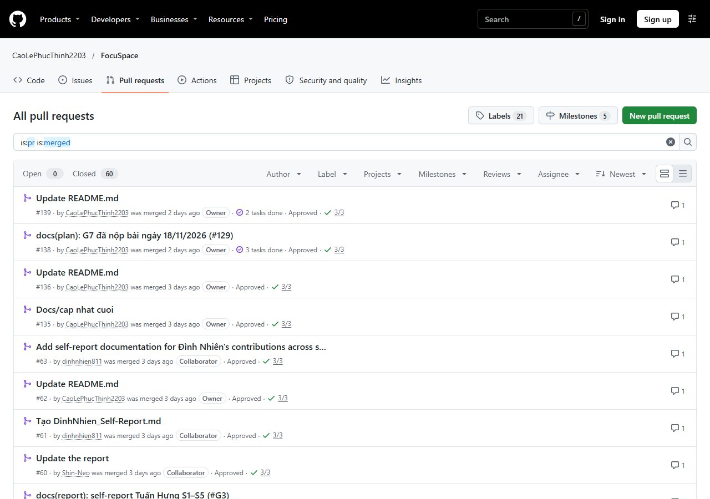

*Danh sách Pull Request đã merge: mỗi PR có người duyệt (Approved) và CI đạt 3/3 kiểm tra.*

---

## Task 2 — Implement User Interface

### (a) Các trang đã xây dựng

| Trang | URL / Route | Mô tả | Người thực hiện |
|---|---|---|---|
| Homepage | `/` | Giới thiệu ứng dụng, hình ba không gian, liên kết vào Căn phòng | Phúc Thịnh |
| Căn phòng | `/room` | Ba không gian vẽ bằng canvas, kéo thả đồ vật, âm thanh, Pomodoro, Hẹn giờ ngủ, khung cảnh Sân vườn | Phúc Thịnh (Phòng học), Tuấn Hưng (đồ vật, âm thanh), Tuấn Lộc (Phòng ngủ), Đình Nhiên (Sân vườn) |
| Thư viện | `/library` | 17 đồ vật và 5 khung cảnh từ cơ sở dữ liệu, lọc theo phòng và nhóm, điều kiện lọc lưu trên URL | Phúc Thịnh |
| Thống kê | `/stats` | Số phút tập trung, số phiên, tỷ lệ hoàn thành; biểu đồ cột theo ngày; 10 phiên gần nhất | Tuấn Lộc |
| Tài khoản | `/account` | Đăng ký, đăng nhập, đổi tên hiển thị, đăng xuất, xóa tài khoản | Phúc Thịnh (giao diện), Tuấn Lộc (API) |
| Contact / About | `/about` | Vấn đề ứng dụng giải quyết, hướng dẫn sử dụng, thành viên, liên hệ | Phúc Thịnh |
| 404 | đường dẫn không tồn tại | Báo không tìm thấy trang, liên kết về Trang chủ | Phúc Thịnh |

| | |
|:---:|:---:|
| 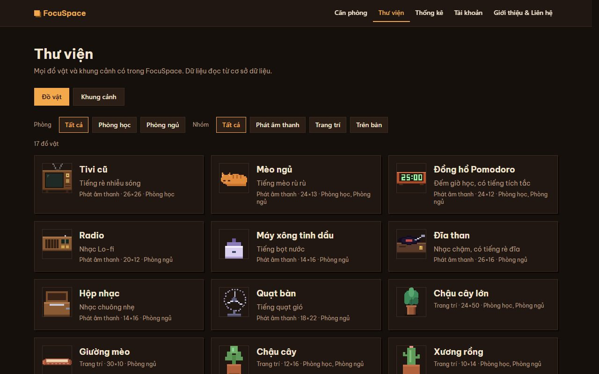<br>Thư viện – Đồ vật | 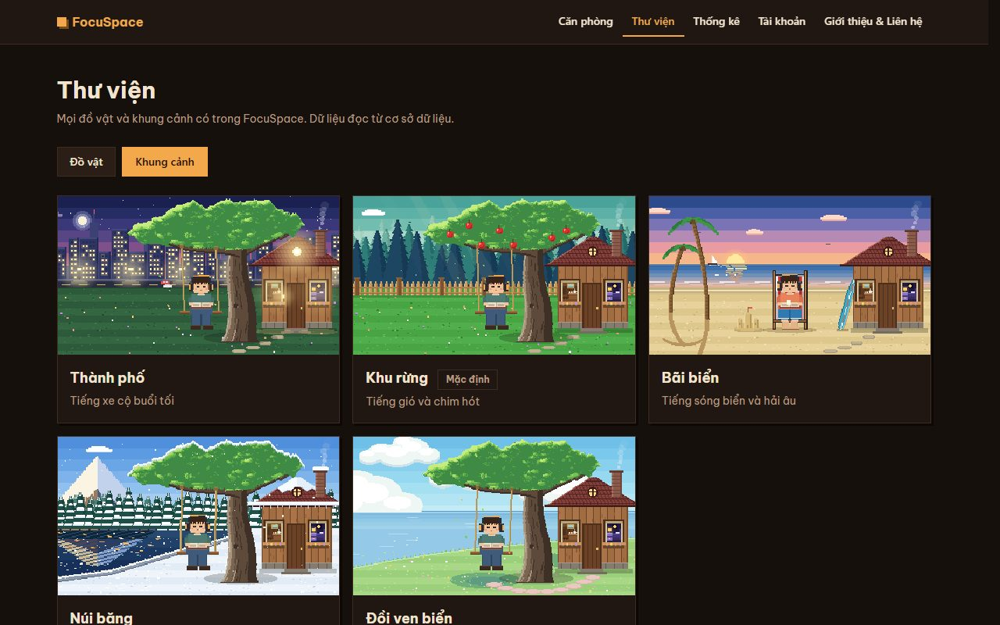<br>Thư viện – Khung cảnh |
| 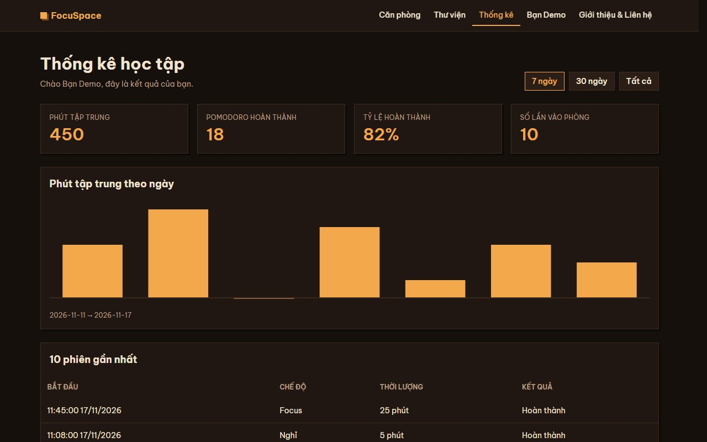<br>Thống kê (số liệu minh họa) | 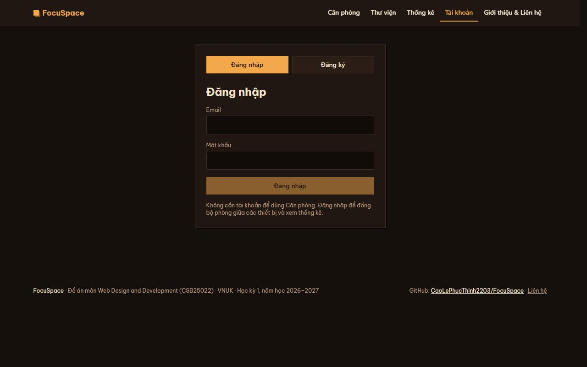<br>Tài khoản |
| 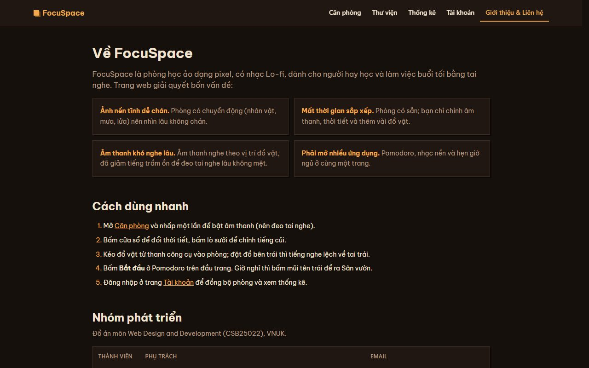<br>Giới thiệu & Liên hệ | 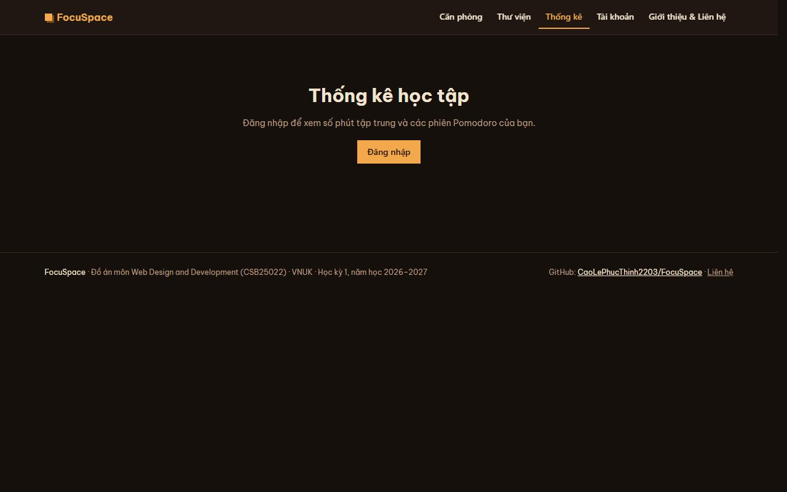<br>Thống kê khi chưa đăng nhập |

### (b) Sử dụng Tailwind CSS

Tailwind CSS 4 cài bằng plugin `@tailwindcss/vite` trong `frontend/vite.config.ts`. Màu và font lấy từ prototype, khai báo một lần bằng `@theme` trong `frontend/src/styles/index.css` (ví dụ `--color-amber`, `--color-panel`, `--font-body: "Be Vietnam Pro"`), rồi dùng lại thành class như `bg-panel`, `text-amber`. Mọi phần giao diện ngoài canvas (NavBar, Footer, các trang, thẻ, form, khay, popover) đều viết bằng utility class. Những lớp mà engine Căn phòng tạo bằng script vẫn giữ tên lớp và viết nội dung bằng `@apply`.

**Ví dụ utility classes đặc trưng nhóm đã dùng:**

```html
<!-- Lưới thẻ Thư viện, Thống kê: 1 cột trên điện thoại, 2 cột từ sm, 3 cột từ lg -->
<div class="grid gap-4 sm:grid-cols-2 lg:grid-cols-3">

<!-- Phần đầu Trang chủ: 2 cột từ md -->
<section class="mx-auto grid max-w-6xl items-center gap-10 px-4 pt-12 pb-10 md:grid-cols-2 md:pt-20">

<!-- Tiêu đề lớn dần theo màn hình -->
<h1 class="font-display text-4xl font-bold leading-tight sm:text-5xl">
```

### (c) Các tính năng tương tác

| Tính năng | Mô tả | File / Component | Người thực hiện |
|---|---|---|---|
| Kéo thả đồ vật | Kéo đồ từ khay vào phòng, di chuyển, thả vào thùng rác để xóa; tối đa 25 đồ mỗi phòng | `engine/legacy/roomEngine.js`, `areas/items-audio/engine/placement.ts` | Tuấn Hưng |
| Popover đồ vật, Bảng âm lượng | Bật/tắt, chỉnh âm từng đồ vật; âm lượng tổng; mèo đổi 3 màu lông | `roomEngine.js`, `areas/items-audio/engine/catPurr.ts` | Tuấn Hưng |
| Chuyển phòng, chọn khung cảnh | Mũi tên chuyển giữa 3 không gian; khay Khung cảnh ở Sân vườn đổi 5 cảnh | `areas/study/engine/rooms.ts`, `roomEngine.js` | Phúc Thịnh, Đình Nhiên |
| Đồng hồ Pomodoro | 4 nhịp học, Bắt đầu / Tạm dừng, Đặt lại vòng, Bỏ qua lượt nghỉ | `areas/study/engine/pomodoro.ts` | Phúc Thịnh |
| Hẹn giờ ngủ | Tắt/15/30/60 phút, Bắt đầu / Tạm dừng, giảm âm dần 2 phút cuối | `areas/bedroom/engine/sleepTimer.ts` | Tuấn Lộc, Phúc Thịnh |
| Form validation | Kiểm tra email, mật khẩu, tên hiển thị ngay trên form; hộp thoại xác nhận xóa tài khoản | `areas/study/pages/Account.tsx` | Phúc Thịnh |
| Bộ lọc Thư viện | Lọc theo phòng và nhóm, lưu trên URL; trạng thái đang tải / lỗi / rỗng | `areas/study/pages/Library.tsx` | Phúc Thịnh |
| Hộp thoại hợp nhất | Khi đăng nhập, chọn giữ phòng trên máy hay trên tài khoản; báo xung đột khi hai thiết bị cùng sửa | `areas/study/roomSync.ts` | Phúc Thịnh |
| Chọn khoảng thời gian Thống kê | 7 ngày, 30 ngày, toàn bộ; nút Thử lại khi lỗi | `areas/bedroom/pages/Stats.tsx` | Tuấn Lộc |
| Menu mobile | Thu gọn điều hướng thành nút menu trên điện thoại | `areas/study/components/SiteNav.tsx` | Phúc Thịnh |

Các tương tác được kiểm thử E2E bằng Playwright, mỗi use case một file `frontend/e2e/ucXX-*.spec.ts`; quy tắc nghiệp vụ (đặt đồ, Pomodoro, hẹn giờ ngủ, chuyển phòng) có unit test Vitest.

### (d) Giao diện trên nhiều thiết bị

- [x] Mobile (< 768px) — kiểm tra ở 375 px; Căn phòng dùng màn hình ngang
- [x] Tablet (768px – 1024px) — kiểm tra ở 768 px
- [x] Desktop (> 1024px) — kiểm tra ở 1280 px

E2E responsive (L11, [#102](https://github.com/CaoLePhucThinh2203/FocuSpace/issues/102)) kiểm tra 6 trang ở 375, 768, 1280 px không bị cuộn ngang.

| | |
|:---:|:---:|
| 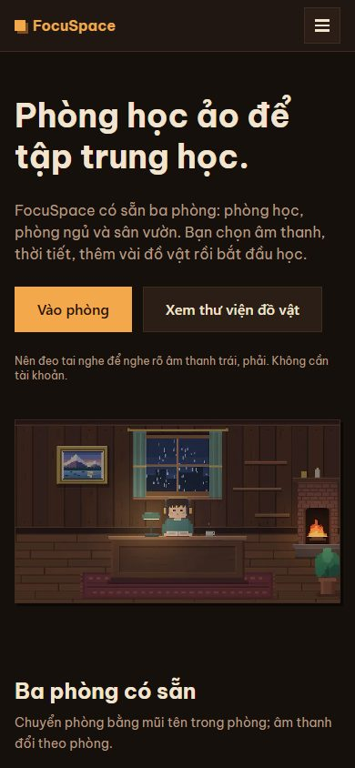<br>Trang chủ trên điện thoại | 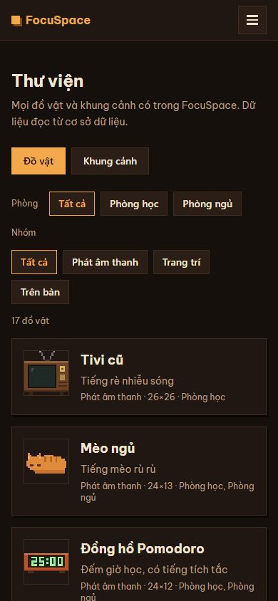<br>Thư viện trên điện thoại |

| | |
|:---:|:---:|
| 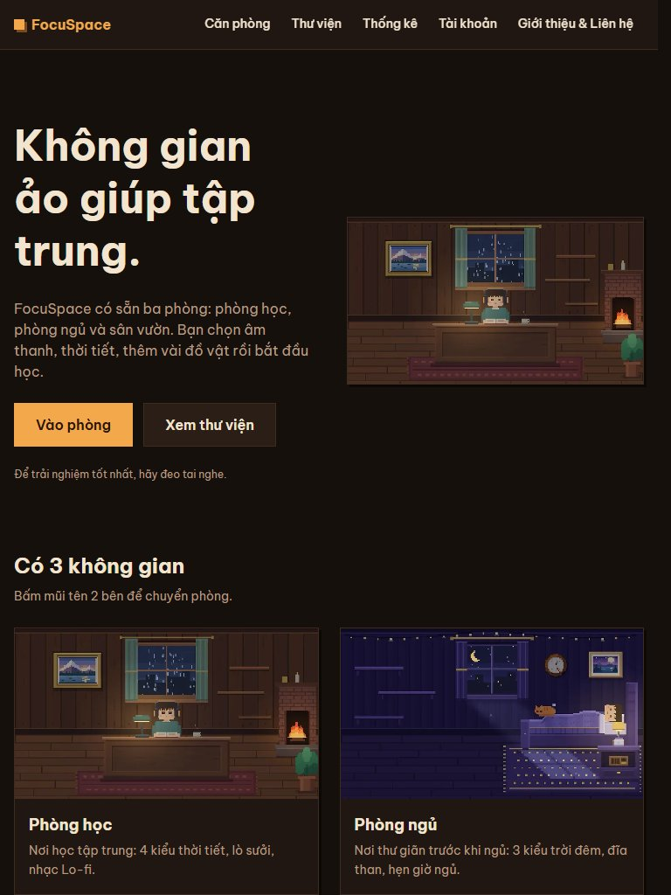<br>Trang chủ ở 768 px (tablet) | 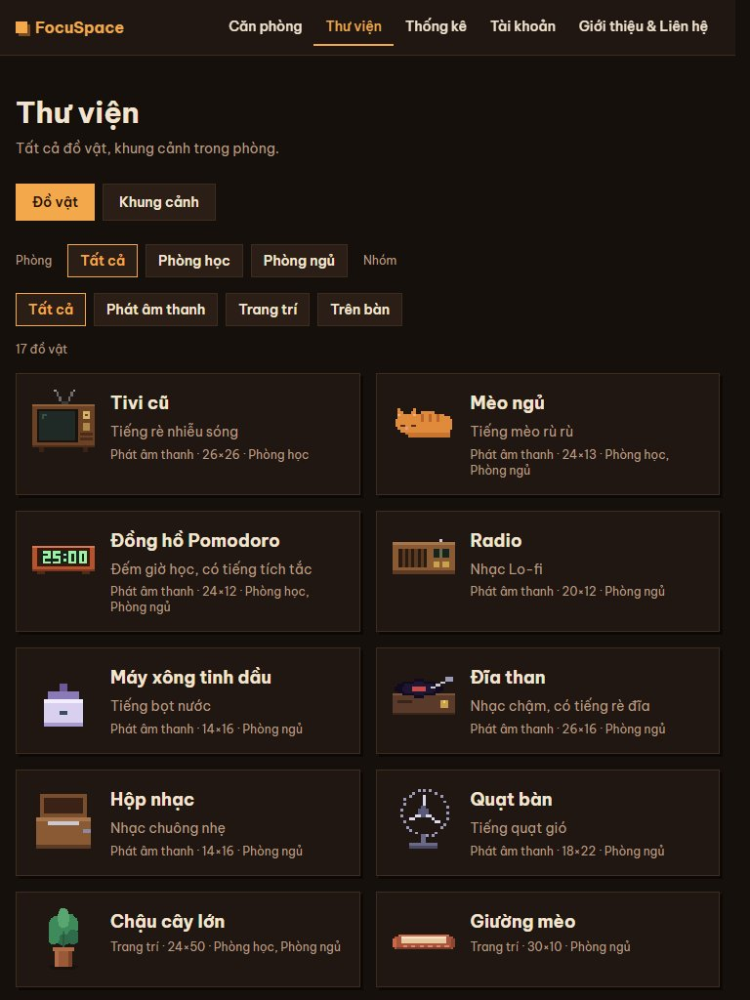<br>Thư viện ở 768 px (tablet) |

---

## Task 3 — Database Integration & Dynamic Content

### (a) Thiết kế cơ sở dữ liệu

- **Database system:** PostgreSQL 16
- **Số bảng:** 8

**Danh sách bảng:**

| Bảng | Mô tả | Các cột chính |
|---|---|---|
| `users` | Tài khoản thành viên | `id`, `email`, `password_hash` (Argon2id), `display_name`, `created_at`, `last_login_at` |
| `refresh_tokens` | Phiên đăng nhập, refresh token đã băm, xoay vòng theo họ token | `id`, `user_id`, `token_hash`, `family_id`, `expires_at`, `revoked_at` |
| `room_states` | Trạng thái Căn phòng của từng thành viên (JSONB) | `user_id`, `schema_ver`, `data`, `revision`, `updated_from`, `updated_at` |
| `usage_sessions` | Lượt sử dụng Căn phòng theo mã ẩn danh, gắn tài khoản khi đăng nhập | `id`, `client_id`, `user_id`, `started_at`, `ended_at`, `interaction_count`, `visited_study`, `visited_bed`, `visited_out` |
| `pomodoro_sessions` | Các phiên Pomodoro | `id`, `usage_session_id`, `mode`, `planned_sec`, `started_at`, `ended_at`, `outcome` |
| `client_errors` | Lỗi phát sinh phía trình duyệt | `id`, `usage_session_id`, `kind`, `message`, `occurred_at` |
| `item_types` | Danh mục 17 đồ vật, nạp bằng seeder | `code`, `name`, `description`, `item_group`, `width`, `height`, `in_study`, `in_bed`, `default_vol` |
| `scenes` | Danh mục 5 khung cảnh Sân vườn, nạp bằng seeder | `code`, `name`, `description`, `is_default`, `sort_order` |

Danh sách cột đầy đủ, khóa và ràng buộc: [`DATABASE.md`](DATABASE.md), [`backend/prisma/schema.prisma`](../backend/prisma/schema.prisma), [lược đồ quan hệ](images/diagrams/luoc-do-quan-he.png).

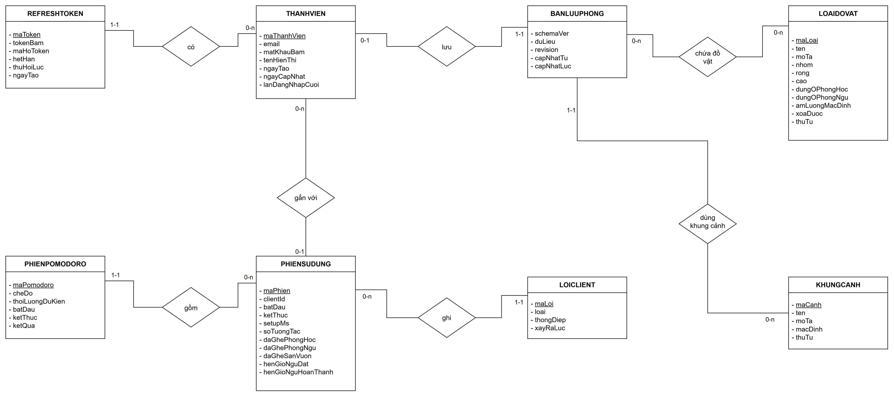

### (b) Kết nối cơ sở dữ liệu

- **Công nghệ server-side:** Node.js 20 + Express, ORM Prisma
- **Cách kết nối:** RESTful API dưới `/api/v1` (14 endpoint, JSON, lỗi theo dạng `{ error: { code, message } }`); Vercel chuyển tiếp `/api/...` sang Render để cookie đăng nhập dùng cùng tên miền
- **Các thao tác CRUD đã implement:**
  - [x] Create — đăng ký tài khoản (`POST /auth/register`), ghi phiên học (`POST /telemetry/batch`)
  - [x] Read — `GET /me`, `GET /me/stats`, `GET /room-state`, `GET /catalog/items`, `GET /catalog/scenes`
  - [x] Update — đổi tên hiển thị (`PATCH /me`), lưu trạng thái phòng (`PUT /room-state`, kiểm tra `revision`, trả 409 khi xung đột)
  - [x] Delete — xóa tài khoản (`DELETE /me`), đăng xuất xóa refresh token (`POST /auth/logout`)

```
Trình duyệt (React + Canvas + Web Audio) ── GA4, Sentry
   │  /api/v1 (JSON; refresh token trong cookie httpOnly)
   ▼
Express API (Render): routes → services → Prisma ── Sentry, log JSON (pino)
   │
   ▼
PostgreSQL 16 (Neon)
```

Backend có integration test (Vitest + Supertest) chạy trên một PostgreSQL 16 tạm cho mọi endpoint. Đặc tả từng endpoint: [`API.md`](API.md).

### (c) Các trang hiển thị dữ liệu động

| Trang | Dữ liệu hiển thị | Query / Endpoint | Người thực hiện |
|---|---|---|---|
| Thư viện | 17 đồ vật và 5 khung cảnh, lọc theo phòng, nhóm | `GET /api/v1/catalog/items?room=&group=`, `GET /api/v1/catalog/scenes` | Phúc Thịnh (trang), Tuấn Hưng (`/catalog/items`), Đình Nhiên (`/catalog/scenes`) |
| Thống kê | Số phút tập trung, số phiên, tỷ lệ hoàn thành, biểu đồ theo ngày, 10 phiên gần nhất | `GET /api/v1/me/stats?range=&tz=` | Tuấn Lộc |
| Căn phòng (khi đăng nhập) | Trạng thái phòng đã lưu trên tài khoản | `GET/PUT /api/v1/room-state` | Phúc Thịnh |
| Tài khoản | Email, tên hiển thị của thành viên | `GET/PATCH/DELETE /api/v1/me` | Tuấn Lộc (API), Phúc Thịnh (trang) |

| | |
|:---:|:---:|
| <br>Thư viện – dữ liệu từ `item_types` | <br>Thống kê (số liệu minh họa) |

---

## Task 4 — Optimization

### (a) Kiểm tra hiệu năng với Lighthouse

Đo bằng Lighthouse trong Chrome DevTools trên bản triển khai https://focuspace-iota.vercel.app. Nhật ký tối ưu và file JSON các lần đo trong quá trình làm: [`reports/lighthouse/`](reports/lighthouse/README.md).

**Kết quả trước khi tối ưu:**

Trước khi tối ưu, nhóm đo hai trang có vấn đề là Căn phòng và Thư viện; các trang khác chưa đo.

| Metric | `/room` | `/library` |
|---|---|---|
| Performance | 60 (TBT 6.180 ms) | 83 (CLS 0,327) |
| Accessibility | 100 | 100 |
| Best Practices | 96 | 100 |
| SEO | 91 | 100 |

Ảnh dưới là một lần đo; nhật ký Lighthouse ghi `/library` 84 theo lần có Performance trung vị trong 3 lần đo.

| | |
|:---:|:---:|
| 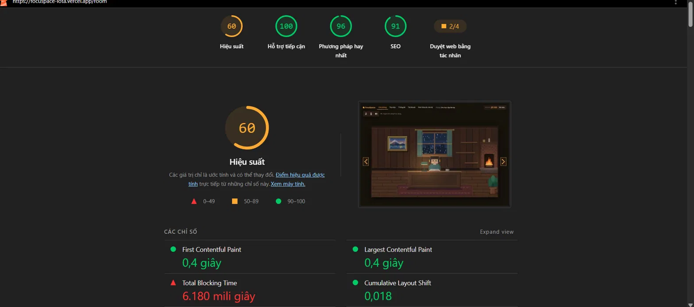<br>`/room` trước tối ưu | 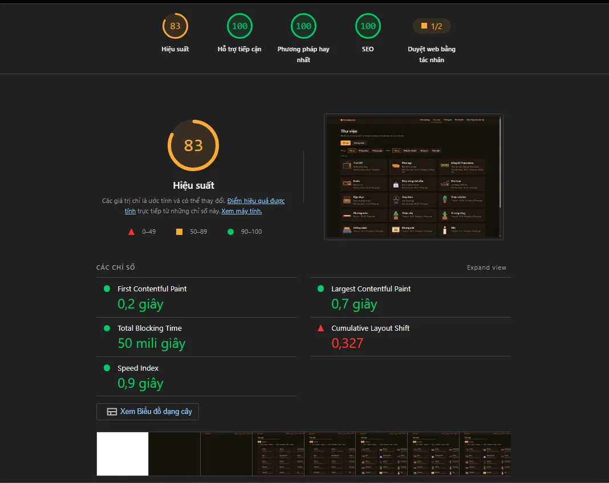<br>`/library` trước tối ưu |

**Các vấn đề đã xác định và cách khắc phục:**

| Vấn đề | Hành động khắc phục |
|---|---|
| `/room` TBT 6,2 s do dựng toàn bộ âm thanh tổng hợp khi mở trang | Dựng âm thanh sau cú nhấp hoặc phím đầu tiên, mỗi nguồn một tác vụ ([#19](https://github.com/CaoLePhucThinh2203/FocuSpace/pull/19)) |
| CSS chính và CSS Google Fonts chặn hiển thị | Nhúng CSS chính vào `index.html` ([#21](https://github.com/CaoLePhucThinh2203/FocuSpace/pull/21)); tự host font Be Vietnam Pro, tải trước các độ đậm dùng nhiều ([#40](https://github.com/CaoLePhucThinh2203/FocuSpace/pull/40), [#48](https://github.com/CaoLePhucThinh2203/FocuSpace/pull/48)) |
| `/library` CLS 0,327: khung chờ khác cỡ thẻ thật, thanh điều hướng hiện muộn, đổi font giữa chừng, thanh cuộn xuất hiện muộn | Khung chờ cùng cỡ thẻ, `Suspense` đặt trong Layout, font `display=optional`, `scrollbar-gutter: stable` ([#32](https://github.com/CaoLePhucThinh2203/FocuSpace/pull/32), [#36](https://github.com/CaoLePhucThinh2203/FocuSpace/pull/36), [#39](https://github.com/CaoLePhucThinh2203/FocuSpace/pull/39), [#41](https://github.com/CaoLePhucThinh2203/FocuSpace/pull/41)) |
| Ảnh xem trước nặng (98 KiB siêu dữ liệu), LCP Trang chủ tải muộn | Bỏ siêu dữ liệu ảnh (101,5 KB → 3,5 KB); tải trước ảnh LCP ([#37](https://github.com/CaoLePhucThinh2203/FocuSpace/pull/37), [#40](https://github.com/CaoLePhucThinh2203/FocuSpace/pull/40), [#27](https://github.com/CaoLePhucThinh2203/FocuSpace/pull/27)) |
| Lỗi 401 ghi vào console khi khách tải trang; thiếu `robots.txt`; file không tồn tại trả `index.html` | Khách chưa đăng nhập không gọi refresh; thêm `robots.txt`; Vercel trả 404 đúng ([#20](https://github.com/CaoLePhucThinh2203/FocuSpace/pull/20), [#26](https://github.com/CaoLePhucThinh2203/FocuSpace/pull/26)) |
| `/room` Best Practices 96: chữ chú thích 11 px | Nâng lên 12 px ([#43](https://github.com/CaoLePhucThinh2203/FocuSpace/pull/43)) |

**Kết quả sau khi tối ưu (đã bật Google Analytics 4 và Sentry):**

Desktop:

| Metric | `/` | `/room` | `/library` | `/stats` | `/account` | `/about` |
|---|---|---|---|---|---|---|
| Performance | 96 | 100 | 98 | 98 | 97 | 96 |
| Accessibility | 100 | 100 | 100 | 100 | 100 | 100 |
| Best Practices | 100 | 100 | 100 | 100 | 100 | 100 |
| SEO | 100 | 100 | 100 | 100 | 100 | 100 |

Mobile:

| Metric | `/` | `/room` | `/library` | `/stats` | `/account` | `/about` |
|---|---|---|---|---|---|---|
| Performance | 83 | 100 | 83 | 82 | 82 | 83 |
| Accessibility | 100 | 100 | 100 | 100 | 100 | 100 |
| Best Practices | 100 | 100 | 100 | 100 | 100 | 100 |
| SEO | 100 | 100 | 100 | 100 | 100 | 100 |

So với trước tối ưu (cùng đo trên desktop): `/room` Performance 60 → 100 (TBT 6.180 ms → 20 ms), Best Practices 96 → 100, SEO 91 → 100; `/library` Performance 83 → 98 (CLS 0,327 → 0). Mọi trang đạt 100 ở Accessibility, Best Practices, SEO.

| | |
|:---:|:---:|
| 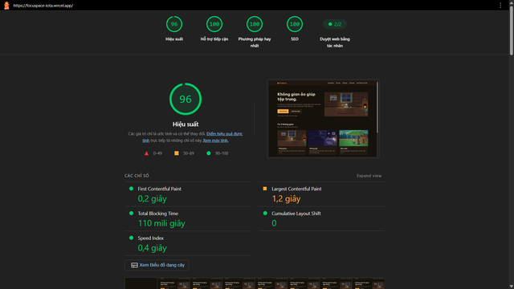<br>Desktop `/` | 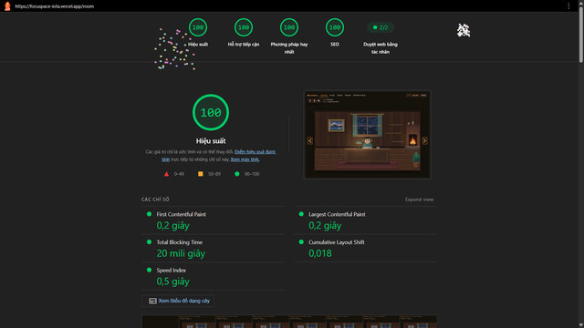<br>Desktop `/room` |
| 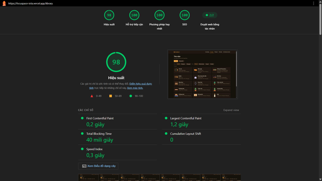<br>Desktop `/library` | 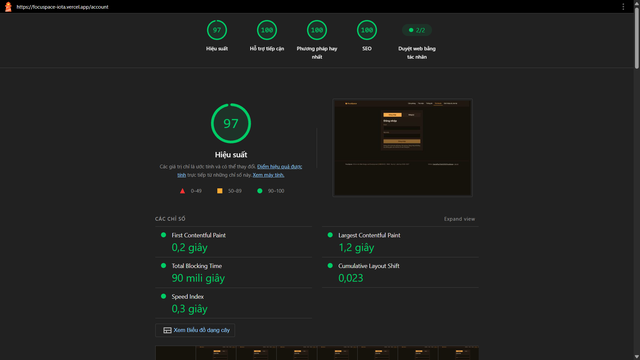<br>Desktop `/account` |
| 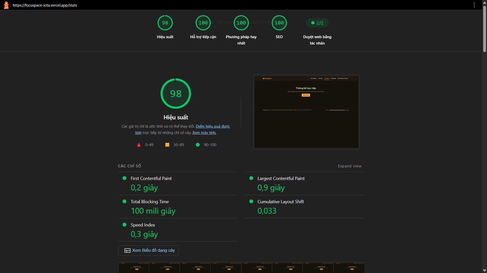<br>Desktop `/stats` | 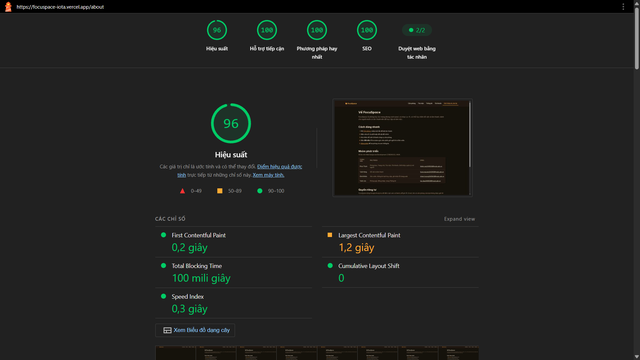<br>Desktop `/about` |
| 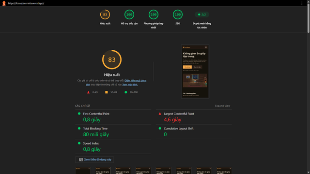<br>Mobile `/` | 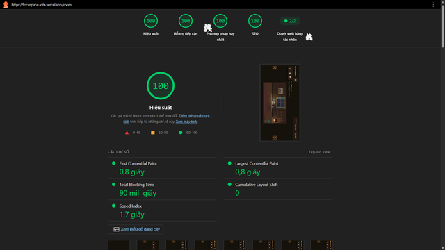<br>Mobile `/room` |
| 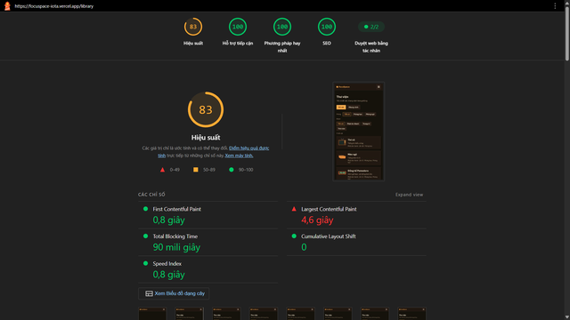<br>Mobile `/library` | 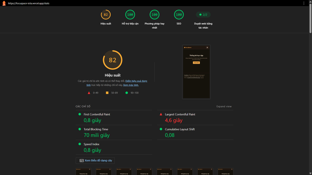<br>Mobile `/stats` |
| 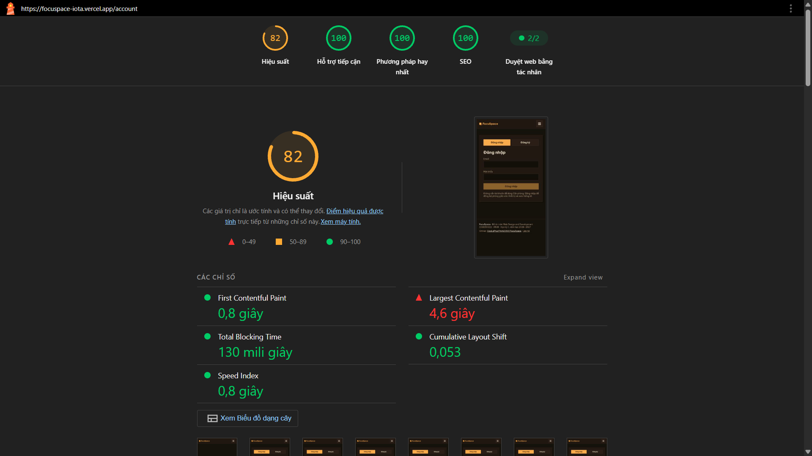<br>Mobile `/account` | <br>Mobile `/about` |

**Vì sao Performance trên mobile còn 82–83:**

Trên mobile, Lighthouse giả lập điện thoại tầm trung với mạng 4G chậm. Ở 5 trang `/`, `/library`, `/stats`, `/account`, `/about`, chỉ số LCP là 4,6 giây; các chỉ số còn lại vẫn tốt (FCP 0,8 giây, TBT 70–130 ms, CLS 0–0,08). Lighthouse báo “Giảm JavaScript không dùng đến”, ước tính tiết kiệm 112 KiB.

Nguyên nhân là mã theo dõi của bên thứ ba mà nhóm bật trên bản triển khai để đáp ứng Task 4b. Nhóm đo độ phủ JavaScript khi mở Trang chủ trên bản Vercel (Chrome, cùng cách Lighthouse tính mục này):

| File | Kích thước | Không dùng khi mở trang | Nguồn |
|---|---|---|---|
| `googletagmanager.com/gtag/js` | 538 KB | 275 KB | Google Analytics 4, tải từ máy chủ của Google |
| `assets/index-*.js` | 243 KB | 149 KB | Bundle chính; khoảng 73 KB trong đó là thư viện Sentry (`@sentry/react`) |

Khi build không có Sentry, bundle chính chỉ còn 176 KB. Trên mạng chậm, tải và chạy hai thư viện này làm nội dung lớn nhất hiện muộn hơn. Trên desktop, ảnh hưởng nhỏ nên các trang vẫn đạt 96–100. GA4 và Sentry cần thiết để theo dõi lỗi và hành vi người dùng, nên nhóm giữ chúng và chấp nhận mức điểm này. Có thể cải thiện bằng cách tải Sentry và GA4 sau khi trang đã hiện, đổi lại sẽ mất một phần dữ liệu theo dõi (lỗi xảy ra sớm, lượt xem của người vào rồi rời ngay).

### (b) Theo dõi lỗi và hành vi người dùng

**Google Analytics:**
- [x] Đã tích hợp
- **Tracking ID / Measurement ID:** `G-TTSLLPTMYZ` (đặt qua biến môi trường `VITE_GA_ID` trên Vercel, không commit vào mã nguồn)
- Nạp `gtag.js` khi có `VITE_GA_ID`, gửi `page_view` mỗi lần đổi trang và sự kiện `login`; không gửi dữ liệu cá nhân (`frontend/src/areas/garden/observability.ts`). Đã kiểm tra trên GA4 Realtime.

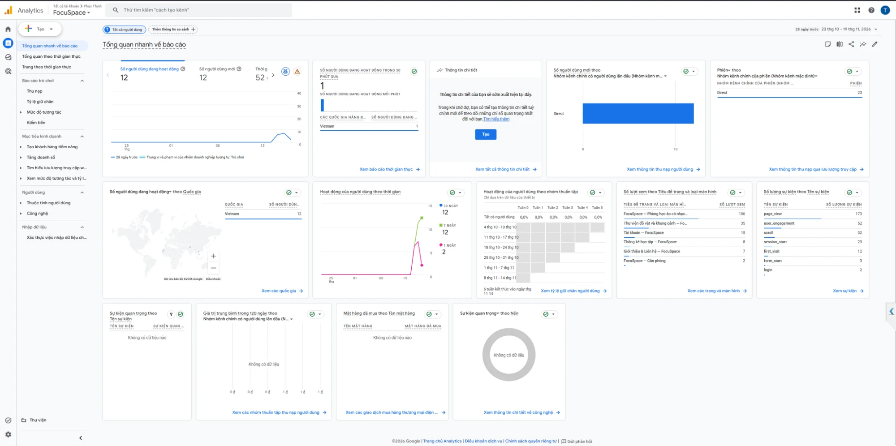

*GA4, 23/10 – 19/11/2026: 12 người dùng (Việt Nam), 173 sự kiện `page_view`, 2 sự kiện `login`; lượt xem nhiều nhất ở Căn phòng và Thư viện.*

**Sentry (hoặc tương đương):**
- [x] Đã tích hợp
- **Tool sử dụng:** Sentry (frontend và backend), kèm log JSON bằng pino ở backend
- **Project DSN / Config:** đặt qua biến môi trường `VITE_SENTRY_DSN` (Vercel) và `SENTRY_DSN` (Render), `sendDefaultPii: false`
- Theo dõi lỗi JavaScript chưa bắt ở trình duyệt và lỗi phát sinh trong Express API. Đã gửi lỗi thử và thấy trên Sentry frontend.

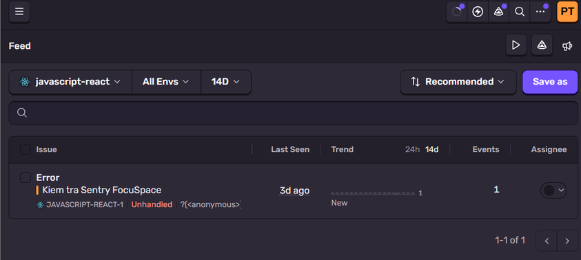

*Sentry project `javascript-react` (frontend) nhận lỗi thử “Kiem tra Sentry FocuSpace”.*

---

## Task 5 — UI/UX Peer Review & Evaluation

### (a) Feedback cho các nhóm khác

**Nhóm được review #1:**

- **Tên nhóm / Dự án:** Nhóm 6 — Quản lí chi tiêu (Phúc Thịnh review, 07/11/2026)
- **Link dự án:** [Cần bổ sung]

| Khía cạnh | Điểm mạnh | Gợi ý cải thiện |
|---|---|---|
| Usability | — | Làm đơn giản hơn |
| Aesthetics | Tông màu trắng kết hợp các màu nổi bật, bắt mắt; phông chữ đẹp | Thiết kế lại giao diện |
| User-Friendliness | — | Thêm tính năng nhập nhanh bằng giọng nói |

**Nhóm được review #2:**

- **Tên nhóm / Dự án:** Nhóm 4 — PawPass (Tuấn Lộc, Tuấn Hưng, Đình Nhiên review chung, 12/11/2026)
- **Link dự án:** https://github.com/iceruychi-netizen/PawPass-Hosothucung

| Khía cạnh | Điểm mạnh | Gợi ý cải thiện |
|---|---|---|
| Usability | Dễ sử dụng; tốc độ đẩy file khá ổn | Khi tải lại trang, web đưa về trang đăng nhập rồi mới tới trang đang ở: nên giữ người dùng ở trang cuối cùng đang xem (mức độ Cao) |
| Aesthetics | — | — |
| User-Friendliness | Dễ sử dụng | — |

Ô “—” là khía cạnh nhóm không ghi nhận xét. Bản gốc: [`reviews/given/`](reviews/given/).

### (b) Xử lý feedback từ các nhóm khác

Người góp ý: Hữu Triết, Bá Phát, Thành Long. Bản gốc: [`reviews/received.md`](reviews/received.md).

| Feedback | Nguồn (nhóm nào) | Quyết định | Lý do / Commit |
|---|---|---|---|
| Mèo có thể đổi màu | Hữu Triết, Bá Phát, Thành Long | Đã implement | [#30](https://github.com/CaoLePhucThinh2203/FocuSpace/pull/30): 3 màu lông Cam, Xám tro, Kem |
| Sửa lại giao diện Trang chủ | như trên | Đã implement | [#10](https://github.com/CaoLePhucThinh2203/FocuSpace/pull/10), [#44](https://github.com/CaoLePhucThinh2203/FocuSpace/pull/44), [#48](https://github.com/CaoLePhucThinh2203/FocuSpace/pull/48): thêm Mô tả & Tính năng, viết lại chữ ngắn gọn |
| Tối ưu web | như trên | Đã implement | [#40](https://github.com/CaoLePhucThinh2203/FocuSpace/pull/40)–[#43](https://github.com/CaoLePhucThinh2203/FocuSpace/pull/43), [#48](https://github.com/CaoLePhucThinh2203/FocuSpace/pull/48): font tự host, hết CLS, chữ 12 px |
| Sửa lại đồng hồ Pomodoro | như trên | Đã implement | [#29](https://github.com/CaoLePhucThinh2203/FocuSpace/pull/29): Pomodoro theo vòng, 4 nhịp học |
| Thêm nút bắt đầu, kết thúc cho đồng hồ | như trên | Đã implement | [#29](https://github.com/CaoLePhucThinh2203/FocuSpace/pull/29): nút Bắt đầu / Tạm dừng, Đặt lại vòng, Bỏ qua lượt nghỉ |
| Sửa lại chế độ Hẹn giờ ngủ | như trên | Đã implement | [#29](https://github.com/CaoLePhucThinh2203/FocuSpace/pull/29): chọn mức xong chờ Bắt đầu, có Tạm dừng, giảm âm dần 2 phút cuối |
| Thêm khung cảnh tuyết | như trên | Không implement | Đã có tuyết ở cảnh Núi băng và thời tiết Tuyết rơi ở Phòng ngủ; cảnh mới cần vẽ, làm âm nền, thêm seeder, không kịp hạn nộp |
| Làm khung cảnh Thành phố sinh động hơn | như trên | Đã implement | [#46](https://github.com/CaoLePhucThinh2203/FocuSpace/pull/46), [#50](https://github.com/CaoLePhucThinh2203/FocuSpace/pull/50): âm nền buổi tối, tiếng còi xe xa, chỉnh vị trí xe |
| Sửa lại độ lớn âm thanh | như trên | Đã implement | [#46](https://github.com/CaoLePhucThinh2203/FocuSpace/pull/46), [#49](https://github.com/CaoLePhucThinh2203/FocuSpace/pull/49): chỉnh tiếng mèo, máy xông theo số đo thật; mèo rù rù theo lượt |
| Thêm nhạc Lo-fi | như trên | Đã implement | [#10](https://github.com/CaoLePhucThinh2203/FocuSpace/pull/10), [#47](https://github.com/CaoLePhucThinh2203/FocuSpace/pull/47): 6 bài Lo-fi, đổi bài mượt |

[Cần bổ sung: ảnh chụp trước/sau của những thay đổi đã implement]

---

## Deliverables Checklist

- [x] **Source code trên GitHub** — repository public: https://github.com/CaoLePhucThinh2203/FocuSpace
- [x] **README.md** bao gồm: hướng dẫn cài đặt, tổng quan project, danh sách tính năng có screenshots, ERD
- [x] **Video demo trên YouTube** — https://www.youtube.com/watch?v=9J9uekvG_xA (≤ 10 phút, ≥ 720p, không để private)
- [ ] **Self-Report** — mỗi thành viên đã commit file vào `docs/self-reports/` (đã soạn, chưa commit)

---

## Self-Reports

| Họ tên | MSSV | Link Self-Report |
|---|---|---|
| Cao Lê Phúc Thịnh | 24090024 | [self-report-24090024.md](https://github.com/CaoLePhucThinh2203/FocuSpace/blob/main/docs/self-reports/self-report-24090024.md) |
| Trương Đình Nhiên | 24090060 | [self-report-24090060.md](https://github.com/CaoLePhucThinh2203/FocuSpace/blob/main/docs/self-reports/self-report-24090060.md) |
| Đậu Tuấn Lộc | 24090025 | [self-report-24090025.md](https://github.com/CaoLePhucThinh2203/FocuSpace/blob/main/docs/self-reports/self-report-24090025.md) |
| Nguyễn Tuấn Hưng | 24090019 | [self-report-24090019.md](https://github.com/CaoLePhucThinh2203/FocuSpace/blob/main/docs/self-reports/self-report-24090019.md) |
