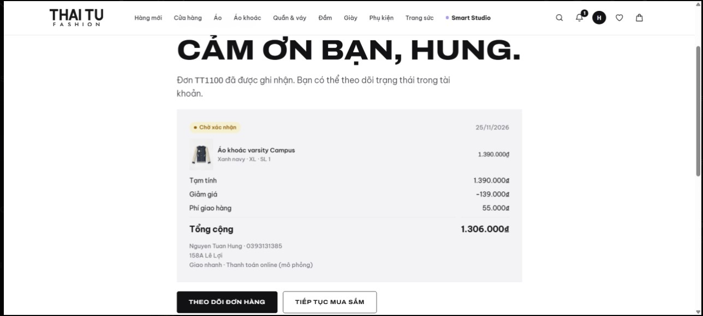
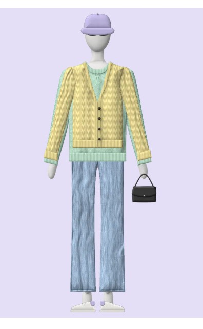
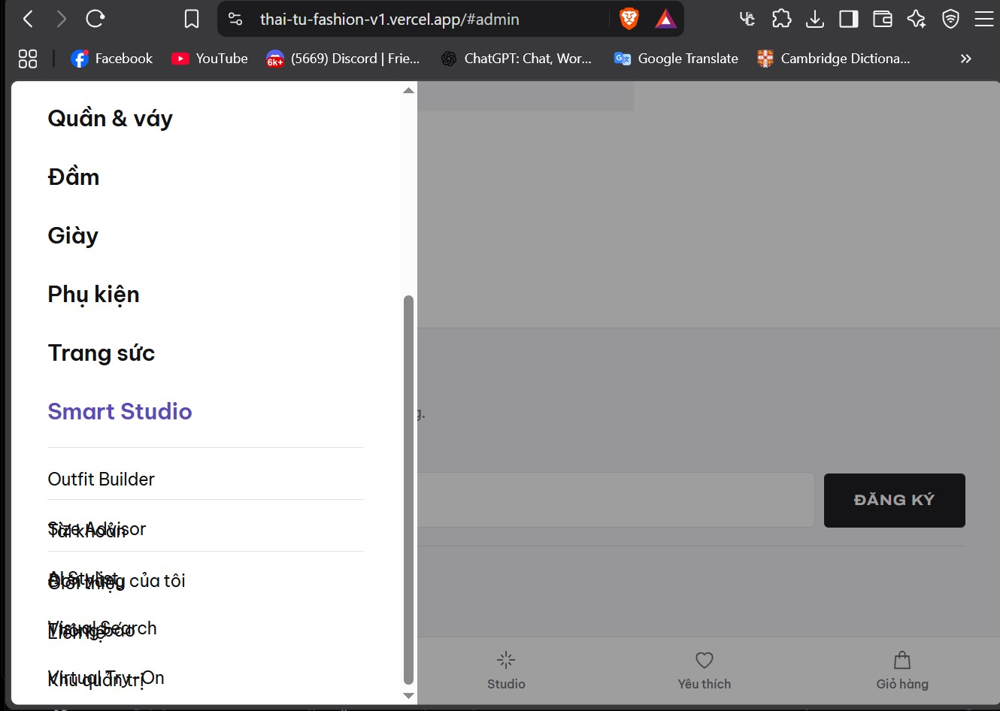
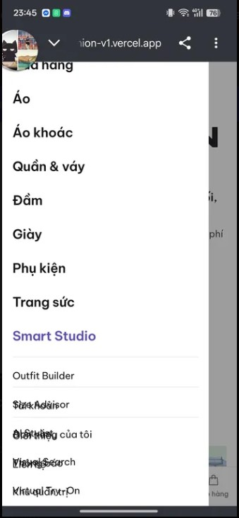
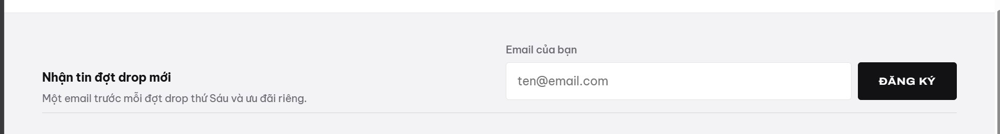

# Góp ý UI/UX cho Nhóm 5 (ThaiTuFashion)
 
## Thông tin chung
- **Nhóm được review:** Nhóm 5 (ThaiTuFashion)
- **Link repo:** https://github.com/huynhsy986-droid/thai_tu_fashion
- **Ngày review:** 25/11/2026
- **Người review:** Tuấn Hưng, Đình Nhiên
## 1. Usability (Tính khả dụng)
**Điểm mạnh**
- Ô tìm kiếm ở trang Cửa hàng gợi ý ngay khi gõ và hiểu từ khóa không dấu (gõ "ao khoac" vẫn ra 3 áo khoác).
- Khi không có kết quả, trang báo rõ "Không có sản phẩm phù hợp", gợi ý từ khóa khác và có nút "Xoá bộ lọc".
- Trang Chi tiết sản phẩm chặn thêm vào giỏ khi chưa chọn size và báo "Hãy chọn size trước khi tiếp tục"; size sắp hết có nhãn "Còn 2".
- Sau khi thêm vào giỏ có thông báo nhỏ kèm liên kết "Xem giỏ", số trên biểu tượng giỏ hàng cập nhật ngay.
- Bộ lọc ở trang Cửa hàng đầy đủ (danh mục, dịp mặc, phong cách, khoảng giá, size, màu), mỗi mục có số lượng sản phẩm bên cạnh.
**Đề xuất cải thiện**
- Trang theo dõi đơn hàng hiện đơn TT1100 và trạng thái "Chờ xác nhận" nhưng chỉ có nút "Huỷ đơn hàng", không đổi được size; muốn đổi size khách phải huỷ đơn rồi đặt lại. Đề xuất cho mục "Đơn hàng của tôi" liệt kê các đơn kèm trạng thái và cho phép đổi size khi đơn chưa được xử lý.
- Ở trang xác nhận đặt hàng, mã đơn "TT1100" nằm lẫn trong câu thông báo "Đơn TT1100 đã được ghi nhận…", khó nhận ra. Đề xuất tách mã đơn thành dòng riêng, nổi bật, và dùng chính mã này trong mục "Đơn hàng của tôi".
- Trong Studio thử đồ, các món được chọn chưa đồng bộ với nhau: khi chọn mũ và kính, mũ che luôn phần kính mà model đang đeo thay vì hiển thị model đeo cả hai; khi chọn hai áo, ảnh của hai áo bị chồng lên nhau. Đề xuất đồng bộ lại thứ tự lớp hiển thị theo từng vùng trên cơ thể để mũ và kính cùng xuất hiện đúng vị trí, đồng thời chỉ cho phép mang một món ở mỗi vùng (ví dụ một áo, một phụ kiện đầu) để tránh các món cùng vùng chồng lên nhau.
- Đường dẫn `#admin` xuất hiện trên menu và mục "Khu quản trị" xuất hiện ở phần footer của trang người dùng. Người dùng thông thường không cần và không nên thấy lối vào khu quản trị. Đề xuất gỡ cả hai khỏi giao diện người dùng, chỉ truy cập khu quản trị bằng đường dẫn riêng hoặc sau khi đăng nhập bằng tài khoản quản trị.
- Khi thu nhỏ cửa sổ, biểu tượng Yêu thích và Giỏ hàng bị đẩy ra ngoài màn hình và bị thay bằng nút menu, khiến người dùng khó vào giỏ hàng. Đề xuất giữ hai biểu tượng này (kèm số lượng trong giỏ) hiển thị trên thanh trên cùng ở mọi kích thước màn hình.
## 2. Aesthetics (Tính thẩm mỹ)
**Điểm mạnh**
- Phong cách "Seoul mood" rõ ràng: màu pastel (tím lavender, xanh bạc hà, vàng bơ), chữ tiêu đề đậm, dòng phụ tiếng Hàn tạo nhận diện riêng.
- Ảnh sản phẩm cùng một kiểu (áo dựng 3D trên nền nhạt), nên lưới sản phẩm trông gọn và đồng bộ.
- Ảnh đầu trang (hero) có điểm "+" trên từng món đồ người mẫu mặc, bấm vào là tới trang sản phẩm.
- Bản điện thoại gọn, không bị tràn ngang, có thanh điều hướng dưới (Trang chủ, Cửa hàng, Studio, Yêu thích, Giỏ hàng).
**Đề xuất cải thiện**
- Model thử đồ hiện chỉ chèn ảnh sản phẩm lên trên model, chưa vừa với dáng người như nội dung đã trình bày trước đó. Đề xuất điều chỉnh từng món để khớp với model (vị trí, kích thước, độ ôm) thay vì chỉ đặt ảnh sản phẩm đè lên.
- Các liên kết trên thanh menu (`#account`, `#about`, `#contact`) bị lỗi phông chữ, không đồng nhất với các mục còn lại. Đề xuất áp dụng cùng một phông chữ cho toàn bộ mục trên thanh menu.
- Thanh thông báo trên cùng (các nội dung như đổi size, miễn phí giao hàng, sản phẩm mới, discount) chuyển nội dung quá nhanh và bị giật trên một số máy. Đề xuất làm chuyển động mượt hơn, kéo dài thời gian hiển thị mỗi nội dung và kiểm tra lại trên nhiều thiết bị.
## 3. User-friendliness (Tính thân thiện với người dùng)
**Điểm mạnh**
- Có nhiều cách tìm đồ: theo danh mục, theo dịp mặc (Đi làm, Hẹn hò, Tiệc…), set phối sẵn, Smart Studio.
- Trang sản phẩm có "Tìm size hợp với tôi" và "Bảng size" ngay cạnh phần chọn size.
- Giỏ hàng ghi rõ màu, size, đơn giá, có ô mã giảm giá và gợi ý mã dùng thử.
**Đề xuất cải thiện**
- Điểm "+" trên ảnh đầu trang chưa cho biết thông tin sơ bộ của món hàng, người dùng phải bấm vào mới biết đó là món gì. Đề xuất hiển thị tên và giá món hàng khi di chuột (hoặc chạm) vào điểm "+".
- Mục "Gợi ý cho bạn" bị trống với khách mới. Đề xuất hiển thị sản phẩm mới hoặc bán chạy cho đến khi hệ thống có đủ dữ liệu để gợi ý riêng.
- Sau khi đăng nhập, trang vẫn hiển thị mục "Nhận tin đợt drop mới", gây cảm giác thừa. Đề xuất ẩn mục này với người đã đăng nhập, có thể chuyển thành tùy chọn trong trang tài khoản.
- Khi lướt xuống xem sản phẩm, người dùng thường không để ý nên bỏ qua nút "Xem thêm". Đề xuất tự động tải thêm sản phẩm khi người dùng lướt xuống, hoặc chia thành nhiều trang để người dùng chuyển trang xem tiếp.
## Bảng tổng hợp đề xuất
| # | Tiêu chí | Vấn đề | Đề xuất | Mức độ |
|---|---|---|---|---|
| 1 | Usability | Trang theo dõi đơn hàng chỉ có nút "Huỷ đơn hàng", không đổi được size | Cho "Đơn hàng của tôi" liệt kê đơn kèm trạng thái, cho đổi size khi đơn chưa xử lý | Cao |
| 2 | Usability | Mã đơn "TT1100" nằm lẫn trong câu thông báo ở trang xác nhận, khó nhận ra | Tách mã đơn thành dòng riêng, nổi bật, dùng mã này trong "Đơn hàng của tôi" | Cao |
| 3 | Usability | Studio: mũ che kính, hai áo chồng lên nhau | Đồng bộ thứ tự lớp theo vùng; mỗi vùng chỉ mang một món | Cao |
| 4 | Usability | `#admin` trên menu và "Khu quản trị" ở footer hiển thị ở trang người dùng | Gỡ khỏi giao diện người dùng, truy cập bằng đường dẫn riêng | Cao |
| 5 | Usability | Biểu tượng Yêu thích, Giỏ hàng bị đẩy ra ngoài khi thu nhỏ màn hình | Giữ hai biểu tượng hiển thị ở mọi kích thước màn hình | Trung bình |
| 6 | Aesthetics | Model thử đồ chỉ đè ảnh sản phẩm, chưa vừa với dáng người | Điều chỉnh từng món để khớp với model | Cao |
| 7 | Aesthetics | Liên kết `#account`, `#about`, `#contact` trên menu bị lỗi phông chữ | Dùng cùng một phông chữ cho toàn bộ menu | Trung bình |
| 8 | Aesthetics | Thanh thông báo trên cùng chuyển nội dung nhanh, giật trên một số máy | Làm chuyển động mượt hơn, kéo dài thời gian hiển thị | Trung bình |
| 9 | User-friendliness | Điểm "+" trên ảnh đầu trang không cho biết thông tin món hàng | Hiển thị tên và giá khi di chuột hoặc chạm | Trung bình |
| 10 | User-friendliness | "Gợi ý cho bạn" trống với khách mới | Hiển thị sản phẩm mới hoặc bán chạy khi chưa có dữ liệu | Trung bình |
| 11 | User-friendliness | Vẫn hiện "Nhận tin đợt drop mới" sau khi đăng nhập | Ẩn với người đã đăng nhập | Thấp |
| 12 | User-friendliness | Người dùng bỏ qua nút "Xem thêm" | Tự tải thêm khi lướt xuống hoặc chia trang | Trung bình |
## Ảnh và video minh họa
 
**Hình 1.** Trang xác nhận đặt hàng (đã che thông tin cá nhân): mã đơn "TT1100" nằm trong câu thông báo, có nút "Theo dõi đơn hàng". Minh họa cho đề xuất số 1, 2.
 

 
**Hình 2.** Studio thử đồ: ảnh sản phẩm đặt đè lên model, hai áo (áo len xanh bạc hà và áo cardigan vàng) chồng lên nhau. Minh họa cho đề xuất số 3, 6.
 

 
**Hình 3.** Menu thu gọn khi thu nhỏ cửa sổ (đường dẫn `#admin`): chữ của các mục chồng lên nhau, có mục "Khu quản trị". Minh họa cho đề xuất số 4, 7.
 

 
**Hình 4.** Menu trên điện thoại: chữ của các mục chồng lên nhau, có mục "Khu quản trị". Minh họa cho đề xuất số 4, 7.
 

 
**Hình 5.** Mục "Nhận tin đợt drop mới" ở cuối trang. Minh họa cho đề xuất số 11.
 

 
**Video 1.** Thanh thông báo trên cùng chuyển nội dung nhanh, bị giật: [`images/VID_1.mp4`](images/VID_1.mp4). Minh họa cho đề xuất số 8.